<h1 align="center">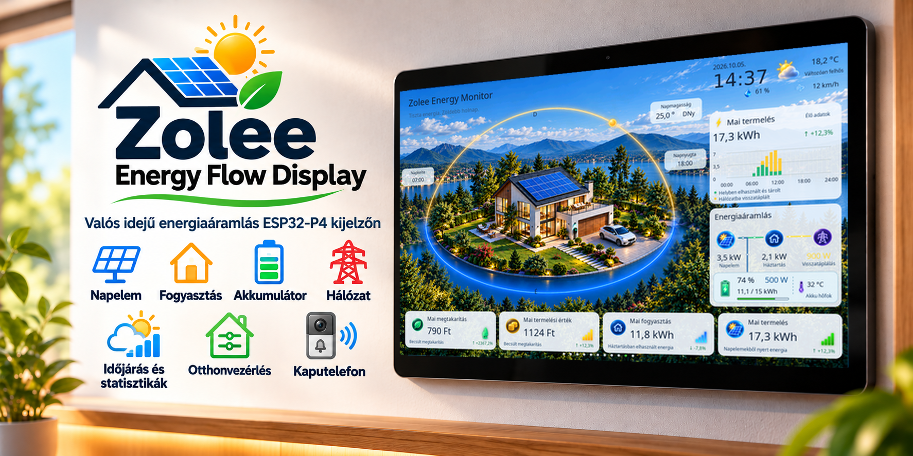</h1>

<p align="center">
  <a href="https://ko-fi.com/E1H8299KGN"></a>
  <a href="https://revolut.me/zoleebb"></a>
</p>

Otthoni energiaáramlás-kijelző a **Waveshare ESP32-P4-WIFI6-Touch-LCD-10.1 (SKU 33150)** panelhez. A 1280×800 fekvő LVGL felület a napelem, a ház, a hálózat és az akkumulátor pillanatnyi teljesítményét, energiaútjait és napi statisztikáit mutatja. A külön Slave firmware a **Waveshare ESP32-P4-WIFI6-Touch-LCD-4B (SKU 31416)** panelen fut, 720×720-as felbontással.

A firmware ESP-IDF 5.5.4 és LVGL 9.5.0 alapú. MQTT vagy HTTP POST fogadja a teljes mérési JSON-t öt másodpercenként; a közvetlen Loxone mód WebSocket-állapotokból állítja össze ugyanazt a mintát, a Slave pedig Bluetooth-on a mastertől kapja az élő adatokat és az időt. SD-s működésben FAT32 microSD tárolja a konfigurációt, tizenegy, módtól függően választható, szabadon sorbarendezhető sablont és 35 nap saját statisztikáját. A világos/sötét módot a `NightMode` adat vezérli; az OTA két alkalmazáspartícióval és visszaállítással működik.

A közvetlen Loxone mód beállítása és jelenlegi ellenőrzési korlátai: [Loxone adatkapcsolat](docs/loxone-direct.md).

**Loxone világításvezérlő kártyák:** automatikusan felismert világítási blokkok,
kompakt `− / Ki / +` gombok, aktív világításikép-név és külön kapcsoló-, dimmer-,
RGB/RGBW-kezelő. Feldolgozott kártyamodell csak a megnyitott Otthon-oldalhoz
készül; a konfigurált kártyák utolsó nyers állapotait a kapcsolat idejére
megőrzi, így első megnyitáskor sem kell telefonról változtatni a világítást.
A részletes, görgethető ablak egyetlen színválasztót és legfeljebb nyolc élő
körsort tart memóriában. [Beállítás, működés és készülékes visszaellenőrzés](docs/lighting-controller.md).

| Világításvezérlő Otthon-kártya | RGB/RGBW-kezelő |
| --- | --- |
| 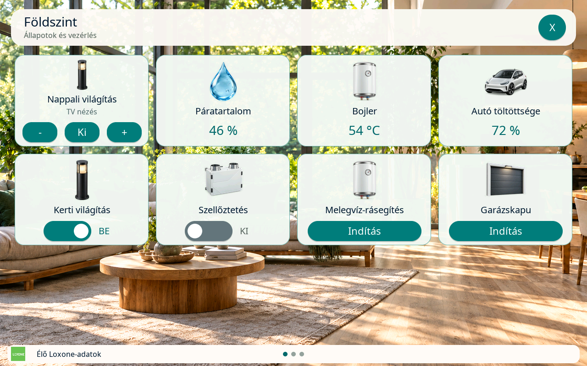 | 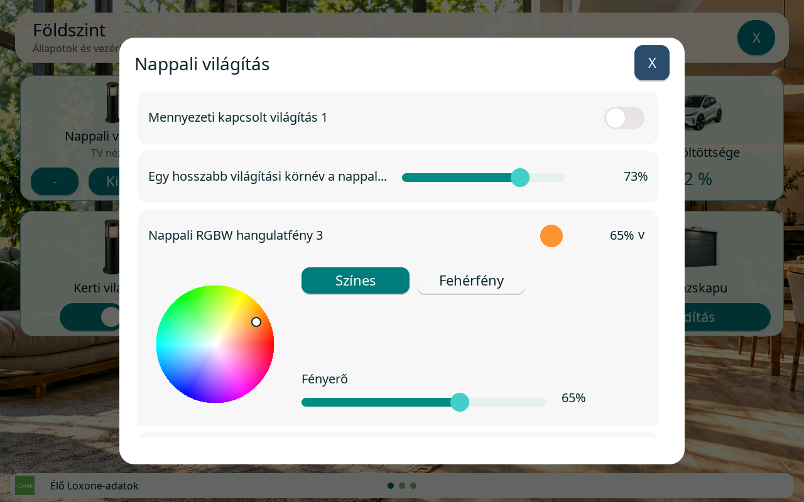 |

A képek a tényleges LVGL-felület szintetikus adatokkal készült, statikus
előnézetei, nem készülékfotók. [Mind az öt előnézet, éjszakai és fehérfény-kezeléssel](docs/lighting-controller.md#statikus-előnézetek).


Loxone módban opcionális [relatív páratartalom](docs/relative-humidity.md) párosítható,
szorzóval és eltolással, egész százalékként. A szélsebességes témákon és a Slave-eken
ikonnal jelenik meg; párosítás/érvényes adat nélkül rejtett. A Nap pálya igazított
időjárási és akkumulátorértékeket kapott.

Opcionális **Bluetooth adat seed**: a Beállításokban bekapcsolható master mód
`ZoleeEnergy` néven, párosítás nélkül, csak olvasható energia- és időjárásadatokkal.
Beállítások, protokoll és a C6 firmware követelményei: [BLE adatmegosztás](docs/ble-data-seed.md).

**SD nélküli Slave** is használható: új eszköz automatikus Slave indulással,
belső NVS-beállításokkal és kizárólag a beépített Rendszer témával. A napi
diagramokat és összehasonlításokat hitelesített BLE-kapcsolaton a mastertől
kapja; nincs szükség hálózati fájlmegosztásra vagy flashbe írt statisztikára.
A korábban fő kijelzőként használt eszköz SD-hibája nem vált automatikusan Slave-re.
**SD-kártyával a Slave az adott módban elérhető telepített témákat használhatja,
és saját statisztikát gyűjt a fogadott élő mintákból.** Az Elektromos autó téma
kizárólag közvetlen Loxone módban választható. A master korábbi történetét nem másolja át.

Az új **Slave (Bluetooth)** adatfogadási mód automatikusan mastert keres,
és onnan kapja az energiaadatokat és az időszinkront, Wi-Fi/NTP-beállítás nélkül is.
A slave az első csatlakozáskor érintős PIN-padot mutat, majd titkosítva átveszi
a master Wi-Fi-jét és automatikusfrissítés-kapcsolóját. A kétoszlopos diagnosztika
a BT-szerepet, címeket, kapcsolatot, jelerősséget, masterként a kapcsolódó slave-ek
számát és a párosítási PIN-t is mutatja. Új párosítás kétperces ablaka itt nyitható meg.

Az üzemállapotok között az **5: Hálózat újra elérhető** is támogatott minden témában; a Nap pálya v21 nappal és éjjel nagyobb, zöld felirattal, kontrasztos buborékban, a Rendszer téma új hálózati ikonnal jelzi. Normál üzemben a Nap pálya státuszbuborékja rejtett. [Státuszok, frissítés és adatprotokoll](docs/mqtt.md#status).

## Tartalom

- [Első indítás](#első-indítás)
- [Funkciók és üzemmódok](#funkciók-és-üzemmódok)
- [Téma-előnézetek](#téma-előnézetek)
- [Dokumentáció](#dokumentáció)
- [Fejlesztői ellenőrzés](#fejlesztői-ellenőrzés)
- [Verziók](#verziók)

## Első indítás

1. Telepítsd a firmware-t az [USB útmutató](docs/usb-install.md) szerint.
2. A [MQTT konfigurációt](config.sample.json) vagy [HTTP konfigurációt](examples/config.http.sample.json), közvetlen kapcsolathoz a [Loxone konfigurációt](examples/config.loxone.sample.json) töltsd ki, és másold az SD gyökerébe `config.json` néven.
3. A repó `templates` vagy az USB-csomag `sd-card/templates` könyvtárát másold az SD gyökerébe.
4. MQTT/HTTP esetén állítsd be a [Loxone adatküldést](docs/loxone.md). Közvetlen Loxone módban indulás után a `/loxone` weboldalon add meg a Miniservert és párosítsd az állapotokat. Wi-Fi és NTP szükséges az induláshoz.

Slave-ként SD-vel a minimális `config.json`: `{"DataReceptMode":"slave"}`.
Új, korábban fő kijelzőként nem azonosított eszköz SD nélkül automatikusan Slave
módban indul. A masteren kapcsold be az adat seedet, nyisd meg a párosítási ablakot,
és a diagnosztikáján látható PIN-t írd be a Slave-en. Saját MQTT/Loxone/NTP
beállítás nem kell. [Párosítás és átállítás](docs/ble-data-seed.md).

Az I1–I12 bemenetek sorrendje fix; I13 az időjárási jelenlétmaszk, T1 pedig az opcionális, `#`-elválasztott nappályaadat. Mindkét Pico C változat (MQTT és HTTP) ezt a kiosztást használja. A négy időjáráskulcs kötelező, de értékük lehet `null`; ilyenkor a kapcsolódó adatok egyik témában sem jelennek meg. A Loxone minták I13 jelenlétmaszkját a bekötésnek megfelelően kell beállítani, mert a Pico C API nem tudja automatikusan felismerni a bekötetlen vezetéket. [Teljes mérés](examples/mqtt-payload.sample.json), [időjárás nélküli mérés](examples/mqtt-payload.no-weather.sample.json).

A Nap pálya érvényes `SunPosition` esetén lapozható. SD-vel a témák weben átrendezhetők, de a Rendszer nézet mindig az első helyen marad. Balra/jobbra húzás lapoz a rendszernézet és az elérhető sablonok között; SD nélkül csak a Rendszer nézet érhető el. Felfelé húzás nyitja a diagnosztikát, jobb felső X zárja. Master/Loxone módban lefelé húzás az Otthon-lapokat, a ház érintése a fogyasztókat nyitja meg, ha a szükséges csomag és konfiguráció elérhető. A helyi weboldal: `http://zolee-energy-flow-display.local/` vagy az eszköz IP-címe; `/update` firmware-frissítés, `/templates` sablonkezelés és GitHub-témafrissítés, `/settings` beállítások (SD-n vagy belső NVS-ben), `/backup` mentés és visszaállítás, `/diagnostics` diagnosztika. A gesztusok teljes listája: [Kezelés és gesztusok](docs/gestures.md). A Slave webfelületéhez a mastertől örökölt Wi-Fi-n kapott saját IP-cím használható. HTTP módban az adatfogadó: `POST /api/energy`. A diagnosztika mind a négy adatfogadási módot jelzi, magonkénti CPU-terhelést, belső RAM-/PSRAM-használatot, SD- vagy belsőtár-állapotot és Bluetooth-adatokat mutat.

## Funkciók és üzemmódok

- **Energiaáramlás és statisztika:** élő teljesítmények, animált energiautak, napi/heti/havi adatok, pénzügyi mutatók és akkumulátordiagnosztika.
- **Adatfogadás:** MQTT, HTTP POST, közvetlen Loxone vagy Bluetooth Slave; világos/sötét megjelenés a `NightMode` szerint.
- **Loxone Otthon:** külön mért fogyasztók, lapozható kapcsoló-, nyomógomb-, szenzor-, állapot- és világításvezérlő-kártyák, energiaasszisztens, jelenlét és postaláda-jelzés. Rövid, legfeljebb 10 másodperces adatkapcsolati kimaradáskor a már megjelenített energianézet/Otthon-oldal figyelmeztetés nélkül, változatlan adatokkal marad látható; a vezérlés ilyenkor nem aktív. [Loxone kapcsolat és türelmi idő](docs/loxone-direct.md#kapcsolat-és-hibák).
- **Elektromos autó:** nappali/éjszakai házjelenet, összegzett töltési teljesítmény, mai töltési energia és becsült közvetlen napelemes arány. Töltő konfigurálása nélkül is választható, rejtett autós adatokkal. [Beállítás](docs/electric-car.md).
- **Kaputelefon:** MJPEG-kép, kétirányú hang, kapunyitás, csengőhangok és párosított 4B kijelzők központi híváskezelése. Csengetés után a médiafeladatok leállása megelőzi a háttértéma visszatöltését; elhúzódó betöltésnél korlátozott újrapróbálás és biztonságos tartalék nézet áll rendelkezésre. [Kaputelefon útmutató](docs/intercom.md) · [Helyreállítás és korlátok](docs/intercom.md#kaputelefon-utáni-témahelyreállítás).
- **Karbantartás:** webes konfiguráció, mentés/visszaállítás, OTA, gyári témák GitHub-frissítése és részletes diagnosztika.

## Loxone Otthon kaputelefon-kijelzőként

Az alapból kikapcsolt **Energiaáramlás tiltás** csak Loxone módban engedélyezhető.
Ilyenkor az Otthon-kártyák maradnak elérhetők, az Adatpárosítás csak NightMode-ot
kínál; a korábbi energia-beállítások megmaradnak. Csempék nélkül fekete logós
nézet és fix 10% fényerő működik; a kaputelefon nappali/éjszakai fényerővel nyílik,
bezárásakor visszatér a logó és 10%. A Slave-ek szintén logós nézetet mutatnak.
A fogyasztók, Otthon-kártyák és kaputelefon külön menthetők.
[Részletek és Master/Slave-frissítés](docs/energy-flow-disable.md).

## Téma-előnézetek

A képek a valódi LVGL-rajzolóból készültek. A Loxone-oldalak és az Elektromos autó téma csak Masteren, közvetlen Loxone módban érhetők el.

| Téma | Nappal | Éjjel |
| --- | --- | --- |
| Rendszer (beépített) | 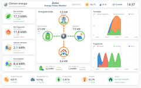 | 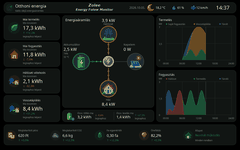 |
| Loxone – Ház külön mért fogyasztói | 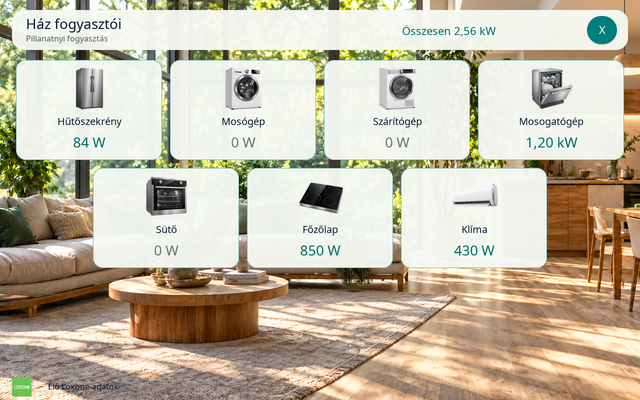 | 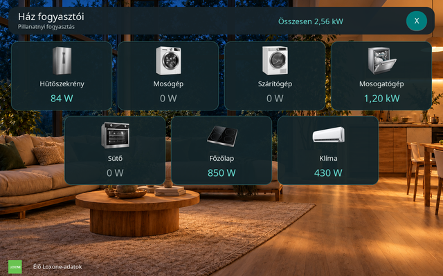 |
| Loxone – Otthon-kártyák | 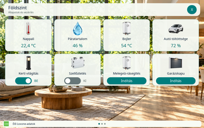 | 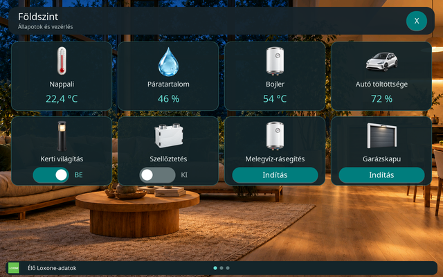 |
| Élő otthon | 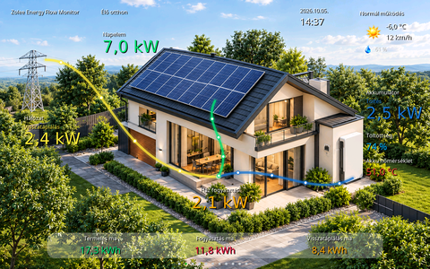 | 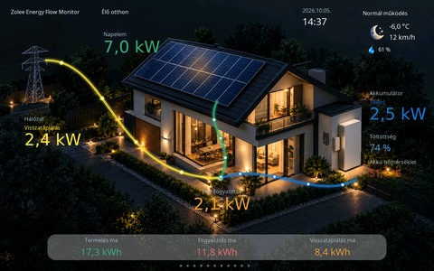 |
| Elektromos autó (Loxone) | 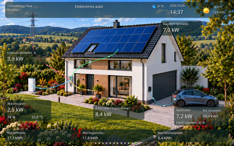 | 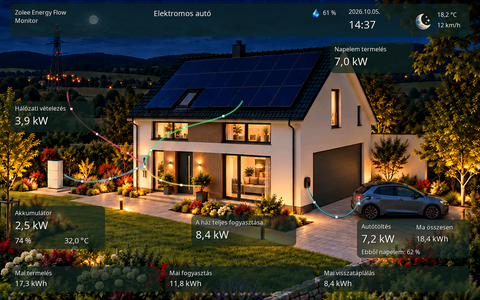 |
| Energiautak | 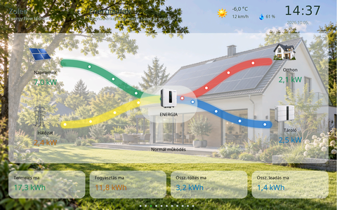 | 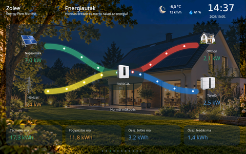 |
| Műszerfal | 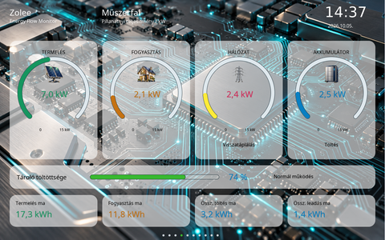 | 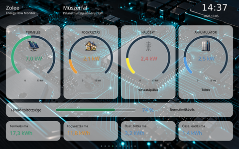 |
| Napi mérleg | 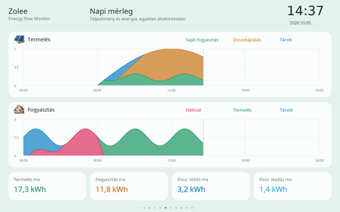 | 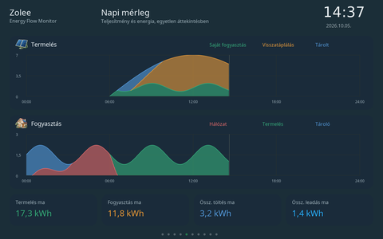 |
| Nyugodt otthon | 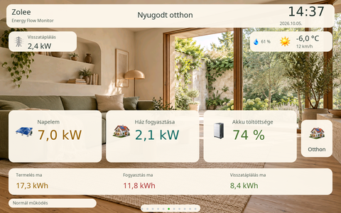 | 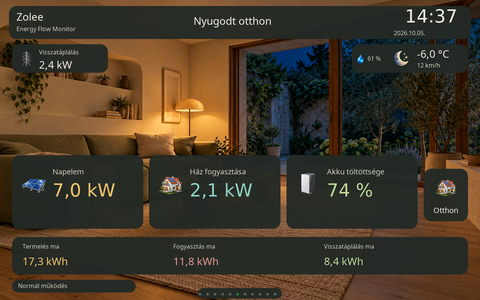 |
| Energiakör | 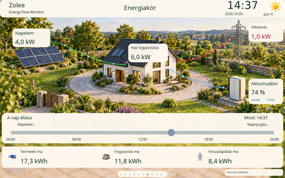 | 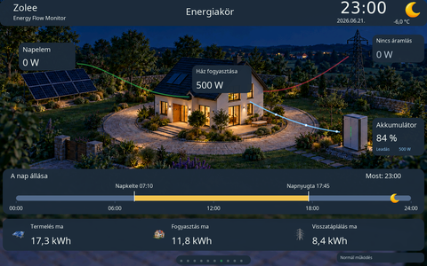 |
| Energiafőkönyv | 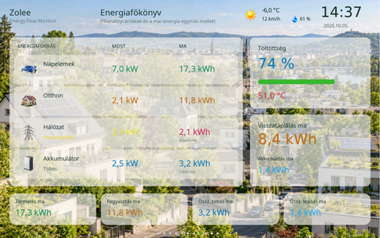 | 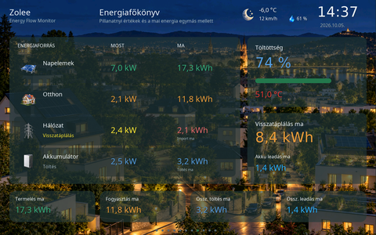 |
| Energiastatisztika | 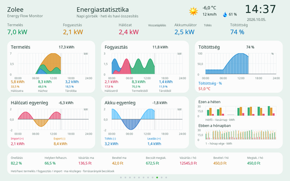 | 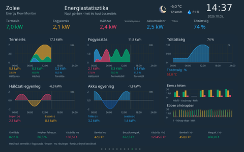 |
| Nap pálya | 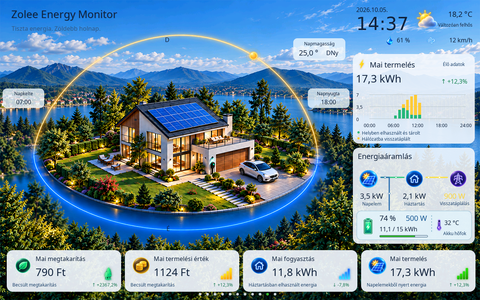 | 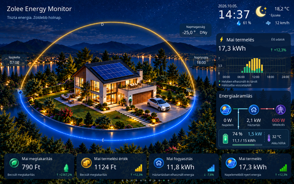 |
| Akku diagnosztika | 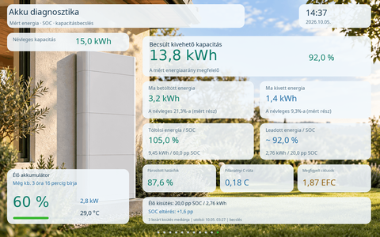 | 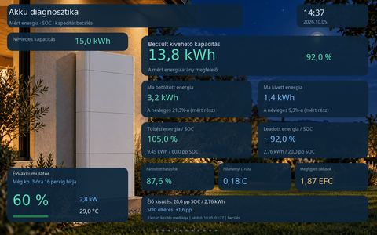 |

A webes sablonkezelő a csomagok `preview-light.png` / `preview-dark.png` képeit mutatja; régi csomagnál üres keret marad, amíg a témát ZIP-ből frissíted.

További képi ellenőrzések: [beépített ikonok](docs/previews/icons.png), [rendszernézet lapjelzővel](docs/previews/builtin-pagination.png), [közös diagnosztika](docs/previews/diagnostics.png).

## Dokumentáció

- [Önkéntes fejlesztői támogatás – Revolut.me és Ko-fi, kizárólag a webfelületen](docs/voluntary-support.md)
- [Kezelés és gesztusok](docs/gestures.md)
- [Beállítások mentése és visszaállítása](docs/backup.md)
- [Hardver](docs/hardware.md)
- [Konfiguráció](docs/configuration.md)
- [JSON és MQTT](docs/mqtt.md)
- [HTTP adatfogadás](docs/http-input.md)
- [Közvetlen Loxone kapcsolat](docs/loxone-direct.md)
- [Opcionális relatív páratartalom, témák és Slave-frissítési sorrend](docs/relative-humidity.md)
- [Energiaáramlás tiltás – Otthon, logós készenlét, 10% fényerő és Slave-ek](docs/energy-flow-disable.md)
- [Energiaáramlás tiltás – fejlesztési terv és ellenőrzési állapot](docs/energy-flow-disable-plan.md)
- [Kaputelefon – videó, kétirányú hang, hangerők és időzített kapunyitás utáni bontás](docs/intercom.md)
- [Kaputelefon utáni témavisszatöltés – időkorlátok, tartalék nézet és hibaelhárítás](docs/intercom.md#kaputelefon-utáni-témahelyreállítás)
- [4B Slave kaputelefon, központi hívásfoglalás és csengőhangcsomagok](docs/slave-intercom.md)
- [PR #23 átadás – SD-javítások, ellenőrzések és összevonás](docs/slave-intercom-handover.md)
- [Loxone fogyasztók és lapozható Otthon-kártyák – beállítás és mintaprofil](docs/v3-home-config.md)
- [Helyi energiaasszisztens – napelemes indításjavaslat és éjszakai fogyasztás](docs/energy-assistant.md)
- [Slave-jelenlétprofil, éjszakai sötétítés és BLE-protokoll](docs/slave-presence-protocol.md)
- [Loxone mintaprogramok](docs/loxone.md)
- [SD-kártya](docs/sd-card.md)
- [BLE master/Slave, PIN-es párosítás és SD nélküli működés](docs/ble-data-seed.md)
- [Tizenegy SD-s téma és a beépített Rendszer nézet](docs/templates.md)
- [Nyugodt otthon – megújult nappali/éjszakai téma](docs/calm-home.md)
- [Energiakör – megújult téma és 24 órás napállás-idővonal](docs/energy-orbit.md)
- [Nap pálya – működés, energiautak és ellenőrzés](docs/solar-journey-acceptance.md)
- [Akku diagnosztika – energia/SOC, kapacitásbecslés, hatásfok és webes statisztika/nullázás](docs/battery-diagnostics.md)
- [Akku diagnosztika – fejlesztési és folytatási állapot](docs/battery-diagnostics-plan.md)
- [Elektromos autó – töltőbeállítás, napi energia és napelemes arány](docs/electric-car.md)
- [Elektromos autó – fejlesztési terv és ellenőrzési állapot](docs/electric-car-development.md)
- [Saját sablon készítése](docs/template-authoring.md)
- [Külső témák kompatibilitási ellenőrzése](docs/external-template-review.md)
- [Statisztika és számítások](docs/statistics.md)
- [Webfelület és OTA, kapcsolható automatikus éjféli GitHub-frissítés](docs/ota.md)
- [Automatikus OTA-frissítés diagnosztikája, kézi próba és memória](docs/automatic-update-diagnostics.md)
- [Hibakezelés](docs/errors.md)
- [Fordítás és flash](docs/build-flash.md)
- [USB telepítés](docs/usb-install.md)
- [Windows szimulátor](docs/simulator.md)
- [Automatikus kiadás](docs/releases.md)
- [Felépítés](docs/architecture.md)
- [Memória- és képfrissítési optimalizálás](docs/performance.md)
- [Világításvezérlés – veremvédelem, fordítási javítás és ellenőrzési korlátok](docs/lighting-stack-validation.md)
- [Fejlesztői instrukciók](AGENTS.md)
- [Master/Slave átadási és lezárási jegyzet](docs/master-slave-handover.md)
- [Waveshare 4B Slave – 720×720-as firmware és szimulátor](docs/slave-waveshare-4b.md) (külön alkalmazás, falra vagy asztali tartóra)
- [Waveshare 4B Slave – firmware fordítása, működése és hardveres átvétele](firmware/slave-waveshare-4b/README.md)
- [Waveshare 4B Slave – megjelenési rétegek és geometria](firmware/slave-waveshare-4b/design/README.md)
- [Képek és licencek](docs/assets.md)
- [Loxone Otthon – közös ikonkészlet, hátterek és SD-erőforráscsomag](assets/loxone-home/README.md)
- [v3 telepítési és eszközös átadási lista (HU/EN)](docs/v3-handover.md)
- [v3 követelmény- és záró ellenőrzés](docs/v3-completion-review.md)
- [v3 felhasználói próba utáni javítások](docs/v3-field-fixes.md)
- [v3 fejlesztési és folytatási terv – döntések és ellenőrzési napló](docs/v3-development-plan.md)

## Fejlesztői ellenőrzés

A firmware-források egységes, jól olvasható tagolására és magyar nyelvű kommentelésére vonatkozó kötelező szabályokat a [fejlesztői instrukciók](AGENTS.md) tartalmazzák. A kódformázás nem érintheti a beágyazott erőforrásokat és nem növelheti problémásan a firmware méretét.

A hosttesztekhez C-fordító, Node.js, valamint a cJSON, zlib és mbedTLS
fejlesztői csomagjai szükségesek. A Python-függőséget a használt környezetbe
(ajánlottan virtuális környezetbe) telepítsd:

```sh
python3 -m pip install -r tests/requirements.txt
python3 tests/run_tests.py
python3 tools/prepare_templates.py
```

ESP-IDF környezetben: `idf.py set-target esp32p4`, majd `idf.py build`. A CI host regressziós teszteket, valódi LVGL renderelést, firmware-fordítást/csomagolást és külön Windows-szimulátortesztet futtat. A fizikai panelen való működést és a Loxone bekötést hardveres próbával kell ellenőrizni.

A kaputelefon utáni visszatöltés célzott tesztje: `python3 tests/test_theme_restore.py` (időkorlát-állapotgép és forrásinvariánsok). A teszt be van kötve a teljes `tests/run_tests.py` futtatásába, de **önmagában nem bizonyítja** a valós SD-/LVGL-/PSRAM-terhelés melletti helyreállítást. A [készülékes ellenőrzési sorrend](docs/intercom.md#ellenőrzés-és-kiadás) és a [beragadt betöltőképernyő hibakeresése](docs/errors.md#kaputelefon-bezárása-után-beragadt-témabetöltés) külön dokumentált.

A személyes `config.json`, buildkönyvtárak és generált telepítőcsomagok nem részei a verziókezelt forrásnak. A beágyazott képek, betűkészletek, licencek és a generált webheader szükséges fordítási bemenetek.

Kijelzőindítási hibánál lásd a [fekete képernyő hibakeresését](docs/errors.md). A MIPI rajzpuffer PSRAM-ban van; a 270°-os forgatás a tiltott PPA helyett CPU ágon fut. Az LVGL sorosan rajzol az adapter zárolásával, külön OSAL rajzolószálak nélkül; a Master `TRIPLE_PARTIAL` módban csak a változó képrészleteket rajzolja/forgatja. A CPU minden új frame elején a legutóbb leadott kész képet másolja a hátsó pufferre, majd az összes részlet után ad át új kész képet. A GUI/touch CPU1-en, a Loxone worker CPU0-n fut. A változatlan feliratok és stílusértékek nem váltanak ki ismételt újrarajzolást, az érintési tengelyek a kamera alul elhelyezkedő, 270°-os fekvő képhez igazodnak. A képcache 10 MiB; az általános foglalások PSRAM-ot részesítenek előnyben, 32 KiB belső/DMA tartalékkal. Az LVGL worker minden ciklusban valódi tickre blokkol a mutexen kívül. Az SDIO DMA után készülő RX csomagmásolatok PSRAM-ba kerülnek; foglalási hiba csomageldobással kezelhető újraindulás helyett.

Az NTP `sys_timeout` újraindulását a 10 napos SDK időzítő és fordítási korlátellenőrzés javítja; a kézi szinkron továbbra is a konfigurált periódust használja.

A [memória- és képfrissítési optimalizálás](docs/performance.md) ismerteti a Waveshare/Espressif példák alapján alkalmazott fix SDIO DMA-ablakot, PSRAM geometriát, natív képcache-t és a hardveres mérés korlátait, valamint a gyors témaváltást (igazított SD-olvasás, egyszeri PNG-ellenőrzés), az Otthon-kártyák háttér-újraolvasás nélküli lapozását és a csak változáskor rajzoló Master/4B Slave frissítést. A fejlesztői teljesítményszabályok az [AGENTS.md](AGENTS.md) fájlban vannak. A webes diagnosztika külön mutatja a belső RAM és a legnagyobb DMA-blokk állapotát.

## Verziók

A részletes kiadási leírások és a korábbi fejlesztési bejegyzések külön dokumentumokban találhatók:

- [v3.1.0 – Kaputelefon](docs/versions/v3.1.0.md)
- [v3.0.0 – Loxone Otthon, energiaasszisztens és Slave](docs/versions/v3.0.0.md)
- [Korábbi fejlesztések és hibajavítások – részletes napló](docs/versions/development-notes.md)
- [Minden kiadott verzió, letölthető csomagok (GitHub Releases)](https://github.com/ZoleeBB/ZoleeEnergyFlowDisplay/releases)