# Zolee Energy Flow Display

[](https://ko-fi.com/E1H8299KGN)

Otthoni energiaáramlás-kijelző a Waveshare ESP32-P4-WIFI6-Touch-LCD-10.1 (SKU 33150) panelhez. A 1280×800 fekvő LVGL felület a napelem, a ház, a hálózat és az akkumulátor pillanatnyi teljesítményét, energiaútjait és napi statisztikáit mutatja.

A firmware ESP-IDF 5.5.4 és LVGL 9.5.0 alapú. MQTT vagy HTTP POST fogadja a teljes mérési JSON-t öt másodpercenként; a közvetlen Loxone mód WebSocket-állapotokból állítja össze ugyanazt a mintát, a Slave pedig Bluetooth-on a mastertől kapja az élő adatokat és az időt. SD-s működésben FAT32 microSD tárolja a konfigurációt, tíz, szabadon sorbarendezhető sablont és 35 nap saját statisztikáját. A világos/sötét módot a `NightMode` adat vezérli; az OTA két alkalmazáspartícióval és visszaállítással működik.

A közvetlen Loxone mód beállítása és jelenlegi ellenőrzési korlátai: [Loxone adatkapcsolat](docs/loxone-direct.md).

Opcionális **Bluetooth adat seed**: a Beállításokban bekapcsolható master mód
`ZoleeEnergy` néven, párosítás nélkül, csak olvasható energia- és időjárásadatokkal.
Beállítások, protokoll és a C6 firmware követelményei: [BLE adatmegosztás](docs/ble-data-seed.md).

**SD nélküli Slave** is használható: új eszköz automatikus Slave indulással,
belső NVS-beállításokkal és kizárólag a beépített Rendszer témával. A napi
diagramokat és összehasonlításokat hitelesített BLE-kapcsolaton a mastertől
kapja; nincs szükség hálózati fájlmegosztásra vagy flashbe írt statisztikára.
A korábban fő kijelzőként használt eszköz SD-hibája nem vált automatikusan Slave-re.
**SD-kártyával a Slave minden telepített témát használhat, és saját statisztikát
gyűjt a fogadott élő mintákból.** A master korábbi történetét nem másolja át.

Az új **Slave (Bluetooth)** adatfogadási mód automatikusan mastert keres,
és onnan kapja az energiaadatokat és az időszinkront, Wi-Fi/NTP-beállítás nélkül is.
A slave az első csatlakozáskor érintős PIN-padot mutat, majd titkosítva átveszi
a master Wi-Fi-jét és automatikusfrissítés-kapcsolóját. A kétoszlopos diagnosztika
a BT-szerepet, címeket, kapcsolatot, jelerősséget, masterként a kapcsolódó slave-ek
számát és a párosítási PIN-t is mutatja. Új párosítás kétperces ablaka itt nyitható meg.

Az üzemállapotok között az **5: Hálózat újra elérhető** is támogatott minden témában; a Nap pálya v21 nappal és éjjel nagyobb, zöld felirattal, kontrasztos buborékban, a Rendszer téma új hálózati ikonnal jelzi. Normál üzemben a Nap pálya státuszbuborékja rejtett. [Státuszok, frissítés és adatprotokoll](docs/mqtt.md#status).

## Loxone Otthon kaputelefon-kijelzőként

Az alapból kikapcsolt **Energiaáramlás tiltás** csak Loxone módban engedélyezhető.
Ilyenkor az Otthon-kártyák maradnak elérhetők, az Adatpárosítás csak NightMode-ot
kínál; a korábbi energia-beállítások megmaradnak. Csempék nélkül fekete logós
nézet és fix 10% fényerő működik; a kaputelefon nappali/éjszakai fényerővel nyílik,
bezárásakor visszatér a logó és 10%. A Slave-ek szintén logós nézetet mutatnak.
A fogyasztók, Otthon-kártyák és kaputelefon külön menthetők.
[Részletek és Master/Slave-frissítés](docs/energy-flow-disable.md).

## v3.1.0 – Kaputelefon

Loxone módban a Master csengetésállapotra teljes képernyős MJPEG-kameraképet nyit,
opcionális, nagy kapunyitó nyomógombbal és külön gombbal indítható kétirányú
hangkapcsolattal. A weben külön menthető a hangszóró hangereje és a mikrofon
erősítése; kézzel indítható helyi hangszóróteszt is elérhető.

Az aktív beszélgetés a csengetés megszűnése után is nyitva tartja a videót.
Elfogadott kapunyitás után 5 másodperccel a hang automatikusan bontódik;
ha addigra nincs csengetés, a videóablak is bezárul. Létrejött kapcsolatnál
nincsenek folyamatos diagnosztikai feliratok, csak kapcsolódási állapot és hiba.
A videó, a kétirányú hang és az időzített bontás készüléken visszaigazolt.

[Beállítás, működés és korlátok](docs/intercom.md).
A #20 PR mainre összevonásának célverziója **v3.1.0**;
[kiadási folyamat](docs/releases.md#automatikus-kiadás-pr-merge-után).

## v3.0.0 újdonságai

A [#16-os PR](https://github.com/ZoleeBB/ZoleeEnergyFlowDisplay/pull/16) főbb változásai és részletes leírása:

| Funkció | Működés és dokumentáció |
| --- | --- |
| Ház külön mért fogyasztói | Legfeljebb 12 fogyasztó, 64 választható ikon és külön nappali/éjszakai háttér. Az 1 W alatti érték 0 W és kikapcsolt állapot; a fejléc a teljes ház `PowerFull` mérését mutatja. [Beállítás és mintaprofil](docs/v3-home-config.md). |
| Lapozható Otthon-oldalak | Legfeljebb 8 elnevezhető oldal, oldalanként 12 érték-, kapcsoló- vagy pillanatnyi gombkártya. Webes szerkesztés a `/loxone` oldalon, állapot-visszajelzéshez kötött kapcsolás. [Kártyák, vezérlés és navigáció](docs/v3-home-config.md). |
| Helyi energiaasszisztens | Külön engedélyezhető indításjavaslat 100%-os akkunál és legalább kétperces elegendő napelemes többletnél; magasabb éjszakai fogyasztás jelzése mért referencia alapján. A jelzés nem kapcsol fogyasztót. [Feltételek és működés](docs/energy-assistant.md). |
| Slave-jelenlét és saját fényerő | Nappal saját nappali fényerő; engedélyezett éjszakai sötétítésnél jelenlét vagy érintés ébreszt a saját éjszakai fényerőre, időkorlát után újra sötétít. Az első teljes érintés csak ébreszt. [Felhasználói beállítás](docs/loxone-direct.md), [profil és BLE-protokoll](docs/slave-presence-protocol.md). |
| Megújult témák | Új nappali/éjszakai megjelenés: [Nyugodt otthon](docs/calm-home.md) és [Energiakör](docs/energy-orbit.md); utóbbiban 00:00–24:00 napállás-idővonal. |
| Stabilitás és kiadási csomagok | Érintés-, navigáció- és villogásjavítások, részleges képfrissítés, egységes CI és négy kiadási csomag. [Javítások](docs/v3-field-fixes.md), [teljesítmény](docs/performance.md), [kiadási folyamat](docs/releases.md). |

A fogyasztói/Otthon-oldalak és az energiaasszisztens **csak Masteren, közvetlen Loxone módban** érhetők el. A kijelzőoldalakhoz működő SD és telepített `loxone-home.zip` szükséges. A Slave jelenlétfunkciójához a Master és a Slave megfelelő firmware-e is kell.

**Frissítési sorrend:** előbb a megfelelő firmware-ek, majd a Master `/templates` oldalán a `loxone-home.zip`, `05-calm-home.zip` és `06-energy-orbit.zip` csomagok. Az OTA önmagában nem frissíti az SD-s témákat. [Telepítési sorrend és eszközös átadás (HU/EN)](docs/v3-handover.md). Az átadási és ellenőrzési jegyzetek a fejlesztéskori állapotokat és a még nem rögzített készülékes méréseket is őrzik.

## Első indítás

1. Telepítsd a firmware-t az [USB útmutató](docs/usb-install.md) szerint.
2. A [MQTT konfigurációt](config.sample.json) vagy [HTTP konfigurációt](examples/config.http.sample.json), közvetlen kapcsolathoz a [Loxone konfigurációt](examples/config.loxone.sample.json) töltsd ki, és másold az SD gyökerébe `config.json` néven.
3. A repó `templates` vagy az USB-csomag `sd-card/templates` könyvtárát másold az SD gyökerébe.
4. MQTT/HTTP esetén állítsd be a [Loxone adatküldést](docs/loxone.md). Közvetlen Loxone módban indulás után a `/loxone` weboldalon add meg a Miniservert és párosítsd az állapotokat. Wi-Fi és NTP szükséges az induláshoz.

Slave-ként SD-vel a minimális `config.json`: `{"DataReceptMode":"slave"}`.
Új, korábban fő kijelzőként nem azonosított eszköz SD nélkül automatikusan Slave
módban indul. A masteren kapcsold be az adat seedet, nyisd meg a párosítási ablakot,
és a diagnosztikáján látható PIN-t írd be a Slave-en. Saját MQTT/Loxone/NTP
beállítás nem kell. [Párosítás és átállítás](docs/ble-data-seed.md).

Az I1–I12 bemenetek sorrendje fix; I13 az időjárási jelenlétmaszk, T1 pedig az opcionális, `#`-elválasztott nappályaadat. Mindkét Pico C változat (MQTT és HTTP) ezt a kiosztást használja. A négy időjáráskulcs kötelező, de értékük lehet `null`; ilyenkor a kapcsolódó adatok egyik témában sem jelennek meg. A Loxone minták I13 jelenlétmaszkját a bekötésnek megfelelően kell beállítani, mert a Pico C API nem tudja automatikusan felismerni a bekötetlen vezetéket. [Teljes mérés](examples/mqtt-payload.sample.json), [időjárás nélküli mérés](examples/mqtt-payload.no-weather.sample.json).

A Nap pálya érvényes `SunPosition` esetén lapozható. SD-vel a témák weben átrendezhetők, de a Rendszer nézet mindig az első helyen marad. Balra/jobbra húzás lapoz a rendszernézet és a tíz sablon között; SD nélkül csak a Rendszer nézet érhető el. Felfelé húzás nyitja a diagnosztikát, jobb felső X zárja. Master/Loxone módban lefelé húzás az Otthon-lapokat, a ház érintése a fogyasztókat nyitja meg, ha a szükséges csomag és konfiguráció elérhető. A helyi weboldal: `http://zolee-energy-flow-display.local/` vagy az eszköz IP-címe; `/update` firmware-frissítés, `/templates` sablonkezelés, `/settings` beállítások (SD-n vagy belső NVS-ben), `/diagnostics` diagnosztika. A Slave webfelületéhez a mastertől örökölt Wi-Fi-n kapott saját IP-cím használható. HTTP módban az adatfogadó: `POST /api/energy`. A diagnosztika mind a négy adatfogadási módot jelzi, magonkénti CPU-terhelést, belső RAM-/PSRAM-használatot, SD- vagy belsőtár-állapotot és Bluetooth-adatokat mutat.

| Téma | Nappal | Éjjel |
| --- | --- | --- |
| Rendszer (beépített) | 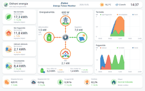 | 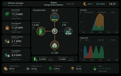 |
| Loxone – Ház külön mért fogyasztói | 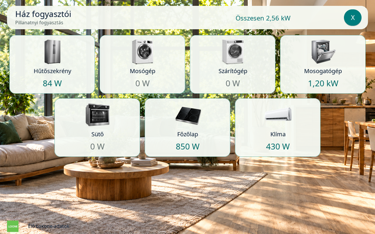 | 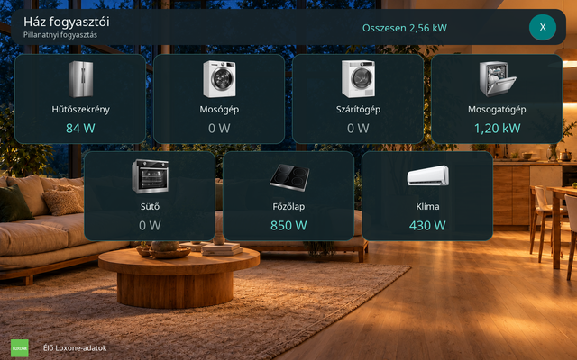 |
| Loxone – Otthon-kártyák | 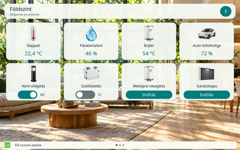 | 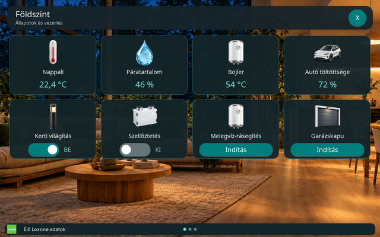 |
| Élő otthon | 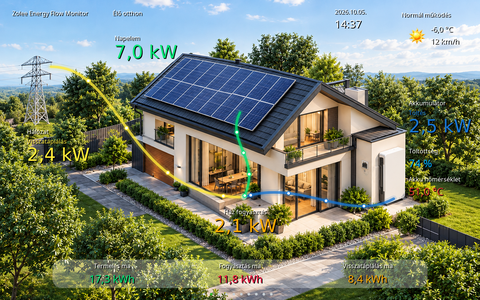 | 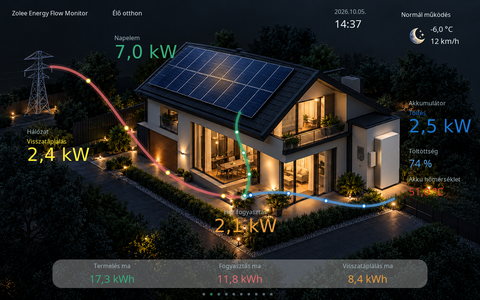 |
| Energiautak | 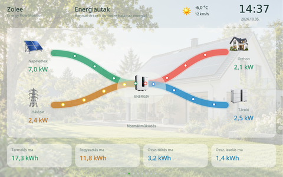 | 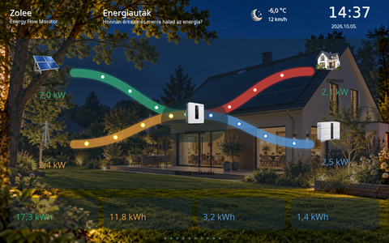 |
| Műszerfal | 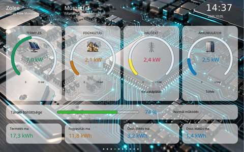 | 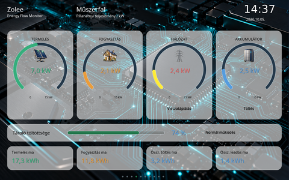 |
| Napi mérleg | 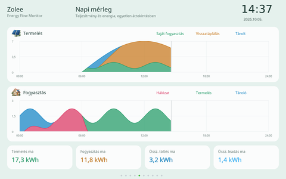 | 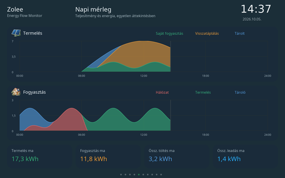 |
| Nyugodt otthon | 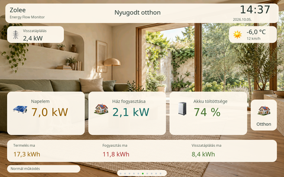 | 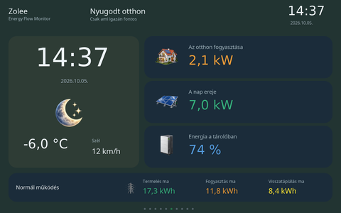 |
| Energiakör | 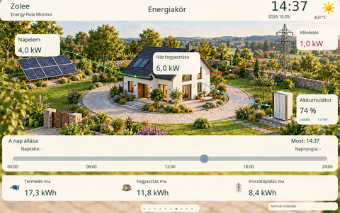 | 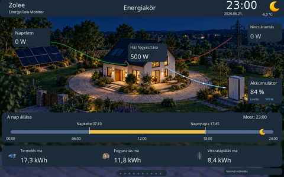 |
| Energiafőkönyv | 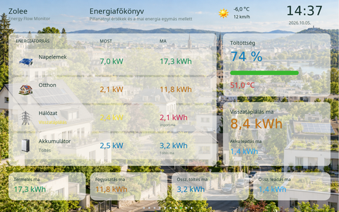 | 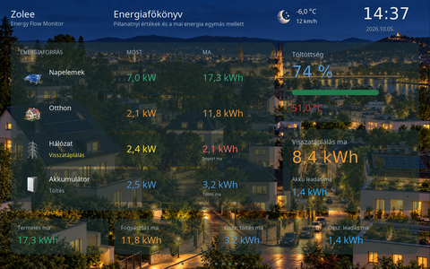 |
| Energiastatisztika | 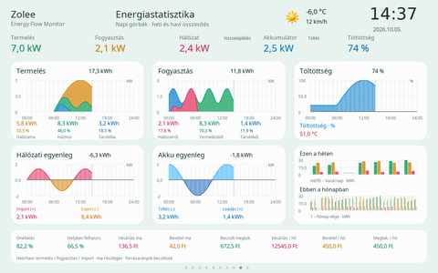 | 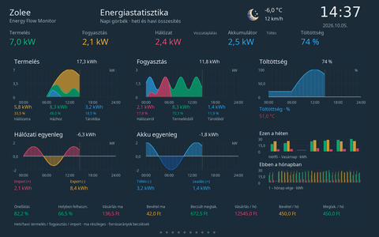 |
| Nap pálya | 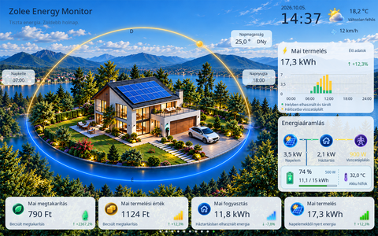 | 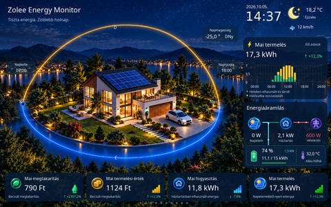 |
| Akku diagnosztika | 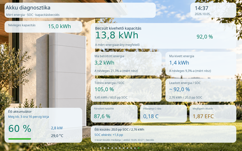 | 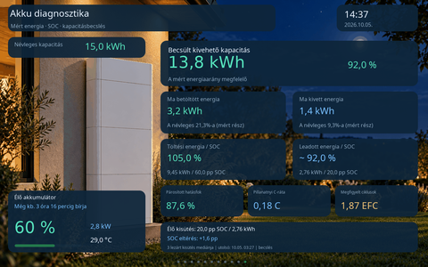 |

A webes sablonkezelő a csomagok `preview-light.png` / `preview-dark.png` képeit mutatja; régi csomagnál üres keret marad, amíg a témát ZIP-ből frissíted.

További képi ellenőrzések: [beépített ikonok](docs/previews/icons.png), [rendszernézet lapjelzővel](docs/previews/builtin-pagination.png), [közös diagnosztika](docs/previews/diagnostics.png).

## Dokumentáció

- [Önkéntes fejlesztői támogatás – Revolut.me és Ko-fi, kizárólag a webfelületen](docs/voluntary-support.md)
- [Hardver](docs/hardware.md)
- [Konfiguráció](docs/configuration.md)
- [JSON és MQTT](docs/mqtt.md)
- [HTTP adatfogadás](docs/http-input.md)
- [Közvetlen Loxone kapcsolat](docs/loxone-direct.md)
- [Energiaáramlás tiltás – Otthon, logós készenlét, 10% fényerő és Slave-ek](docs/energy-flow-disable.md)
- [Energiaáramlás tiltás – fejlesztési terv és ellenőrzési állapot](docs/energy-flow-disable-plan.md)
- [Kaputelefon – videó, kétirányú hang, hangerők és időzített kapunyitás utáni bontás](docs/intercom.md)
- [Loxone fogyasztók és lapozható Otthon-kártyák – beállítás és mintaprofil](docs/v3-home-config.md)
- [Helyi energiaasszisztens – napelemes indításjavaslat és éjszakai fogyasztás](docs/energy-assistant.md)
- [Slave-jelenlétprofil, éjszakai sötétítés és BLE-protokoll](docs/slave-presence-protocol.md)
- [Loxone mintaprogramok](docs/loxone.md)
- [SD-kártya](docs/sd-card.md)
- [BLE master/Slave, PIN-es párosítás és SD nélküli működés](docs/ble-data-seed.md)
- [Tíz választható téma](docs/templates.md)
- [Nyugodt otthon – megújult nappali/éjszakai téma](docs/calm-home.md)
- [Energiakör – megújult téma és 24 órás napállás-idővonal](docs/energy-orbit.md)
- [Nap pálya – működés, energiautak és ellenőrzés](docs/solar-journey-acceptance.md)
- [Akku diagnosztika – energia/SOC, kapacitásbecslés és hatásfok](docs/battery-diagnostics.md)
- [Akku diagnosztika – fejlesztési és folytatási állapot](docs/battery-diagnostics-plan.md)
- [Saját sablon készítése](docs/template-authoring.md)
- [Külső témák kompatibilitási ellenőrzése](docs/external-template-review.md)
- [Statisztika és számítások](docs/statistics.md)
- [Webfelület és OTA, kapcsolható automatikus éjféli GitHub-frissítés](docs/ota.md)
- [Automatikus OTA-frissítés diagnosztikája, kézi próba és memória](docs/automatic-update-diagnostics.md)
- [Hibakezelés](docs/errors.md)
- [Fordítás és flash](docs/build-flash.md)
- [USB telepítés](docs/usb-install.md)
- [Windows szimulátor](docs/simulator.md)
- [Automatikus kiadás](docs/releases.md)
- [Felépítés](docs/architecture.md)
- [Memória- és képfrissítési optimalizálás](docs/performance.md)
- [Fejlesztői instrukciók](AGENTS.md)
- [Master/Slave átadási és lezárási jegyzet](docs/master-slave-handover.md)
- [Waveshare 4B Slave – 720×720-as firmware és szimulátor](docs/slave-waveshare-4b.md) (külön alkalmazás, falra vagy asztali tartóra)
- [Waveshare 4B Slave – firmware fordítása, működése és hardveres átvétele](firmware/slave-waveshare-4b/README.md)
- [Waveshare 4B Slave – megjelenési rétegek és geometria](firmware/slave-waveshare-4b/design/README.md)
- [Képek és licencek](docs/assets.md)
- [Loxone Otthon – közös ikonkészlet, hátterek és SD-erőforráscsomag](assets/loxone-home/README.md)
- [v3 telepítési és eszközös átadási lista (HU/EN)](docs/v3-handover.md)
- [v3 követelmény- és záró ellenőrzés](docs/v3-completion-review.md)
- [v3 felhasználói próba utáni javítások](docs/v3-field-fixes.md)
- [v3 fejlesztési és folytatási terv – döntések és ellenőrzési napló](docs/v3-development-plan.md)

## Fejlesztői ellenőrzés

A firmware-források egységes, jól olvasható tagolására és magyar nyelvű kommentelésére vonatkozó kötelező szabályokat a [fejlesztői instrukciók](AGENTS.md) tartalmazzák. A kódformázás nem érintheti a beágyazott erőforrásokat és nem növelheti problémásan a firmware méretét.

A hosttesztekhez C-fordító, Node.js, valamint a cJSON, zlib és mbedTLS
fejlesztői csomagjai szükségesek. A Python-függőséget a használt környezetbe
(ajánlottan virtuális környezetbe) telepítsd:

```sh
python3 -m pip install -r tests/requirements.txt
python3 tests/run_tests.py
python3 tools/prepare_templates.py
```

ESP-IDF környezetben: `idf.py set-target esp32p4`, majd `idf.py build`. A CI host regressziós teszteket, valódi LVGL renderelést, firmware-fordítást/csomagolást és külön Windows-szimulátortesztet futtat. A fizikai panelen való működést és a Loxone bekötést hardveres próbával kell ellenőrizni.

A személyes `config.json`, buildkönyvtárak és generált telepítőcsomagok nem részei a verziókezelt forrásnak. A beágyazott képek, betűkészletek, licencek és a generált webheader szükséges fordítási bemenetek.

Kijelzőindítási hibánál lásd a [fekete képernyő hibakeresését](docs/errors.md). A MIPI rajzpuffer PSRAM-ban van; a 270°-os forgatás a tiltott PPA helyett CPU ágon fut. Az LVGL sorosan rajzol az adapter zárolásával, külön OSAL rajzolószálak nélkül; a Master `TRIPLE_PARTIAL` módban csak a változó képrészleteket rajzolja/forgatja. A CPU minden új frame elején a legutóbb leadott kész képet másolja a hátsó pufferre, majd az összes részlet után ad át új kész képet. A GUI/touch CPU1-en, a Loxone worker CPU0-n fut. A változatlan feliratok és stílusértékek nem váltanak ki ismételt újrarajzolást, az érintési tengelyek a kamera alul elhelyezkedő, 270°-os fekvő képhez igazodnak. A képcache 10 MiB; az általános foglalások PSRAM-ot részesítenek előnyben, 32 KiB belső/DMA tartalékkal. Az LVGL worker minden ciklusban valódi tickre blokkol a mutexen kívül. Az SDIO DMA után készülő RX csomagmásolatok PSRAM-ba kerülnek; foglalási hiba csomageldobással kezelhető újraindulás helyett.

Az NTP `sys_timeout` újraindulását a 10 napos SDK időzítő és fordítási korlátellenőrzés javítja; a kézi szinkron továbbra is a konfigurált periódust használja.

A [memória- és képfrissítési optimalizálás](docs/performance.md) ismerteti a Waveshare/Espressif példák alapján alkalmazott fix SDIO DMA-ablakot, PSRAM geometriát, natív képcache-t és a hardveres mérés korlátait. A webes diagnosztika külön mutatja a belső RAM és a legnagyobb DMA-blokk állapotát.
