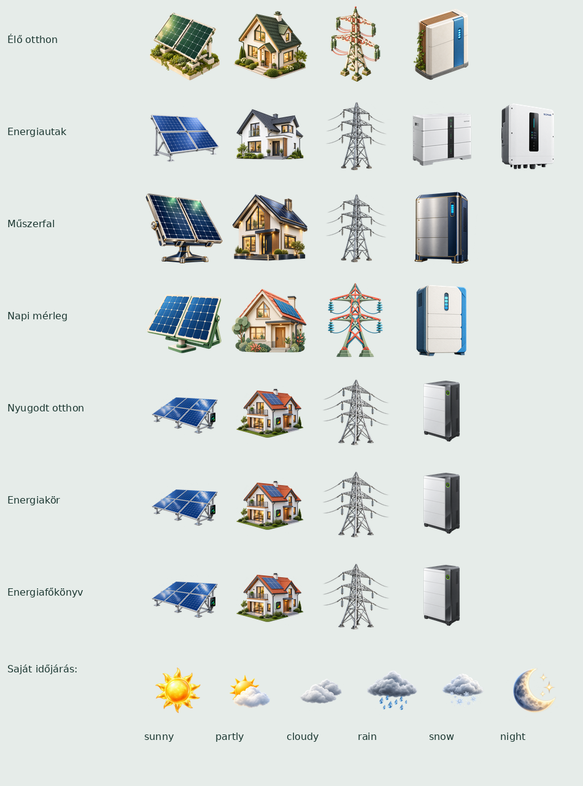

# Képek és betűkészletek

A beépített nézet futásidejű PNG-ket használ a `main/assets/png` alatt. A forrásképek és a vágási/méretezési leírás az `assets/source` könyvtárban vannak; újragenerálás: `python tools/prepare_assets.py`. A közös összegző forráslap több ikonhoz szükséges, ezért megmarad.

A tizenegy SD-s sablon saját képei a `templates` könyvtárban találhatók. A jelenlegi fájlok SHA-256 ellenőrzőösszege és az ismert generálási eredet az [assetjegyzékben](../assets/template-manifest.json) szerepel. A korábbi képcserék elavult promptjegyzékei nem részei a repónak. A hiányzó eredeti generálási metaadatokat a jegyzék nem találja ki.

Átlátszó ikon importálása: `python tools/import_template_icons.py manifest.json`; a bemeneti lista elemei `template`, `name`, `path`, `prompt` mezőket tartalmaznak. A program az alfa megtartásával 128×128 PNG-t készít és aktualizálja az assetjegyzéket.

A beágyazott betűkészletek mind használatban vannak. A Noto Sans és DejaVu licenceket a betűforrások mellett meg kell tartani. A generált C fájlok a firmware fordítási bemenetei, nem ideiglenes állományok.

A webes sablonkezelő HTML/JS forrása és a belőle generált `main/app_template_page.h` együtt szükséges. Módosítás után az erre szolgáló generátort futtasd.



## Loxone kapcsolat képernyő

A [helyben tárolt Loxone-logó](../assets/loxone-logo.png) a Loxone saját
LxCommunicator.NET MIT-licencű példatárának változatlan `Logo.png` képe.
A `main/app_loxone_logo.h` ugyanezt a PNG-t ágyazza a firmware-be, ezért
a kijelzőnek nincs szüksége internetelérésre vagy SD-s logófájlra.
A helyi PNG az USB-telepítőcsomag `assets/loxone-logo.png` fájlja is. A márkajelzés kizárólag
az adatkapcsolat megjelölésére szolgál. A Loxone név és logó a jogosult tulajdona.
A példatár licencét a `main/licenses/Loxone-LxCommunicator-MIT.txt` őrzi.

## Páratartalomikon

Az új, átlátszó generált kék csepp a `assets/source/weather_humidity.png`
eredetiből készül: `python3 tools/prepare_humidity_icon.py`. A beépített és 4B
nézet 28×28-as, a hét érintett SD-téma 30×30-as natív PNG-t használ,
3136/3600 bájtos ARGB8888 képpontadattal. Az új fájlok 2 KiB alatt maradnak.
A beépített változat eredetét az `assets/source/weather_humidity.json`, az
SD-változatokat az assetjegyzék tartalmazza. [Működés](relative-humidity.md).

## IRC termosztátikon

A kötött digitális termosztátgrafika méretezett forrása az
`assets/source/irc-thermostat.png`: **384×351 RGBA PNG, 89 289 bájt**.
A verziókezelt forrás a natív ikon négyszeres szélességét őrzi; a nagy
generálási eredeti nem része a repónak. A `tools/prepare_irc_icon.py`
arányosan kicsinyíti és átlátszó vászonra, középre helyezi:

```sh
python3 tools/prepare_irc_icon.py
```

A kimenet a `main/assets/png/irc_thermostat.png`,
**96×96 RGBA PNG, 8048 bájt**. A kép kijelzője üres marad; a célhőmérsékletet
és a kis fűtési/hűtési üzemmódjelet a firmware LVGL-kódja rajzolja rá.
A méretezett forrás és a generátor a kész ikont reprodukálhatóan őrzi;
a kész PNG-t nem kell kézzel módosítani. Ezek a fejlesztői fájlok a repóban
találhatók, az offline USB-telepítőnek nem részei.

Az ikon a firmware-be épül, azonosítója `thermostat-irc`. Nem része a 64
választható SD-ikonnak, és nem bővíti a `loxone-home.zip` csomagot.
A webes előnézet útvonala `/api/templates/home-icon?id=thermostat-irc`;
a kiszolgáláshoz nem kell telepített Otthon-csomag. Az aktív oldal összes
IRC-kártyája közös, 36 864 bájtos ARGB8888-képpontpuffert használ.
Ez a kép tartós képpontadata; a dekóder átmeneti foglalásait és a UI-objektumokat
nem tartalmazza. [Használat és memóriakezelés](irc-controller.md).

## Redőnyikon

A rögzített redőnygrafika az ellenőrzött közös ikonkészlet meglévő
`assets/loxone-home/icons/blinds.png` fájlja: **96×96 RGBA PNG, 11 648 bájt**.
A natív méretű, átlátszó kép változatlan másolata kerül a firmware-be;
nincs új nagy felbontású forráskép vagy további átméretezési lépés:

```sh
python3 tools/prepare_shading_icon.py
```

A kimenet a `main/assets/png/shading_blinds.png`. A generátor a képet
méret- és formátumellenőrzés után másolja, így az alfa és az eredeti PNG
bájtjai megmaradnak. Ezek a fejlesztői fájlok a repóban találhatók;
az offline USB-telepítő dokumentációja kódútvonalként hivatkozik rájuk.

A beépített azonosító **`blinds-shading`**. A webes előnézet útvonala
`/api/templates/home-icon?id=blinds-shading`, amely webes hitelesítés után,
telepített SD-csomag nélkül is elérhető. A 64 általános ikon katalógusa
és a `loxone-home.zip` csomag változatlan; az ottani `blinds` továbbra is
választható általános ikon. Az aktív oldal összes redőnykártyája egyetlen,
**36 864 bájtos ARGB8888-képpontpuffert** használ. Ez a tartós képpontadat
mérete, a dekóder és a UI további foglalásai nélkül.
[Használat és memóriakezelés](shading-controller.md).
