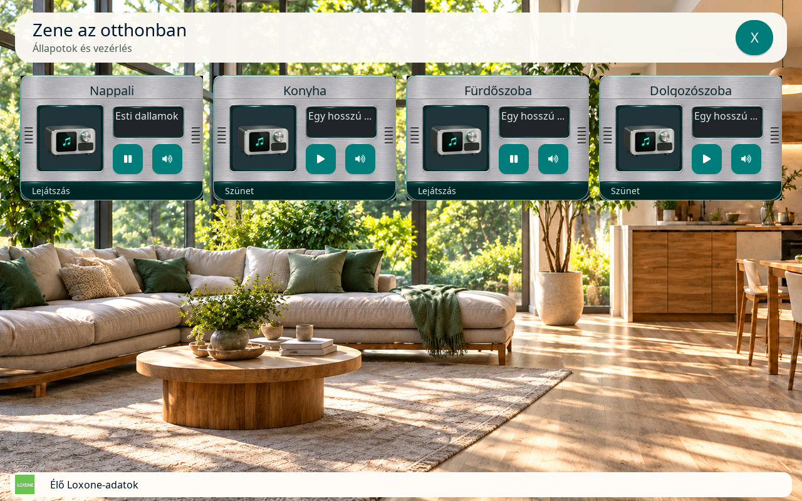
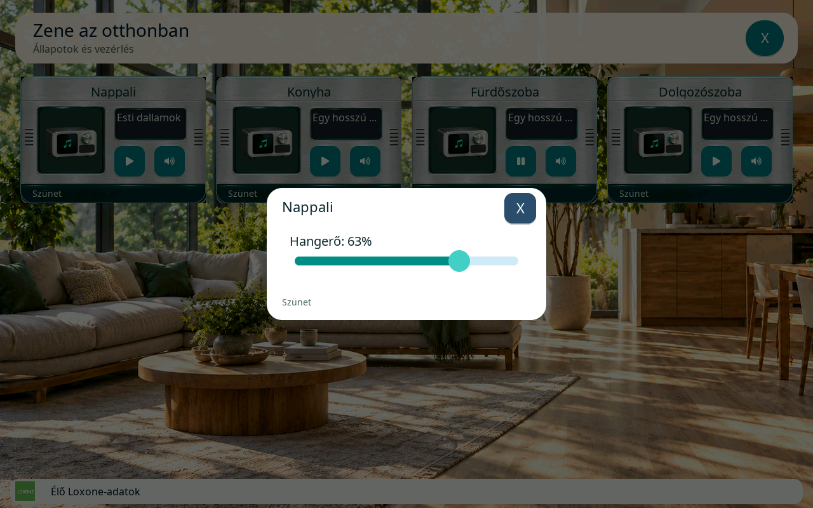
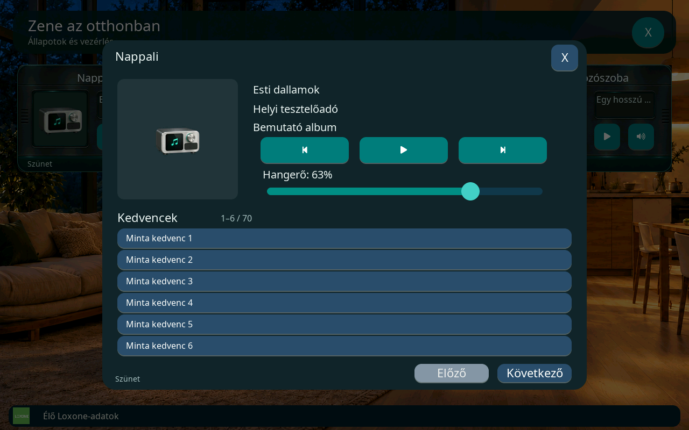

# Audio – modern Loxone Audioserver

Az **Audio** Otthon-kártya a modern Audioserver `AudioZoneV2` zónáját kezeli.
A többi kártyával azonos helyet foglal: a lejátszó kijelzőjén borítókép vagy
helyettesítő ikon, mellette zenecím, Play/Pause és hangerőgomb látható.
A részletes ablakból a számváltás és a zóna kedvencei is elérhetők.

Ez a funkció a 10.1-es Master közvetlen Loxone módjához tartozik.
A régi `AudioZone` / Music Server nem választható ehhez a kártyához.
Az automatizált modell-, protokoll-, képfeldolgozási és LVGL-próbák helyi
tesztadatokkal futnak. Az első fizikai próba során a Play/Pause működött,
de a hangerőnél, natív adatoknál, borítóknál és egyes feliratoknál hibák
jelentkeztek. Ezek valós rádió- és Spotify-eseményei külön regressziós
esetekbe kerültek; **a javított verzió fizikai elfogadása még szükséges**.

## Beállítás

1. Telepítsd az új firmware-t, utána a hozzá tartozó **v4 `loxone-home.zip`**
   csomagot a Sablonok oldalon. A [frissítési és visszaállítási sorrend](v3-home-config.md#v4-otthon-erőforráscsomag-frissítése)
   a régi csomagok használatát is ismerteti.
2. A Loxone beállításainál adj hozzá Otthon-kártyát. Először a
   **Kártyatípus: Audio**, utána a megfelelő Audio-zóna, végül a kártyanév
   választható. A fel/le gombok az aktuális oldalon mozgatják a kártyát.
3. Mentsd az Otthon-oldalakat. A kijelző a már beállított Miniserver-kapcsolat
   felhasználóját és munkamenetét használja; külön Audio-jelszó nem szükséges.

A szerver és a zóna azonosítója a Miniserver struktúrájából származik:
`mediaServer`, `details.server` és `details.playerid`. A támogatott szerver
`type: 2`. A firmware a szerver helyi `localIP`, ennek hiányában `host`
címét használja, alapértelmezésben a 7091-es porttal. A Masternek ezt a helyi
Audioserver-címet is el kell érnie.

A kártya ikonja kötött: **`audio-player`**. A nappali/éjszakai lejátszókép
292×200-as SD-erőforrás; mind a kép, mind az ikon az Otthon-csomagból érkezik.
Régi, érvényes csomagnál a kártya szöveges feliratai és kezelőgombjai maradnak
használhatók. A firmware új beágyazott lejátszóképet nem tartalmaz.

## Kezelés a kijelzőn

| Érintési terület | Működés |
| --- | --- |
| **Play/Pause gomb** | Lejátszás közben szüneteltet, szünet vagy leállított állapot esetén elindít. Ismeretlen állapotnál tiltott. |
| **Hangszóró gomb** | Kis hangerőablakot nyit. A csúszka húzás közben küldi a kívánt értéket. |
| **Borítókép / a lejátszó kijelzője** | A részletes vezérlőt nyitja meg: cím, előadó, forrás, előző, Play/Pause, következő, hangerő és kedvencek. |
| **X vagy az ablakon kívüli sötét terület** | Bezárja a kezelőt és visszavonja a hozzá tartozó függő részletkéréseket. |

A Play/Pause gombhoz nincs külön Stop művelet. A kijelzett lejátszási állapot
a Loxone-visszajelzésből származik; az elküldött kérés önmagában nem írja át.
A részletes ablak és a kis hangerőablak közül egyszerre egy lehet nyitva.
Üres zenecímnél az állomás neve jelenik meg, ha a szerver megadta; rádiónál
ez szabályos adat. Ha cím és állomás sincs, a felület a zeneszámadat hiányát
jelzi, nem állítja, hogy nincs lejátszott zeneszám. A forrássor állomásnevet
vagy albumot mutat, a címként használt állomásnevet nem ismétli meg.



*Valódi LVGL-render helyi fixture adatokkal. A képen az SD-ből betöltött
helyettesítő ikon látható, nem élő Audioserver-borító.*

### Hangerő

A csúszka a zóna aktuális maximumáig állítható. Húzás közben a kérések
összevonódnak: normál esetben legfeljebb 100 ms-onként megy tovább a legújabb
célérték, az elengedés pedig az utolsó cél továbbítását kéri. A Miniserver
parancssorának foglaltsága késleltetheti a küldést. A függő kívánt értéket
**Célhangerő** felirat jelzi, és a csúszka elengedéskor is ennél marad.
Egy későn érkező korábbi köztes hangerő nem írja felül az újabb célt.
A tényleges **Hangerő** csak a visszajelzésből származik: a kért célérték
beérkezése zárja le a várást. Ha ez két másodpercen belül nem történik meg,
a kezelő sikertelen hangerőállítást jelez és ismét a legutóbbi tényleges
értéket mutatja. Az új szerkesztés törli ezt a korábbi hibát.

Az ablak bezárása törli a még el nem küldött hangerőkérést. Ez az abszolút
csúszkaértékre és a külső −/+ műveletekre is érvényes, a Miniserver sorában
várakozó kérésre is. A már visszaigazolt hangerőt a bezárás nem állítja vissza;
a Play/Pause és számváltó műveleteket ez a szerkesztési törlés nem érinti.

Ha a zóna külső fel/le impulzusos hangerővezérlést jelez, a százalékos
csúszka helyett **− / +** gombok jelennek meg. Hiányzó maximumértéknél az
abszolút hangerőállítás tiltott; a maximum csökkenését a tényleges küldés
előtti ellenőrzés is figyelembe veszi.



*Helyi tesztadatból renderelt hangerőablak; a százalék nem élő zónamérés.*

### Kedvencek

A részletes kezelő egyszerre hat sort mutat. Az **Előző / Következő**
gombokkal a teljes, Audioserver által visszaadott lista bejárható; nincs
nyolc elemre korlátozott helyi kedvenclista.

A firmware legfeljebb 32 elemet kér és tárol egy hálózati válaszban.
Rövidebb, érvényes szerveroldal esetén a ténylegesen kapott elemszámmal
lép tovább. Visszalépéskor az előző elemek helyét keresi; rövid válaszoknál
ehhez legfeljebb hat egymást követő, aszinkron olvasás kellhet. A kezelő
ezalatt sem blokkolja a kijelzőt. Egyszerre egy listaolvasás van folyamatban.
Az ablak vagy a zóna váltásakor a korábbi válasz nem írhatja át az új listát.

A kiválasztás a szerver által adott pozitív **`item.id`** azonosítót küldi.
A lista sorszáma és a `slot` mező nem helyettesíti ezt. A korábbi listából
származó, időközben elavult kiválasztás nem indíthat másik kedvencet.
Megszakadt listaolvasás újracsatlakozáskor megismételhető; a kedvenc
lejátszási parancsát bizonytalan küldés után nem ismételjük meg.



*A címek és kedvencek helyi tesztadatok. A borító helyén az SD-ikon látható;
ez a kép a kezelő elrendezését szemlélteti.*

## Kapcsolat, jogosultság és hibák

Az alapvezérlések a meglévő, ellenőrzött Miniserver-parancssort használják.
A borító, zeneszámadat és kedvenclista a helyi Audioserver külön
WebSocket-kapcsolatán érkezik, `remotecontrol` alprotokollal. A Miniserver
állapotfrissítése szolgáltatja a zóna elérhetőségét, zárolását, lejátszási
állapotát és hangerőkorlátját.

| Művelet | Küldési út |
| --- | --- |
| Lejátszás / szünet | Miniserver: `play` / `Pause` |
| Előző / következő szám | Miniserver: `prev` / `next` |
| Abszolút hangerő / külső impulzus | Miniserver: `volume/{value}` / `volUp` / `volDown` |
| Kedvencek olvasása | Audioserver: `audio/cfg/getroomfavs/{player}/{start}/32` |
| Kiválasztott kedvenc | Audioserver: `audio/{player}/roomfav/play/{item.id}` |

A natív Audioserver-belépés a Miniserver JWT-jét a protokoll szerinti
RSA-kulcsborítékkal és AES-256-CBC titkosítással adja át. A token nem része
az Otthon-profilnak, a webes állapotnak vagy a naplónak. A borítóképet
külön HTTP-kliens tölti le: **nem kap Miniserver-jelszót, JWT-t vagy
hitelesítési fejlécet**, külső borítószolgáltatónál sem.

A natív protokoll ellenőrzési alapja a hivatalos Loxone App 17.3
(272553) kliensének működése: az LWSS munkamenetköszöntés, a teljes
nyilvános kulcs lekérése és a titkosított belépés után a kliens külön
feliratkozási parancs nélkül dolgozza fel az `audio_event` eseményeket.
A címek és kedvencnevek URI-kódolását a szövegfeldolgozás oldja fel;
a `coverurl` abszolút URL-je változatlanul kerül a képkérésbe.
Ez protokollkompatibilitási ellenőrzés, a paneles belépési próba külön
szükséges.

A szerver kezdeti `audio_event` üzenete már a belépés befejezése előtt is
megérkezhet. A firmware ezt a legfeljebb 12 látható kártyához tartozó,
átmeneti PSRAM-pufferben őrzi meg, és csak az aktuális kapcsolat sikeres
hitelesítése után teszi láthatóvá. A részleges cím-, előadó-, album-,
állomás- és borítófrissítések összeadódnak; a Miniserver közben beérkezett
frissebb hangerő- és lejátszási állapotát a kezdeti pillanatkép nem írja vissza.
Bontás, elutasított belépés vagy elavult oldalgeneráció után a puffer törlődik.

Az Espressif WebSocket-komponense rögzített **1.8.0** verziót használ.
Az [upstream kiadási jegyzet](https://components.espressif.com/components/espressif/esp_websocket_client/versions/1.8.0/changelog?language=en)
ebben közli a taskindítás és a `stop()` / `destroy()` közötti versenyhelyzet
miatti holtpont javítását (`b2b86d73`). Ez a korábbi függőségben azonosított
hiba; panelnapló nélkül nem állítható, hogy a bejelentett fizikai hibát ez
váltotta ki. A natív kapcsolat naplója a nyitás, hitelesítés, bontás és a
hibafázis rövid jelzéseit adja, token és nyers szerverválasz nélkül.
A hibás kapcsolat lezárása után az újrapróbálkozás öt másodperces várása
egyszer indul el. A kezdeti zónaállapot-kérések worker-körönként egyesével
mennek ki, köztük a válaszsor feldolgozásával; több Audio-kártya nem indít
egyszerre tizenkét kérést a négy üzenetet tároló fogadási sorra.

Védett vagy zárolt zónánál, ismeretlen zárolási állapotnál, illetve offline
szerver/kliens mellett a vezérlés tiltott. Oldalváltás, kapcsolatvesztés és
profilrevízió-váltás visszavonja a korábbi kezelő érvényességét. A Miniserver
alapvezérlései a közös sorban a küldés előtt ismét ellenőrződnek.

Ha az alapvezérlés működik, de a borító és kedvencek nem érhetők el,
ellenőrizd a Master és az Audioserver közti helyi kapcsolatot. A részletes
ablak külön jelzi a betöltést, a hiányzó listát és a belépési hibát.
A natív kapcsolat hibáját a korábban kapott lejátszási állapot vagy egy
függő hangerőkérés sem fedi el. Kapcsolat nélkül a kedvencek nem állítják,
hogy a lista betöltése már folyamatban van, és a natív listavezérlés tiltott.
Hiányzó vagy nem támogatott borítónál az SD-ikon marad; ez nem akadályozza
a lejátszó gombjainak használatát.

## Memória és életciklus

| Erőforrás | Korlát |
| --- | --- |
| Borítókép-helyek | Legfeljebb 12 látható kártya és 1 részletes ablak |
| Tömörített borító | Legfeljebb 256 KiB / kép |
| PNG és tartalék JPEG-dekóder forrásképe | Legfeljebb 512×512 pixel |
| TJpgDec által támogatott JPEG forrásképe | Legfeljebb 1024×1024 pixel |
| Kártya / részlet dekódolt képe | Legfeljebb 112×112 / 256×256, képarányt tartó RGB565 |
| Tárolt dekódolt borítók | Legfeljebb 512 KiB, azonos kép megosztható |
| Natív WS-üzenet | Legfeljebb 48 KiB, négy várakozó üzenettel |
| Kedvencek munkapéldánya | Legfeljebb 32 elem |
| Tartalék JPEG-dekóder összes saját foglalása | Legfeljebb 4 MiB, átmeneti PSRAM-munkatér |

A PNG-dekóder nem váltottsoros 1/2/4/8 bites palettás és szürke, valamint
8 bites RGB/RGBA és szürke+alfa képeket kezel. A JPEG elsőként a meglévő
LVGL TJpgDec saját, PSRAM-ban dolgozó példányát használja. Ha az adott JPEG
mintavételét vagy formátumát ez nem támogatja, a legfeljebb 512×512-es kép
egy korlátos, kizárólag JPEG-et kezelő szoftveres tartalékdekóderhez kerül.
Ez a kis rádiólogók eltérő színmintavételét és a kis progresszív JPEG-eket
is kezeli. Nagyobb, például 640×640-es Spotify-borítónál a TJpgDec által
támogatott JPEG-formátum szükséges. Egyik út sem veszi igénybe a kaputelefon
hardveres JPEG-erőforrását.

A borítók nem kerülnek SD-re. Egy letöltőfeladat dolgozik, a nyitott
részletes kép elsőbbséget kap. A tömörített bemenet, a dekóder munkaterülete
és az új RGB565-kép korlátos PSRAM-foglalás. Az 512 KiB a tárolt képek
kerete; a dekódolás átmeneti munkaterülete és a widgetcsere végéig megtartott
régi képpontok ezen felül jelentkezhetnek.
A 4 MiB-os korlát a tartalék JPEG-dekóder összes saját, egyidejű
STB-foglalására vonatkozik. A legfeljebb 256 KiB-os tömörített bemenet és
a kész, legfeljebb 128 KiB-os 256×256 RGB565-kép ettől külön puffer.

A kép referencia szerint él: a widget előbb új forrásra vált, és csak
utána engedi el a régi képet. Lap- vagy ablakváltáskor a már úton lévő
letöltés eredménye csak a hozzá tartozó aktuális generációba kerülhet.
A háttérfeladatok igény szerint indulnak és leállnak. A változatlan
feliratot vagy képforrást a periodikus UI-frissítés nem állítja be újra.

Kaputelefonos csengéskor a lejátszóablak bezárul, a régi kérések érvényüket
vesztik, és a képhivatkozások leválnak. A kamera nagy képpuffereinek foglalása
és a videó indítása megvárja, amíg a borítófeldolgozó a saját ideiglenes
puffereit elengedi. Ez külön UI-körökben ellenőrzött állapot: közben a
kaputelefon előkészítési képernyője látható, nincs kijelzőzár alatt végzett
hálózati várakozás. A csengetés után az eredeti Otthon-oldal újra felépül.

## Ellenőrzés és fizikai elfogadás

```sh
python3 tests/test_audio.py
```

A teszt a tényleges ESP runtime és médiaforrásokat is fordítja, helyi
WS/HTTP/RTOS helyettesítőkkel. A modell-, RSA/AES- és PNG-tesztek valódi
könyvtárakkal futnak. A tényleges TJpgDec JPEG-próbához a rögzített LVGL
9.5.0 forráskönyvtárát add meg `LVGL_SOURCE_DIR` környezeti változóban.

A célzott regresszió kiterjed a hangerőkérések összevonására, a friss
maximumra, a késői kedvenclista-válaszra, a megszakadásra, a memóriahibás
worker-indulásra, a generációváltásra, a képtulajdonra és a letöltési
korlátokra. A natív próbák a belépés előtti részleges metaadatot, a darabolt
WebSocket-üzeneteket, a gyors állapotválaszok sorát, a hibát követő tényleges
újracsatlakozást és az ablakbezárás utolsó küldési kapuját is ellenőrzik.
A fenti képek valódi LVGL-renderek helyi fixture adatokkal;
nem igazolnak Audioserver- vagy fizikai paneles működést.
[A dokumentációs képek eredete](images/audio/README.md).

Az Audio LVGL-regresszió a tényleges gyártási fontokon minden látható
magyar és angol felirat karakterét ellenőrzi, valamint a kapcsolódás,
függő hangerő, offline, belépési hiba és helyreállás állapotait. A valós
rádió- és Spotify-metaadatokból külön vizsgálja a cím/forrás megjelenítését
és a borító URL-jének, verziójának, generációjának átadását a kártya és a
részletes kép felé. Ez az átadási próba önmagában nem állít hálózati
letöltési sikert; a képfeldolgozási tesztek külön futnak.

A kiadás elfogadásához még az alábbi valós próba szükséges:

1. A saját `AudioZoneV2` zónán lejátszás, szünet, előző és következő;
   az állapot a Loxone webfelülettel egyezzen.
2. Hangerőhúzás, elengedés és változó maximum; külső impulzusos zónán
   a −/+ mód ellenőrzése.
3. PNG- és JPEG-borító, zeneszámváltás, azonos URL mögött változó kép,
   valamint hiányzó borító esetén a helyettesítő ikon.
4. Több hálózati oldalt igénylő kedvenclista és a tényleges kiválasztott
   kedvenc lejátszása; gyors zóna-/ablakváltás közben se keveredjenek a listák.
5. Zárolás, Audioserver- és Miniserver-kapcsolatszakadás, visszacsatlakozás;
   régi lejátszási kérés ne ismétlődjön meg.
6. Téma-, nappal/éjjel- és oldalváltás, kaputelefon megnyitása, valamint
   12 Audio-kártya mellett a képkockaidő, szabad belső RAM/PSRAM és
   feladatverem-mélypont mérése a panelen.

## Kapcsolódó szerződések

- [Loxone Structure File V17.0](https://www.loxone.com/enen/wp-content/uploads/sites/3/2026/04/1700_Structure-File.pdf):
  `mediaServer`, `AudioZoneV2`, állapotok és alapvezérlések.
- [Hivatalos Loxone App letöltések](https://www.loxone.com/int/downloads/) és az
  [ellenőrzött 17.3 (272553) Linux-kliens](https://updatefiles.loxone.com/linux/Release/1730272553-amd64.deb):
  az Audioserver natív kapcsolatának és eseményfeldolgozásának elsődleges
  implementációs referenciája.
- [PyLoxone Audio v0.1.7 natív kliens](https://github.com/davehocking/PyLoxone-Audio/blob/v0.1.7/pyloxone_audio/native.py):
  kiegészítő referencia a külön Audioserver-hitelesítéshez és a natív kedvencazonosítókhoz.
- [Otthon-konfiguráció](v3-home-config.md), [közös SD-csomag](../assets/loxone-home/README.md)
  és [a további hét Loxone-kártya](loxone-home-controls.md).
