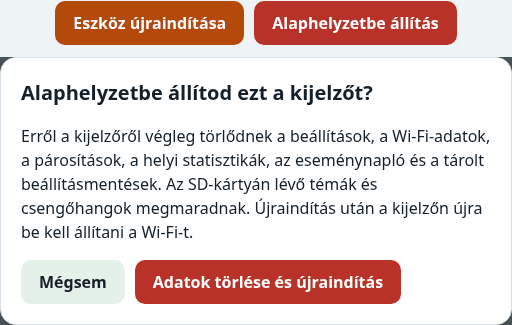

# Beállítások mentése és visszaállítása

A webfelület **Mentés** menüpontja (`/backup`) egyetlen JSON-fájlba menti a
kijelző beállításait, és ugyanonnan vissza is tölthetők. A kijelző emellett a
saját flash-tárában is őriz egy példányt, így egy új vagy üres SD-kártyával
indulva magától visszaállítja a korábbi beállításokat.

## Mi kerül a mentésbe?

| Fájl az SD-n | Tartalom |
| --- | --- |
| `config.json` | Általános, hálózati, kijelző-, statisztikai, energia- és frissítési beállítások |
| `loxone.json` | Miniserver-kapcsolat és adatpárosítás (a jelenlét és a postaláda is) |
| `loxone-home.json` | Fogyasztók, Otthon-oldalak és -kártyák, kaputelefon |
| `templates/order.txt` | A témák sorrendje |
| `templates/selection.txt` | Az aktív téma |

A mentés az öt felsorolt fájlt tartalmazhatja. A helyi mérési előzmények külön tárolódnak. A Közvetlen inverter kapcsolatát, hitelesítési adatait, koordinátáit és heti időprogramját a Master a belső beállítástárban őrzi. Ezeket gyári visszaállítás után ismét meg kell adni. A témák képei és a csengőhangok külön SD-csomagok. A gyári csomagok a kiadás `-templates.zip` és `-ringtones.zip` állományában is elérhetők.

## Jelszavak

- A **letöltött fájlban** a Wi-Fi-, MQTT- és webes adminisztrátori jelszó
  `null` értékű. Visszaállításkor a kijelzőn éppen tárolt jelszavak maradnak.
- A Loxone- és a kamerajelszó a fájlokban eleve az eszköz saját kulcsával
  titkosítva van. Visszatöltéskor az eredeti eszközkulcs szükséges. Másik kijelzőn, illetve a kulcsot törlő gyári visszaállítás után a Loxone oldalon add meg újra a jelszavakat.
- A **belső tartalék** az öt menthető fájlban szereplő adatokat a Wi-Fi- és egyéb beállított jelszavakkal együtt tartalmazza. Így a kijelző új SD-kártyával is a mentett hálózathoz tud csatlakozni.

## Visszaállítás fájlból

1. Válaszd ki a mentésfájlt, majd nyomd meg az **Ellenőrzés** gombot. Az eszköz
   minden részt ugyanazzal a validátorral ellenőriz, mint bootkor és a webes
   mentéskor, de még nem ír semmit.
2. A **Visszaállítás és újraindítás** csak akkor ír, ha minden rész hibátlan:
   egyetlen hibás rész esetén semmi sem változik. Fájlonként ideiglenes fájl és
   biztonsági másolat készül, így egy áramszünet sem hagy félig írt beállítást.
3. A statisztika mentése után az eszköz újraindul.

Részleges mentés is visszaállítható: csak a benne szereplő fájlok íródnak felül.

## Gyári visszaállítás

Az **Alaphelyzetbe állítás** a 10,1 hüvelykes kijelző saját webes kezdőlapján (`/`) érhető el Master és Slave szerepben is. A címsorban ellenőrizd, hogy a visszaállítandó kijelző IP-címét nyitottad meg. A törlés csak ezt az eszközt érinti. A többi kijelző és a hozzájuk tartozó helyi beállítások megmaradnak. A külön 4B Slave saját beüzemelő oldalán ez a művelet nem érhető el.

1. Ha később szeretnéd visszatölteni a menthető beállításokat, SD-s készüléken előbb töltsd le a JSON-fájlt a **Mentés** oldalról a számítógépedre. A fenti táblázat mutatja, mit tudsz így megőrizni.
2. SD-ről működő kijelzőn hagyd a használt kártyát a készülékben a visszaállítás végéig. Válaszd az **Alaphelyzetbe állítás** gombot. A megnyíló ablak felsorolja a törlendő adatokat. A **Mégsem** bezárja az ablakot. A törlést az **Adatok törlése és újraindítás** gomb indítja el. Ha csak újra szeretnéd indítani a készüléket, a kezdőlapon az **Eszköz újraindítása** műveletet válaszd.
3. A kijelző a jóváhagyás után újraindul. A Wi-Fi-modul és a tárolt adatok törlése után még egyszer automatikusan újraindul, majd megjelenik a Wi-Fi-választó. Áramszünet után a következő indításkor folytatja a megkezdett visszaállítást. A panelen válaszd ki a Wi-Fi-hálózatot és szükség esetén írd be a jelszót. Az időszinkron után nyisd meg a kijelzőn megjelenő HTTP-címet, és végezd el a beállítást. Slave szerephez ismét párosítsd a kijelzőt a Masterrel. [Első beállítás Wi-Fi-n](first-run-wifi.md) · [Párosítás a Masterrel](ble-data-seed.md#pin-es-párosítás-és-beállításöröklés)

| Adat | Mi történik a helyi kijelzőn? |
| --- | --- |
| Wi-Fi, webes belépés, adatfogadási mód és adatkapcsolatok | Törlődnek a hitelesítési adatokkal, az inverterprofillal, a helyszínnel és az időprogramokkal együtt. |
| Bluetooth-párosítások, helyi Slave-beállítások | A kijelző elfelejti az eszközkapcsolatait. Új párosításkor nyisd meg a Master párosítási ablakát. |
| Statisztikák, mérési előzmények és helyi események | A korábbi mérési adatok és események törlődnek. Az újonnan beállított rendszer saját előzményeket kezd gyűjteni. |
| Belső konfigurációs tartalék és az SD-n lévő alkalmazásbeállítások | A kijelző törli a belső mentéseket és a behelyezett kártyán tárolt alkalmazásbeállításokat. Ha később másik, korábban konfigurált SD-kártyát teszel be, a kijelző betöltheti az azon lévő beállításokat. |
| Firmware, telepített témák, csengőhangok és az alkalmazáshoz nem tartozó SD-fájlok | A firmware jelenlegi verziója és a fájlok a helyükön maradnak. A témaválasztást és a sorrendet újra beállíthatod. |

## Belső tartalék

- A flash korábban kihasználatlan, 7 MiB-os `storage` partícióját használja,
  fájlrendszer nélkül, két váltakozó, 1 MiB-os slotban. Mindig a régebbi slot
  íródik, a fejléc az adatok után kerül a helyére, így egy félbeszakadt írás
  nem rontja el az utolsó jó példányt.
- Csak akkor ír, ha a tartalom megváltozott (CRC32-összevetés): indulás után
  egyszer, illetve a Loxone- és Otthon-beállítások mentése után 15 másodperccel,
  összevonva. A témaváltás és a statisztika nem okoz flash-írást.
- **Automatikus visszaállítás:** ha induláskor az SD-n nincs `config.json`
  (új vagy üres kártya), a kijelző a belső tartalékból visszaírja a fájlokat,
  és normálisan elindul. Az eseménynapló ezt figyelmeztetésként jelzi.
- A `/backup` oldalon kézzel is frissíthető, illetve abból visszaállítható.

SD nélküli Slave-nél (belső NVS-beállítások) nincs mit menteni; a beállításokat
a mastertől kapja.

## API

| Végpont | Leírás |
| --- | --- |
| `GET /api/backup` | Letöltés (jelszavak nélkül) |
| `POST /api/backup/validate` | Ellenőrzés írás nélkül |
| `POST /api/backup/restore` | Visszaállítás és újraindítás |
| `GET /api/backup/flash` | Belső tartalék állapota |
| `POST /api/backup/flash` | Belső tartalék frissítése most |
| `POST /api/backup/flash/restore` | Visszaállítás a belső tartalékból |

Minden `POST` kérés a beállításoknál is használt `X-Zolee-Settings: 1`
fejlécet és a webes hitelesítést igényli.
