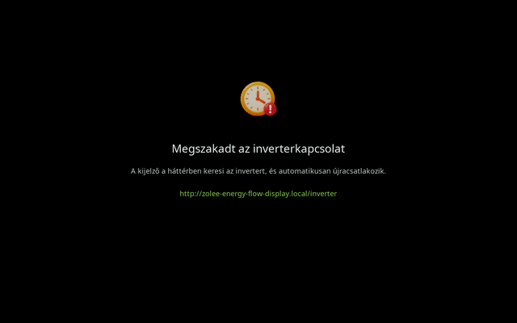

# Közvetlen inverter

Ebben a módban a Master maga olvassa az inverter termelési adatait. Egy Masterhez egy aktív kapcsolat választható. A 10,1 hüvelykes kijelző Slave módban és a külön 4B Slave a Mastertől kapja az adatokat Bluetooth-on. A Loxone-kapcsolat, az Otthon-kártyák, az Audioserver és a kaputelefon kívül maradnak ezen az adatúton.

## Első beállítás

Az **Inverter beállítások** fül és a hozzá tartozó keresés a 10,1 hüvelykes Master **Közvetlen inverter** üzemmódjában érhető el. A helyi webes felület az általános beállításokban megadott adminfiókot használja. Ha ott nincs felhasználónév beállítva, a webfelület bejelentkezés nélkül elérhető a Master helyi IP-címén. A gyártói fiók kulcsait a kiválasztott inverterprofilnál add meg.

Ha a Masteren már a **Közvetlen inverter** mód van elmentve, az időszinkron után az üres inverterprofilhoz a kijelző beállítást kér. Nyisd meg a helyi webfelületen az **Inverter beállítások** fület. Az energiaábra az első érvényes mérésből épül fel.

1. Új, mentett konfiguráció nélküli készüléken válassz Wi-Fi-hálózatot a panelen. A jelszót az érintőbillentyűzettel adhatod meg. Az IP-cím megszerzése után a kijelző szinkronizál a gyári `hu.pool.ntp.org` szerverrel. A fekete beállítóképernyőn látható címet, például `http://192.168.1.80`, nyisd meg a helyi hálózat egyik böngészőjében. [A képernyők és a billentyűzet](first-run-wifi.md)
2. Az általános **Beállítások** oldalon válaszd a **Közvetlen inverter** adatfogadási módot, mentsd a beállítást, és alkalmazd a módváltást. Már működő Masteren is innen válthatsz. SD-s konfigurációhoz az üzemmód azonosítója `"DataReceptMode": "inverter"`.
3. Nyisd meg az **Inverter beállítások** fület. Válaszd ki az inverter és a kommunikációs modul közös profilját. A megjelenő súgó mutatja, mit kell engedélyezni az inverteren vagy a gyártói fiókban. Helyi kapcsolatnál indíts keresést, ha a profilnál elérhető. A gépnevet vagy IPv4-címet kézzel is beírhatod. A port külön mező. Modbusnál az inverter telepített eszközcímét használd.
4. A **Van akkumulátor** jelölőt olyan telepítésnél kapcsold be, ahol az inverter akkumulátort kezel. Kikapcsolva a kijelző elhagyja az akkumulátorméréseket. Az akku hőmérséklete minden adatfogadási módban opcionális. A hiányzó érték és a hozzá tartozó felirat vagy ikon eltűnik, míg a mért 0 °C megjelenik.
5. Állítsd be az igényelt heti sötétítést és a párosított Slave-eket. Az oldal végén add meg a ház GPS-szélességét és hosszúságát tizedes fokban. Példa Budapesthez: **47.4979, 19.0402**. Az első szám a szélesség (−90…90), a második a hosszúság (−180…180).
6. Mentsd a profilt. A szinkronizálási állapot és a legutóbbi valódi mérés kora a fülön ellenőrizhető. Az elérési adatok cseréjekor add meg az új célhoz tartozó kulcsokat is. A helyi mentés a Master belső NVS-tárában marad meg újraindításkor. Az azonos kapcsolathoz tartozó változatlan jelszót a webfelület üresen hagyhatja.

### Inverter keresése a helyi hálózaton

1. Csatlakoztasd az adatgyűjtőt vagy az inverter helyi hálózati portját a Masterrel közös hálózathoz. A gyártói alkalmazásban akkor is látható lehet a termelés, ha csak a felhő felé működik az adatkapcsolat. Helyi olvasáshoz kövesd a kiválasztott profil súgóját.
2. Ha a telepítő a szokásostól eltérő portot vagy Modbus-eszközcímet állított be, azt még a keresés előtt írd be. Nyomd meg az **Inverter keresése a helyi hálózaton** gombot. Az IP-cím maradhat üres. A keresést a Master végzi, így a telefonról és a számítógépről megnyitott oldal ugyanazt a hálózatot látja.
3. A keresés közben a **Keresés leállítása** gombbal bármikor visszatérhetsz a kézi beállításhoz. A megfelelő találat mellett nyomd meg a **Kiválasztás** gombot. Több készüléknél hasonlítsd össze a megjelenő típust és az elérhető sorozatszámot a készülék címkéjével. Egy adatgyűjtő azonosítója a modul címkéjéhez tartozik. Az eredmény kiválasztása kitölti az ismert kapcsolati mezőket. A tartós beállításhoz az oldal alján mentsd az űrlapot. Az első sikeres mérés idejét a fül tetején ellenőrizheted.

Az **Inverter azonosítva** jelzéshez az eszköznek a kiválasztott protokoll szerint azonosíthatónak kell lennie, és az adatolvasásnak is sikerülnie kell. Egyes gyártók csak a családot vagy az API-t azonosítják, a pontos kivitelt a készülék címkéjén ellenőrizheted. **Eszköz észlelve** akkor jelenik meg, ha például csak az adatgyűjtő azonosítható, vagy még hiányzik a mérés. Ilyenkor ellenőrizd a csatlakoztatott invertert, majd mentés után figyeld az első mérés beérkezését.

| Kiválasztott kapcsolat | Mit talál meg a keresés? |
| --- | --- |
| Huawei, GoodWe, Sungrow, SolaX, SolarEdge, Solplanet, Victron GX, Deye és SOFAR Modbus TCP, valamint Deye RTU-over-TCP és LSE-3 RAW | A megadott porton és egységcímen olvassa a családra jellemző azonosítót. SolaXnál előbb válaszd ki az X1, X3 vagy PRO kivitelt. Az átjárónak az adott profil keretezését kell használnia. |
| Deye vagy SOFAR SOLARMAN V5 | A helyi felderítésre válaszoló adatgyűjtő címét és saját decimális sorozatszámát is megkeresi. Ezután a választott egységcímen próbálja kiolvasni a hozzá csatlakozó invertert. Ha a stick nem válaszol a felderítésre, az IP-cím és a matricán lévő sorozatszám kézzel is megadható. |
| Fronius Solar API | A saját szolgáltatását hirdető Fronius inverter DNS-SD segítségével, akár kikapcsolt Solar API mellett is megjelenhet. Engedélyezett API-nál a Master az inverterlistát és a pillanatnyi teljesítményt is lekéri. Több inverter külön sorban jelenhet meg ugyanazon az IP-címen. Az űrlapra a kiválasztott inverter API-azonosítója kerülhet. |
| Solplanet helyi HTTP | A Master a stick helyi inverterlistáját olvassa. Válaszd ki az inverter címkéjén szereplő sorozatszámot. Ha a stick a pontos típust is közli, a Master a hozzá tartozó pillanatnyi teljesítményt is lekéri. |
| Victron GX MQTT | A helyi hálózaton SSDP/UPnP segítségével hirdetett GX-et és VRM Portal ID-ját ismeri fel. Az MQTT-szolgáltatást a GX-en engedélyezd. TLS használatakor szükség szerint írd a megtalált IP helyére a tanúsítványban szereplő nevet. |
| SolaX Pocket HTTP, Solplanet helyi HTTPS | A Pocket helyi jelszavát a már ismert készülék címéhez add meg. A HTTPS-kapcsolathoz add meg a Solplanet stick tanúsítványában szereplő nevet vagy IP-címet és a megfelelő tanúsítványt. Ezeknél a profiloknál a címet kézzel add meg. Ha ugyanazon a Solplanet sticken a HTTP-felület is működik, azzal a profillal előzetesen kikeresheted az eszköz címét és az inverter sorozatszámát. |
| Fronius Solar.web, FusionSolar Northbound, SolaXCloud v2, AISWEI Cloud | A választott API regionális kiszolgálója és a gyártói fiók jogosultsága határozza meg az elérést. A helyi inverter IP-címe elhagyható. |

Az első beállításkor indított keresés legfeljebb 90 másodpercig fut, és nyolc találatot listáz. A profil szerinti, címről címre történő ellenőrzés a Master saját alhálózatán belül legfeljebb a helyi `/24` címtartományt járja be. Kiterjedtebb hálózatnál a kereten kívül eső eszköz címét kézzel is megadhatod. Az üzem közbeni címváltozás követése a már elmentett eszközhöz tartozik. [DHCP-címkövetés](#helyi-elérés-dhcp-vel)

**Ha nincs találat**, a következőket ellenőrizd.

- **„Nincs elegendő memória a kereséshez.”** Ha a keresés indításakor ezt látod, a Master nem tudta lefoglalni a szükséges memóriát. Megadhatod a helyi gépnevet vagy IP-címet az űrlapon, vagy később újra próbálkozhatsz. A mentett inverterkapcsolat a kereséstől függetlenül működik.
- **Átjáró és egységcím.** Az IP-cím az átjáróé, az egységcím a mögötte lévő inverteré. Több inverteres RS485-láncnál egy keresés a beírt egységcímet vizsgálja. A következő inverterhez írd át az egységcímet és indíts új keresést.
- **Port és protokoll.** Ellenőrizd a helyi szolgáltatás engedélyét, a beállított portot és a modul típusát. Deye esetén például a V5 és az LSE-3 RAW ugyanazt a portot használhatja, mégis másik profil kell hozzá. Egyetlen klienst fogadó inverternél a keresés idejére bontsd a másik helyi olvasó kapcsolatát.
- **Hálózat és kézi adatbevitel.** Vendég-Wi-Fi-n vagy elkülönített hálózatok között a router akadályozhatja a felderítést. Ha a keresés üres, de a helyi adatkapcsolat működik, a router eszközlistájából másold át az adatgyűjtő IP-címét, vagy adj meg helyben feloldható gépnevet. Ez akkor is segíthet, ha az inverter firmware-e eltérő azonosítót ad. Mentés után az első friss mérés jelzi, hogy sikerült a beállítás.

### Helyi elérés DHCP-vel

A helyi kapcsolat címeként az inverter vagy LAN-adapter helyi hálózati nevét is beírhatod. Egy routerben bejegyzett név lehet például `inverter.home.arpa`. Minden új kapcsolódáskor a hálózati névfeloldó adja meg a címet, a router DNS-bejegyzésének érvényességi ideje (TTL) szerint. Az azonos helyi hálózaton mDNS-t hirdető eszköz `név.local` formában is megadható. Egyetlen Victron GX esetén a gyári név például `venus.local`. A kijelző ehhez új kapcsolódáskor közvetlenül az adott nevet kérdezi le. A HTTPS- és MQTT/TLS-kapcsolat tanúsítványának a beállított nevet kell igazolnia.

Ha számként megadott IPv4-címmel indulsz, a Master az első érvényes invertermérés után megjegyzi az adatgyűjtő hálózati interfészének MAC-címét, ha az ugyanazon a helyi alhálózaton közvetlenül látható. A **Legutóbb igazolt helyi IP-cím** mutatja az utolsó sikeres méréshez tartozó címet. A következő indításkor a Master a mentett azonossággal és címmel folytatja.

Ha a router később másik címet oszt ki, a Master felismerheti a párosított eszközt a helyi ARP-táblában vagy az új címet bejelentő ARP-üzenetében. Az új címet célzottan ellenőrzi, majd ugyanazzal az inverterprofillal ismét mér. A beírt eredeti IP megmarad. Ha azt időközben egy másik készülék kapta meg, a kijelző várakozást jelez. Inverter-, kommunikációs modul- vagy helyi hálózatcsere után a beállítóoldalon jelöld be az **Új inverter párosítása ezen az IP-címen** lehetőséget, ha valóban a megadott végpontot akarod ismét azonosítani. Ha az eszköz új IP-jét tudod, közvetlenül is megadhatod azt.

Ha az inverter újrainduláskor nem jelenti be az új IP-címét, a bekapcsolva maradt Master két célzott próbával ellenőrzi a régi címet, majd a rögzített MAC-címnek címzett ARP-kérésekkel keresi az új IPv4-címet. A régi cím szomszédaival kezd. A címtalálat után a Master új, érvényes invertermérést kér. Ekkor automatikusan visszaáll a műszerfal. A másik készüléknek újra kiosztott régi IP-címről nem vesz át mérést.

A Master másodpercenként legfeljebb két keresőkérést küld. Egy szokásos, 255.255.255.0 maszkú hálózaton (`/24`) egy teljes kör ideális esetben nagyjából két perc. A közeli címet hamarabb megtalálhatja. A keresés `/22`-ig lefedi a teljes helyi alhálózatot, nagyobb hálózaton az utolsó ismert cím `/24` tartományát járja be. Sikertelen körök között egy, két, majd négy percet vár. Firmware-frissítés és megszakadt Wi-Fi alatt a keresés szünetel.

Másik VLAN, elkülönített Wi-Fi, NAT vagy proxy ARP esetén a valódi MAC-cím, illetve az arra küldött kérések rejtve maradhatnak. Ha az adatgyűjtő a célzott keresésre nem válaszol, használj helyben feloldható gépnevet vagy **DHCP-foglalást** a routerben. HTTPS-nél a tanúsítványnak a használt névre vagy számként megadott címre is érvényesnek kell lennie. A felhős profilok elérését a gyártó kiszolgálóneve határozza meg.

### Modbus-regisztercímek módosítása

A **Modbus olvasási regiszterek** az inverterkapcsolat kiválasztása után jelennek meg. Minden mérésnél látható az aktuális és a gyári cím, a funkciókód, a 16 bites szavak száma és az adatformátum. A mezőbe tízes számrendszerű, nullától számozott PDU-cím kerül. SunSpec-modellnél a felület külön jelzi a modellhez viszonyított eltolást. A SolaX X1, X3 és X3 PRO kiválasztásakor csak az adott modell sorai jelennek meg. A másik kivitel mentett címei megmaradnak. A 0 érvényes érték. A több szóból álló mérés utolsó regiszterének is bele kell férnie a címtartományba.

Módosítsd a kívánt címet, majd válaszd az **Inverter és időprogramok mentése** gombot. A **Gyári cím visszaállítása** csak a kiválasztott sort állítja vissza, a visszaállítást is menteni kell. A módosítás azt határozza meg, honnan olvas a kijelző. A kijelző csak olvasási kérést küld az inverternek.

## Támogatott invertercsaládok és adatgyűjtők

A tíz családhoz összesen 22 kapcsolati profil tartozik. A 18 helyi profilból 16 támogat hálózati keresést. A SolaX Pocket HTTP és a Solplanet HTTPS helyi címe kézzel adható meg. A négy felhős profilhoz a gyártói API-hoz tartozó hozzáférés kell.

| Inverter | Használható kapcsolat | Telepítéskor ezt ellenőrizd |
| --- | --- | --- |
| Fronius Primo/Symo GEN24 Plus | Helyi Solar API HTTP, Solar.web Query API | Engedélyezett Solar API vagy külön Solar.web API-kulcs. Ház és hálózat megjelenítéséhez Smart Meter. |
| Sungrow SH5.0–10RT, RT-20 | Helyi Modbus TCP | Az inverter megfelelő LAN-portja, Modbus-eszközcíme, mérő és a telepített akkumulátor. |
| SolaX X1-Hybrid G4, X3-Hybrid G4 és X3-HYB-G4 PRO | Helyi Modbus TCP, X3-Hybrid G4 esetén kompatibilis Pocket HTTP, továbbá SolaXCloud v2 külön API-hozzáféréssel | Modbusnál válaszd ki az X1, X3 vagy PRO változatot. A PRO beállítás a protokollverziót és az MPPT-bemenetek számát is figyelembe veszi. A helyi HTTP-profil a két MPPT-s X3-Hybrid G4 típushoz készült. |
| Huawei SUN2000 L1/M1, köztük 5KTL-M1 | Helyi Modbus TCP, FusionSolar Northbound | WLAN-FE Smart Dongle és telepítő által engedélyezett Modbus TCP, illetve külön API-fiók. A helyi adatgyűjtő egyidejű klienskorlátjára ügyelj. |
| GoodWe ET/EH | Helyi Modbus TCP | A megfelelő adatgyűjtő támogassa a Modbus TCP-t. A Wi-Fi kapcsolat önmagában a gyártói felhő elérését is jelentheti. |
| Victron MultiPlus/Quattro GX rendszerrel | GX Modbus TCP vagy helyi MQTT | A GX-ben engedélyezd a választott szolgáltatást. MQTT-hez a VRM Portal ID kell. [GX MQTT beállítása](inverters/victron-mqtt.md) |
| SolarEdge SetApp | SunSpec Modbus TCP | Engedélyezett TCP-szerver, helyes port és eszközcím. A mérő szerepe dönti el, melyik pontot méri. |
| Deye SUN-SG, SG04LP3 háromfázisú sorozat | SOLARMAN V5, LSE-3, nyers RTU TCP-n vagy Modbus TCP átjáró | Válaszd az adatgyűjtő saját keretezését. V5 esetén az adatgyűjtő decimális sorozatszáma kell. |
| SOFAR HYD 5/6/8/10/15/20KTL-3PH, két PV-bemenetes hibridek | Modbus TCP–RTU átjáró vagy kompatibilis SOLARMAN V5 adatgyűjtő | Az átjárón egyezzen a monitoring RS485 egységcíme. V5 esetén az adatgyűjtő decimális sorozatszáma szükséges. [SOFAR típusok, adatgyűjtők és mérések](inverters/sofar.md) |
| Solplanet ASW8000-T | Kompatibilis stick helyi HTTP/HTTPS, Modbus TCP–RS485 átjáró, AISWEI Cloud | Az ASW8000-T string inverterhez az akkujelölő kikapcsolható. Az RJ45 kivitelű RS485-porthoz megfelelő átjáró kell. A termelés külön mérő nélkül is megjelenhet. |

A [helyi Modbus-kézikönyv](inverters/modbus.md) modellenként felsorolja a portokat, regisztereket és mérőfeltételeket. A HTTP-profilokhoz szükséges mezők és jogosultságok a [helyi HTTP és a gyártói felhők útmutatójában](inverters/http.md) találhatók. A kompatibilitást az inverter, az adatgyűjtő és annak firmware-e együtt határozza meg. Az adott telepítésen a termelést és az előjeleket a gyári monitorozóval érdemes összevetni. A kijelzőn a pozitív hálózati teljesítmény vételezés, a pozitív akkumulátorteljesítmény kisütés.

## Frissítési idő és mérési hiányok

| Forrás | Alapütem |
| --- | --- |
| Helyi inverter | 5 másodperc |
| SolaXCloud v2 és Fronius Solar.web | 5 perc |
| AISWEI lakossági API | 20 perc |
| Huawei FusionSolar történeti eszközadat | 60 perc |
| Open-Meteo | 15 perc |

A felhőknél a kijelző a szolgáltatói mérés időpontját használja. Ismételten kiadott azonos mérés egyetlen mintának számít. A mérő nélküli rendszer részleges adatokat adhat. A szünetelő energiafolyam megőrzi az utolsó mérés korát, és a hosszabb kimaradásból nem készül becsült kWh. Az időjárás és a nappálya külön frissül. A beállítás újramentése a helyi forrást azonnal újraolvassa, azonos felhőfiók esetén a szolgáltatói ütem érvényesül.

## Nappálya, időjárás és éjszakai mód

A Master a koordinátákból és szinkronizált órájából helyben számolja a Nap irányát, magasságát, a napkeltét és a napnyugtát. Ellenőrizd a kijelző telephelyének időzónáját. A Master és a Slave éjszakai témája a napnyugta percében bekapcsol, a napkelte percében nappalira vált. A felhős időjárás kiesése ezt a számítást nem érinti. A számítás alapja a beépített, MIT-licencű [SolarCalculator](https://github.com/jpb10/SolarCalculator/tree/d7fb0005e3fbe288348c372c6adb76614ab2e254).

A Master a két koordinátát küldi az Open-Meteónak. A válaszból a külső hőmérséklet, páratartalom, szélsebesség, csapadék és közvetlen napsugárzás használható. A csapadékjelzés a környék modellezett időjárását mutatja. 45 percnél régebbi adathoz a kijelző elrejti az időjárási értékeket. A publikus végpont a szolgáltató ingyenes, nem kereskedelmi feltételeivel használható. A mérések forrásmegjelölése **Weather data by Open-Meteo**, az adatok licence CC BY 4.0. [Időjárási API](https://open-meteo.com/en/docs) · [Felhasználási feltételek](https://open-meteo.com/en/terms)

## Slave-ek, heti sötétítés és érintéses ébresztés

A Master általános beállításaiban engedélyezd a BLE-adatmegosztást, majd párosítsd a kijelzőket. Az **Inverter beállítások** fülön a párosított eszközök saját nevet, tájolást és külön nappali vagy éjszakai fényerőt kaphatnak. A teljes v4 funkciókhoz frissítsd a Mastert és a Slave-eket a saját hardverükhöz tartozó firmware-rel. [BLE-párosítás](ble-data-seed.md)

Az időprogram naponként egy kezdő és egy záró időpontot fogad. Például a hétfő **22:00–06:00** sáv hétfő este indul és kedd reggel ér véget. Egy bekapcsolt nap két azonos végpontja az egész napot lefedi. A sáv kezdete beleszámít, a vége már kívül esik. Alapból minden Slave a Master programját örökli. A saját időprogram kikapcsolása visszaállítja az öröklést.

Aktív időablakban a panel elsötétül. Az első érintés a pillanatnyilag érvényes nappali vagy éjszakai fényerőre ébreszti. Az újabb érintések újraindítják az ébrenléti időt. Lejáratkor csak a még aktív időablakban sötétül vissza. Így például a napnyugtakor megjelenő éjszakai téma estig látható maradhat, miközben a teljes sötétítést csak 22 órától kéred.

## Mit ellenőriztünk az integrációkban?

| Kapcsolat | Automatizált ellenőrzés | Mit érdemes a saját telepítésen összevetni? |
| --- | --- | --- |
| 13 helyi Modbus-profil | A tényleges meghajtó által küldött regisztercím, olvasási funkció, szósorrend és skála. Gyári és módosított címek, hiányzó mérő, több tároló és eltérő SolaX-változatok. | A pontos modell és adatgyűjtő regisztertérképe, a hálózati teljesítmény előjele, a csatlakoztatott fogyasztásmérő szerepe. [Modbus-kézikönyv](inverters/modbus.md) |
| 8 helyi HTTP/HTTPS vagy felhős profil | Gyártói válaszformátumok feldolgozása, részleges adat, hitelesítés, mérési idő és munkamenet-megújítás. | A stick firmware-e, az API-fiók régiója és jogosultsága, valamint a legutolsó adat ideje a gyártó alkalmazásában. [HTTP-kézikönyv](inverters/http.md) |
| Victron GX MQTT | Feliratkozás, mérési témák, azonosító, megszakadt adatfolyam és új kapcsolat. | A GX helyi MQTT-beállítása és a Portal ID. [GX-beállítások](inverters/victron-mqtt.md) |

A hálózati próbákban a firmware meghajtója helyi tesztszerverrel, rögzített vagy szintetikus mintaválaszokkal működik. A helyszínen az inverter és adatgyűjtő típusa, a firmware-verzió, az engedélyezett szolgáltatások és a bekötött mérő határozza meg, mely csatornák olvashatók. Az első mérésnél hasonlítsd össze a termelést, a hálózat és az akkumulátor irányát a gyári kijelzéssel.

## Hibakeresés

A **Megszakadt az inverterkapcsolat** felirat akkor jelenik meg, ha az inverter korábban már adott mérést, és azóta a lekérdezés sikertelen. Helyi kapcsolatnál az utolsó jó mérés után 10 másodpercig az energiaábra marad látható. Felhős profilnál a kijelző kivárja az adott szolgáltató két lekérdezési időközét és további egy percet. Ha a szolgáltató elérhető, de a visszaküldött mérés elavult, a kijelző **Nincs friss invertermérés** üzenetet mutat.

A Master a háttérben újrapróbálkozik. Új érvényes méréskor az üzenet automatikusan eltűnik és visszatér az energiaábra. Közben a Masteren kiírt címen megnyithatod az **Inverter beállítások** fület. A párosított v4 Slave ugyanazt a kiesést jelzi, amíg Bluetooth-on eléri a Mastert. Ha a Bluetooth-kapcsolat is megszakad, a Slave a Mastert keresi.

| Jelenség | Mit nézz meg? |
| --- | --- |
| A panel a beállítási címet mutatja | Nyisd meg a kiírt HTTP-címet azonos hálózatról és mentsd el az általános beállításokat. Ezután állítsd be a kiválasztott üzemmódot. |
| Az inverter nem válaszol | Változat, port, IP-cím, protokoll és Modbus-eszközcím. Ellenőrizd a telepítői engedélyezést és az egyidejű klienskorlátot. |
| Csak a PV látszik | Nézd meg a műszaki útmutatóban, ad-e mérő-, ház- vagy akkuadatot a kiválasztott profil. Ellenőrizd a fizikai mérőt, a mérő szerepét és az akkujelölőt. |
| Régi a felhőmérés | Hasonlítsd össze a gyártói alkalmazás idejével. Ellenőrizd a régiós végpontot, API-fiókot, jogosultságot és kvótát. |
| Rossz irányba mozog az energia | Ellenőrizd a mérő helyét, irányát és a csatlakozási pont szerepét. Töltés, kisütés és ismert hálózati vételezés közben is hasonlítsd össze az értékeket. |
| Eltér a téma vagy a sötétítés időpontja | Ellenőrizd a hosszúság előjelét, a helyi időt, majd a heti időablakot és a Slave öröklési beállítását. |
