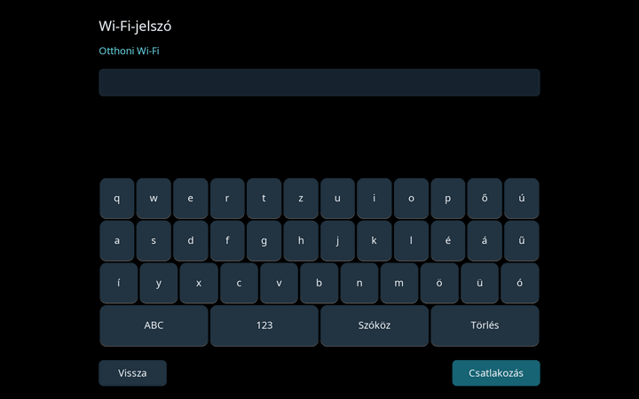
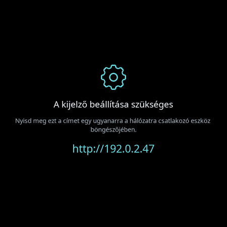

# Első beállítás Wi-Fi-n

Amikor a kijelző első beállítást kér, a Wi-Fi-hálózatot közvetlenül az érintőképernyőn válaszd ki. A további beállításhoz készíts elő egy telefont vagy számítógépet, amely ugyanahhoz a helyi hálózathoz csatlakozik.

## Kapcsolódás a hálózathoz

1. Várd meg a hálózatkeresést. Érintsd meg a saját hálózatod nevét. A listát görgetheted. Ha több mint 16 különböző hálózat látható, az **Előző** és **Következő** gombbal lapozhatsz. Az azonos nevű hozzáférési pontok egyszer szerepelnek. Ha hiányzik a hálózatod, válaszd az **Újrakeresés** gombot.
2. **Nyílt** hálózat kiválasztásakor a kijelző rögtön csatlakozni próbál. **Jelszavas** hálózatnál írd be a Wi-Fi-jelszót. Az **ABC** és **abc** vált a nagy- és kisbetűk között, a **123** a számokat és a speciális karaktereket mutatja. A magyar ékezetes betűk mindkét betűméretben elérhetők. A **Törlés** az utolsó karaktert törli. A beírt jelszó karakterei takarva jelennek meg.
3. Érintsd meg a **Csatlakozás** gombot. Sikertelen kapcsolódás után válaszd ki újra a hálózatot, és add meg ismét a jelszót. Másik hálózat kereséséhez érintsd meg az **Újrakeresés** gombot.

## A beállítás folytatása böngészőben

Sikeres csatlakozás után a kijelző megvárja az időszinkronizálást. Ha az **Időszinkronizálás** felirat hosszabb ideig megmarad, ellenőrizd, hogy a kiválasztott hálózaton elérhető-e az időkiszolgáló.

Amikor megjelenik **A kijelző beállítása szükséges** felirat, írd a telefon vagy számítógép böngészőjének címsorába a kijelzőn látható teljes `http://` címet. Ott add meg és mentsd el a kijelző beállításait. Az alábbi 4B-képernyőképen a `192.0.2.47` példacím. A saját kijelződ a helyi hálózattól kapott IP-címet mutatja.

