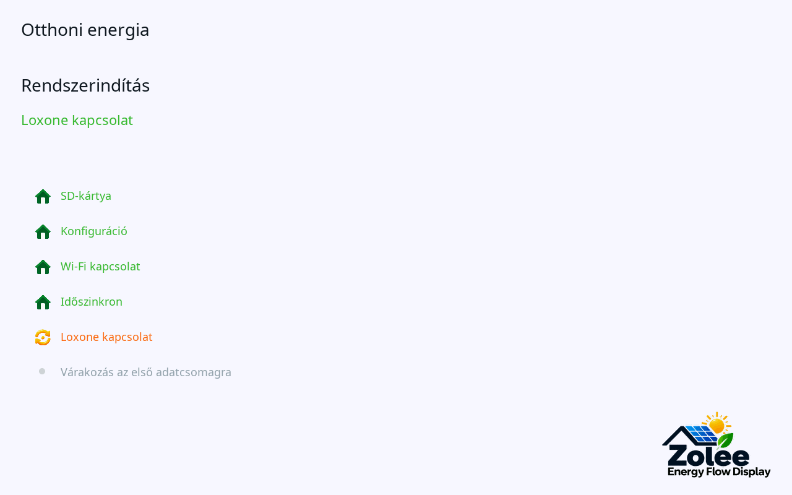

# Első indítás – részletes útmutató

[Dokumentáció](README.md) · [Telepítés és használat](getting-started/README.md)

Az első indításkor a kijelző kap hálózati címet, utána a böngészőben választhatod ki, honnan kapja az adatokat. Előre beállított SD-kártyával is indíthatod.

1. Telepítsd a firmware-t az [USB útmutató](usb-install.md) szerint.
2. Konfiguráció nélküli új eszközön kövesd a [Wi-Fi első beállítását](first-run-wifi.md). Előre beállított telepítéshez a [MQTT konfigurációt](../config.sample.json) vagy [HTTP konfigurációt](../examples/config.http.sample.json), közvetlen kapcsolathoz a [Loxone konfigurációt](../examples/config.loxone.sample.json) töltsd ki, és másold az SD gyökerébe `config.json` néven.
3. A repó `templates` vagy az USB-csomag `sd-card/templates` könyvtárát másold az SD gyökerébe.
4. A választott módhoz állítsd be az adatforrást.

   - **MQTT vagy HTTP** esetén állítsd be a [Loxone adatküldést](loxone.md).
   - **Közvetlen Loxone** módban a kijelző helyi `/loxone` oldalán add meg a Miniservert és párosítsd az állapotokat. Az oldal már a Miniserverre várakozás közben is elérhető.
   - **Közvetlen inverter** módban nyisd meg az **Inverter beállítások** fület (`/inverter`). Válaszd ki a családot és a kapcsolat típusát, majd add meg az elérési adatokat és a helyszín koordinátáit. Mentés után a Master megkezdi a lekérdezést. [Inverterkeresés és beállítás](direct-inverter.md)

Slave-ként SD-vel a minimális `config.json`: `{"DataReceptMode":"slave"}`.
Új eszközön az első webes beállítás során is kiválasztható a Slave szerep. A dedikált 4B Slave-ként párosítható. A masteren kapcsold be az adat seedet, nyisd meg a párosítási ablakot,
és a diagnosztikáján látható PIN-t írd be a Slave-en. Saját MQTT/Loxone/NTP
beállítás nem kell. [Párosítás és átállítás](ble-data-seed.md).

## Indulás mentett beállításokkal

A 10,1″-es kijelző MQTT, HTTP, Loxone és Slave módban az indulóképernyőn jelzi, melyik kapcsolatra vagy adatra vár. A korábbi mérés elévülése vagy a kapcsolat lassú felépülése közben is itt követheted az indulást. Az első sikeres kapcsolódás és adatfogadás után egy újabb kapcsolatvesztést már az üzemi hibaablak jelez.

| Üzemmód | Mikor jelenik meg a beállított nézet? |
| --- | --- |
| Közvetlen Loxone, 10,1″ | Wi-Fi és időszinkron után a kijelző megvárja a Miniserver hitelesített állapotkapcsolatát és az első érvényes, friss energiamérést. Ha hiányoznak a hozzáférési adatok vagy az állapotok párosításai, nyisd meg a „Loxone kapcsolat” lépésnél látható webcímet. Letiltott energiaáramlásnál az Otthon nézet a Miniserver-kapcsolat felépülésekor megnyílik. |
| MQTT vagy HTTP, 10,1″ | A Wi-Fi és az időszinkron után MQTT módban a brokerkapcsolat, HTTP módban a helyi adatfogadó indulása következik. Az első érvényes, friss energiamérés után jelenik meg a téma. |
| Bluetooth Slave, 10,1″ | A kijelző a párosított Master óráját veszi át. Élő Bluetooth-kapcsolat és friss energiamérés után nyitja meg a témát. Ha a Master az energiaáramlás letiltását jelzi, a Slave ennek megfelelő nézetre vált. A saját Wi-Fi opcionális. |
| Közvetlen inverter, 10,1″ | A Wi-Fi és az időszinkron után üres profilnál a kijelző az **Inverter beállítások** oldalra irányít. Mentett profillal megkezdi az olvasást. Az első érvényes mérés után megjelenhet az energiaábra. |
| Dedikált 4B Slave | Az energiaábra már a „Master keresése…” állapottal megjelenik. Bluetooth-kapcsolódáskor átveszi a párosított Master idejét, a mérési értékeket az első érvényes adatcsomagból tölti ki. A Master friss letiltási jelzésére az „Energiaáramlás letiltva” képernyőt mutatja. |

A Master új firmware-e már a Wi-Fi-s IP-cím megszerzése és az időszinkron után véglegesülhet, miközben az indulóképernyő még a Miniserverre, a brokerre vagy az első mérésre vár. A már beállított Slave számára a párosított Master időjele elegendő a véglegesítéshez. [OTA és visszaállítás](ota.md#két-ota-partíció)

## Adatok és kezelés

Az I1–I12 bemenetek sorrendje fix; I13 az időjárási jelenlétmaszk, T1 pedig az opcionális, `#`-elválasztott nappályaadat. Mindkét Pico C változat (MQTT és HTTP) ezt a kiosztást használja. A négy időjáráskulcs kötelező, de értékük lehet `null`; ilyenkor a kapcsolódó adatok egyik témában sem jelennek meg. A Loxone minták I13 jelenlétmaszkját a bekötésnek megfelelően kell beállítani, mert a Pico C API nem tudja automatikusan felismerni a bekötetlen vezetéket. [Teljes mérés](../examples/mqtt-payload.sample.json), [időjárás nélküli mérés](../examples/mqtt-payload.no-weather.sample.json).

A Nap pálya érvényes `SunPosition` esetén lapozható. SD-vel a témák weben átrendezhetők, de a Rendszer nézet mindig az első helyen marad. Balra/jobbra húzás lapoz a rendszernézet és az elérhető sablonok között; SD nélkül csak a Rendszer nézet érhető el. Felfelé húzás nyitja a diagnosztikát, jobb felső X zárja. Master/Loxone módban lefelé húzás az Otthon-lapokat, a ház érintése a fogyasztókat nyitja meg, ha a szükséges csomag és konfiguráció elérhető. A helyi weboldal: `http://zolee-energy-flow-display.local/` vagy az eszköz IP-címe; `/update` firmware-frissítés, `/templates` sablonkezelés és GitHub-témafrissítés, `/settings` beállítások (SD-n vagy belső NVS-ben), `/backup` mentés és visszaállítás, `/diagnostics` diagnosztika. A gesztusok teljes listája: [Kezelés és gesztusok](gestures.md). A Slave webfelületéhez a mastertől örökölt Wi-Fi-n kapott saját IP-cím használható. HTTP módban az adatfogadó: `POST /api/energy`. A diagnosztika mind az öt adatfogadási módot jelzi, magonkénti CPU-terhelést, belső RAM-/PSRAM-használatot, SD- vagy belsőtár-állapotot és Bluetooth-adatokat mutat.
