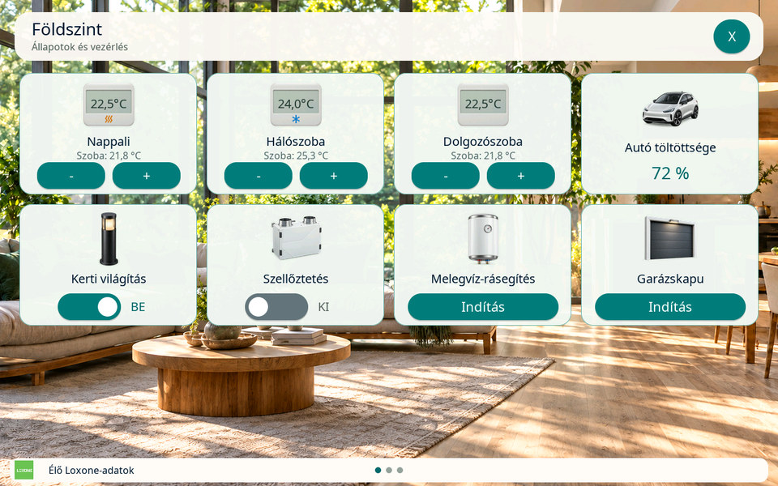
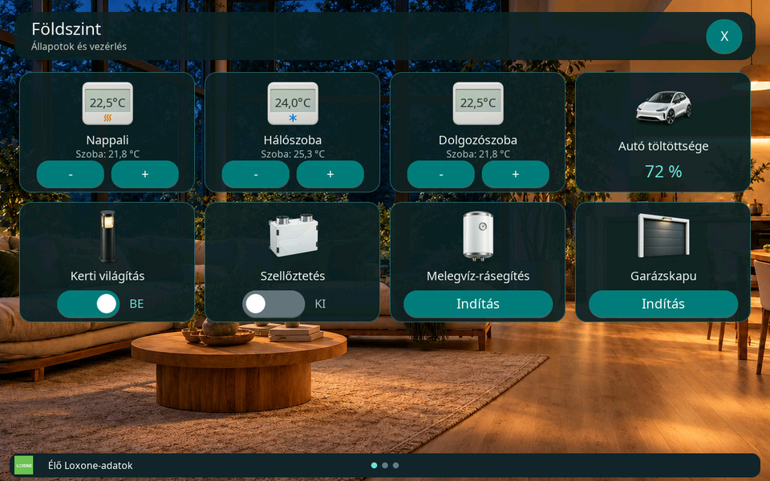
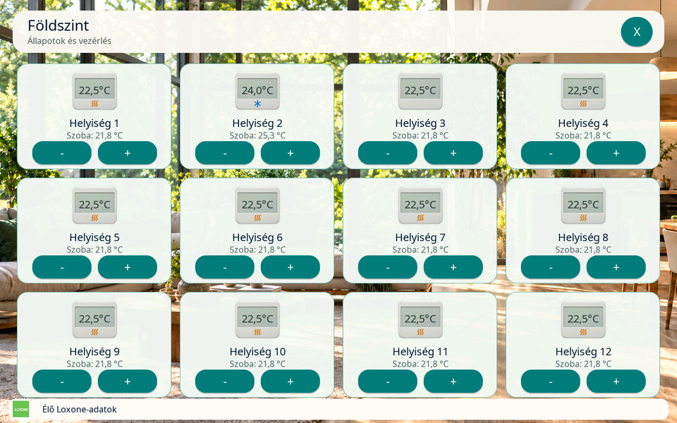

# Loxone IRC termosztát Otthon-kártya

[Funkciók és vezérlés](features/README.md) · [Otthon-konfiguráció](v3-home-config.md)

## Elérhetőség és beállítás

Az **IRC termosztát** a Master 10.1 kijelző közvetlen Loxone üzemmódjában,
az Otthon-oldalakon használható. A modern **`IRoomControllerV2`** intelligens
helyiségszabályzó blokkot kezeli. A régi `IRoomController` eltérő protokollja
nem támogatott. A Waveshare 4B Slave nem kap termosztátkártyát, új vezérlést
vagy új Bluetooth-adatfolyamot.

1. A kijelző `/loxone` weboldalán kérd le a Loxone adatlistáját.
2. Az Otthon-kártyák között válaszd ki a szerkesztendő oldalt, adj hozzá egy
   kártyát, majd válaszd az **IRC termosztát** típust.
3. Add meg a kártya nevét, és a **Loxone helyiségszabályzó (IRC) blokk**
   mezőben válaszd ki a helyiség szabályzóját. Egy blokk egyszer szerepel a
   listában; külön célhőfok- vagy szobahőmérséklet-állapotot nem kell párosítani.
4. Mentsd az Otthon-oldalakat. A kijelző a Miniserver visszajelzéseiből tölti
   ki a kártyát.

Az ikon rögzített: IRC típusnál nincs ikonválasztó, skálázás, egyéni
mértékegység, tizedesjegy- vagy figyelmeztetésbeállítás. A termosztátgrafika a
firmware része, a webes előnézete telepített SD-ikoncsomag nélkül is elérhető.
Az új ikonhoz nem kell frissíteni a 64 ikonos `loxone-home.zip` csomagot.
**Az Otthon-oldal megnyitásához továbbra is szükséges a működő SD és a közös
erőforráscsomag**, amely a hátteret és a logót adja.

## A kártya megjelenése

A kártya 292×200 képpontos, és a meglévő, oldalanként legfeljebb 12 kártyás
elrendezésbe illeszkedik. A 96×96 képpontos digitális termosztát üres
kijelzőfelületére az élő célhőfok kerül.

| Elem | Jelentés |
| --- | --- |
| Hőfok a termosztát kijelzőjén | A Miniserver által visszajelzett célhőmérséklet, egy tizedessel, °C-ban. |
| Név alatti `Szoba: … °C` sor | A ténylegesen mért szobahőmérséklet. |
| Kis narancssárga hullámjel | Fűtési üzemmód. |
| Kis kék hópehelyjel | Hűtési üzemmód. |
| `−` és `+` gomb | A célhőfok natív csökkentése vagy növelése 0,5 °C-os lépéssel. |

A színes jel az IRC **üzemmódját** mutatja. A szelepnyitás, a pillanatnyi
fűtési vagy hűtési igény ebből nem állapítható meg. Ismeretlen vagy egyértelmű
irányt nem adó üzemmódnál nincs színes jel. A kártyán **nincs Auto gomb**,
és az ikon nem nyit külön kezelőablakot.

## Statikus előnézetek

A képek a firmware tényleges LVGL-felületének tesztrenderéből készültek,
szintetikus Loxone-adatokkal. Nem fizikai kijelzőfotók. A nappali és éjszakai
nézet mellett a teljes, 12 kártyás oldal is látható. Az eredeti 1280×800-as
tesztrenderből a dokumentációhoz 960×600-as JPEG-előnézet készül.

| Nappali megjelenés | Éjszakai megjelenés |
| --- | --- |
|  |  |



[Képek eredete és frissítése](images/irc/README.md).

## Hőfokállítás és automatika

Minden elfogadott gombnyomás egyetlen relatív hőfokléptetési kérést küld a
Loxone helyiségszabályzójának. A lépésköz mindig **0,5 °C**. A beállítás
időtartamát, a szabályozási határokat és az automatika további működését a
Loxone saját blokkja határozza meg; a kijelző nem vezet be külön időprogramot
vagy automatikus visszaállítási időzítőt.

A kijelzett célhőfok kizárólag a Miniserver állapot-visszajelzésére változik.
Az érintés és a parancs nyugtája önmagában nem növeli vagy csökkenti a
képernyőn látható számot. Más Loxone-felületen végzett állítás és az
időprogram változása ugyanebben az állapotfolyamban jelenik meg.

Amíg egy parancs feldolgozása folyamatban van, a gombok tiltottak. Elmaradt
nyugta vagy kapcsolatvesztés után a kijelző nem ismétli meg a léptetést:
ugyanannak a relatív kérésnek az újraküldése újabb hőfokváltoztatást okozhatna.
Ilyenkor a Miniserver tényleges célhőfokát ellenőrizd.

## Hiányzó adatok és tiltott vezérlés

| Jelenség | Mit ellenőrizz? |
| --- | --- |
| A kívánt blokk nincs a listában | Frissítsd az adatlistát, ellenőrizd a helyiség-/funkciószűrőt, a felhasználó hozzáférését és az `IRoomControllerV2` típust. |
| A célhőfok helyén `--,-°C` látható | Még nincs érvényes célhőfok. Várd meg az állapotfrissítést, és ellenőrizd a Loxone kapcsolatát, a blokkot és a hőmérséklet-egységet. A gombok ilyenkor tiltottak. |
| `Szoba: nincs adat` látható | Nincs érvényes mért szobahőmérséklet. Ez önmagában nem tiltja a léptetést, ha a célhőfok és a többi vezérlési feltétel érvényes. |
| Van célhőfok, de a gombok tiltottak | Ellenőrizd a Loxone zárolását, a csak olvasható vagy védett hozzáférést, az élő kapcsolatot és a folyamatban lévő kérést. |
| Nincs narancssárga vagy kék jel | Az üzemmód még nem ismert, vagy a visszajelzett mód nem határoz meg fűtési/hűtési irányt. A kijelző nem következtet a két hőfok különbségéből. |
| A webes ikon látszik, az Otthon-oldal mégsem nyitható | Ellenőrizd az SD-t és a közös Otthon-erőforráscsomagot. A beépített ikon előnézete önállóan is elérhető. |

Ha a blokk `jLocked` állapotot szolgáltat, annak megérkezéséig a vezérlés
tiltott. A beérkezett üres szöveg ismert, feloldott állapot; a még nem kapott
vagy hibás zárolásadat nem az. A felhasználói jogosultságok, a `read-only`
korlátozás és a zárolás a kijelzőről nem kerülhető meg.

Az érvénytelen hőfok felülírja a korábbi érték érvényességét. Kapcsolatvesztés,
profilmentés vagy lapváltás után egy régi, sorban maradt gombnyomás nem
hajtható végre. Újracsatlakozáskor a szükséges kezdőértékeknek ismét meg kell
érkezniük. A megszokott Otthon-oldali kapcsolatvesztési és hibaképernyő-kezelés
érvényesül.

## Konfiguráció és protokoll

A schema 2 profilban a kártya típusa `irc`, ikonazonosítója mindig
`thermostat-irc`. A `control_uuid` a szabályzó stabil blokkazonosítója;
a tényleges parancscímet a friss katalógus `action_uuid` mezője adja.

```json
{
  "id": "living-irc",
  "name": "Nappali",
  "type": "irc",
  "icon": "thermostat-irc",
  "control_uuid": "20000000-0000-0000-0000000000000001"
}
```

Az UUID szemléltető. A konfigurációs parser hiányzó, eltérő vagy hibás
`icon` mezőből is a rögzített azonosítót állítja elő, a szerializáló ugyanezt
menti. IRC-kártyához nincs `source`, skálázás vagy egyéni formátum.
A szerkesztő az összes oldal IRC-kártyájára alkalmazza ezt; más típusra
váltva ismét az általános ikonválasztás érhető el.

A katalógus egyetlen szülőbejegyzéshez csatolja az IRC-metaadatot. A modell a
`tempTarget`, `tempActual`, `currentMode`, `operatingMode` és `jLocked`
állapotot használja. A felismert `currentMode` elsőbbséget kap; ennek
hiányában az ismert `operatingMode` adhat üzemmódjelzést.

| Gomb | Celsius-adatfolyam parancsvége |
| --- | --- |
| − | `decreasetemperature/0.500000` |
| + | `increasetemperature/0.500000` |

A teljes parancs alakja `jdev/sps/io/<action_uuid>/<parancsvég>`. A
hőmérséklet-egységet a Miniserver `msInfo.tempUnit` mezője adja, hiányában a
blokk `details.format` mezője használható. Fahrenheit-adatfolyamnál a
kijelzés Celsiusra alakul, a natív lépés pedig `0.900000` °F, ami 0,5 °C-nak
felel meg. Hiányzó, hibás vagy ellentmondó egységnél nincs találgatott
átváltás vagy parancsküldés. A `settemp`, Auto- és üzemmódváltó parancsok
nem részei ennek a kártyának.

## Memória és láthatóság

Az IRC a meglévő Loxone-workerhez és az egyetlen WebSocket-állapotfolyamhoz
csatlakozik. Nem kap új feladatot, feladatvermet, lekérdezési ciklust vagy
állapotfeliratkozást. Blokkmodell csak a látható Otthon-oldalhoz készül;
azonos oldalon ugyanarra a szabályzóra mutató kártyák közös modellt használnak.
Az LVGL-felirat és üzemmódjelzés csak változáskor frissül.

A [világításvezérlésnél használt közös nyers állapottár](lighting-controller.md#memória-és-láthatóság)
az IRC legfeljebb öt állapot-UUID-ját is megőrzi, rejtett oldalnál is.
Egy UUID egyszer szerepel; a kezdeti üres zárolásadat is megmarad. Lapnyitáskor
ez tölti fel a modellt, új hálózati lekérés nélkül. Rejtett oldalon nincs
IRC-blokkmodell vagy LVGL-frissítés. A tár parancsot nem tárol.

A közös tábla igény szerint, 16 bejegyzéstől legfeljebb 512 UUID-ig nő;
a szövegek teljes kerete 64 KiB. Az IRC-modellek, a nyers tábla és szövegei
PSRAM-ból foglalódnak, belső/DMA-heapre visszaesés nélkül. Kapcsolatváltás és
profilmentés érvényteleníti a tárat és a látható modelleket.

A termosztát PNG-je **8048 bájt**, natív mérete **96×96**. Egy aktív oldalon
az összes IRC-kártya ugyanazt a dekódolt ARGB8888-képet használja: a tartós
képpontpuffer **36 864 bájt**, nem kártyánként ennyi. IRC nélküli oldalhoz
nem készül ilyen puffer; lapváltáskor és bezáráskor felszabadul. Ez a szám a
képpontadat mérete, nem a teljes UI memóriaigénye vagy a dekódolás átmeneti
csúcsterhelése. Az ikon [forrása és újragenerálása](assets.md#irc-termosztátikon)
külön dokumentált.

## Fejlesztői ellenőrzés

A repó gyökeréből:

```sh
python3 tests/test_irc.py
python3 tests/test_loxone_protocol.py
node tests/test_loxone_home_web.js
node tests/test_irc_browser.js
python3 tools/prepare_web.py --check
python3 tests/test_documentation.py
```

A böngészőpróbához Playwright és Chromium szükséges. A teszt a firmware-be
ágyazott valódi weboldalt és az új PNG-t használja 390 és 1280 képpontos
nézetben; a helyi HTTP-válaszokat tesztadatok adják. A C-modellteszt a natív
parancsokat, egységeket, zárolásokat és a kötött ikont ellenőrzi. A közös
protokollteszt a rejtett kezdőállapotot, lapváltást, újracsatlakozást, a
függő kérések érvénytelenítését és az ismétlés elmaradását is vizsgálja.

A `tests/preview` natív LVGL-próbája `ZOLEE_IRC_ONLY=1` kapcsolóval fut;
RGB565 megjelenítéshez a `ZOLEE_PREVIEW_RGB565=1` is megadható. A szintetikus
adatokkal végzett render és a host memória-/veremellenőrzés a fejlesztői
ellenőrzés része. Ezek nem helyettesítik a Master és 4B firmware fordítását,
valamint a saját Miniserverrel és fizikai panellel végzett működési és
terhelési próbát. Az aktuális CI-eredményt az adott forrásváltozathoz tartozó
ellenőrzések mutatják; ez az útmutató nem rögzít készülékes elfogadást.
