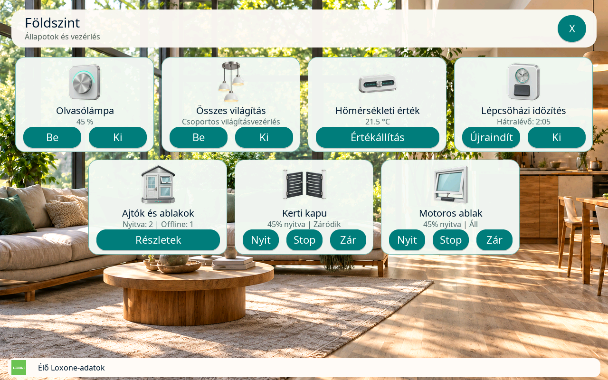
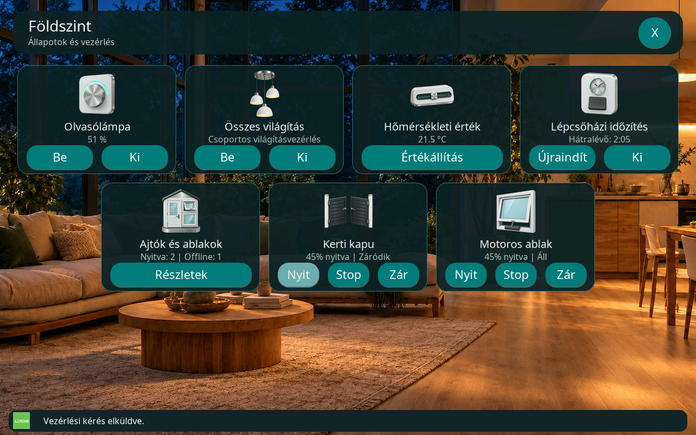
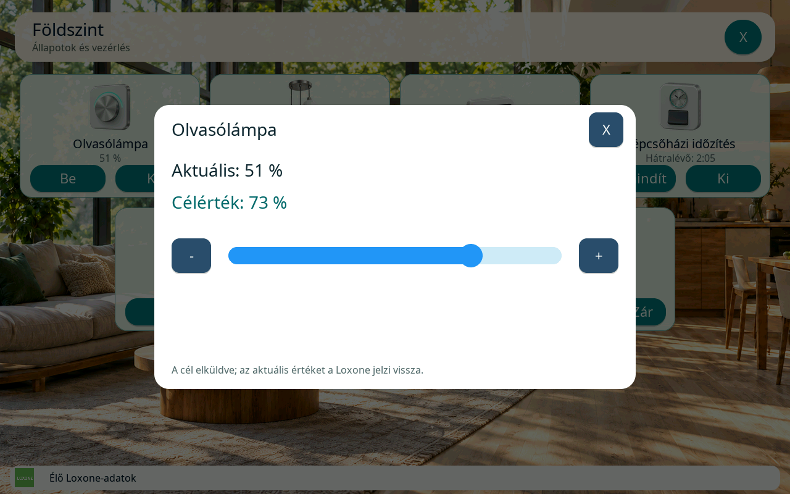
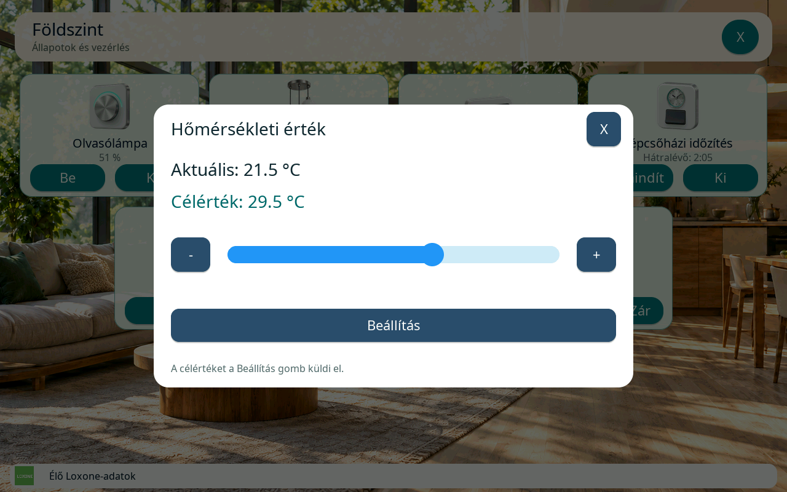
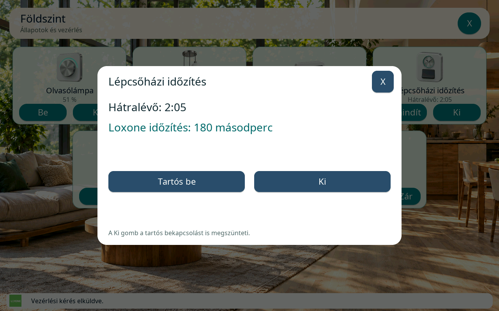
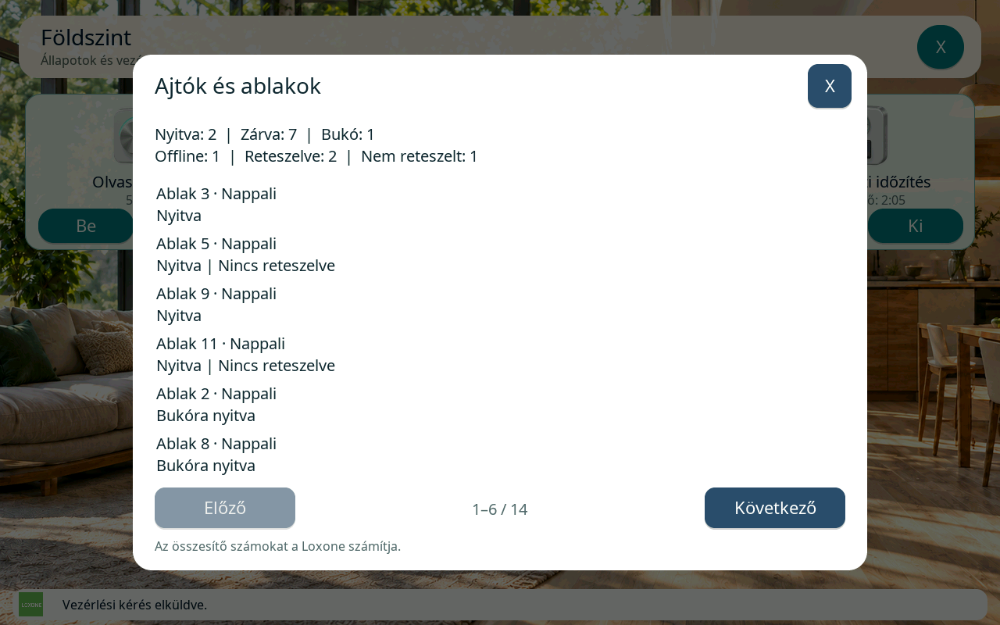
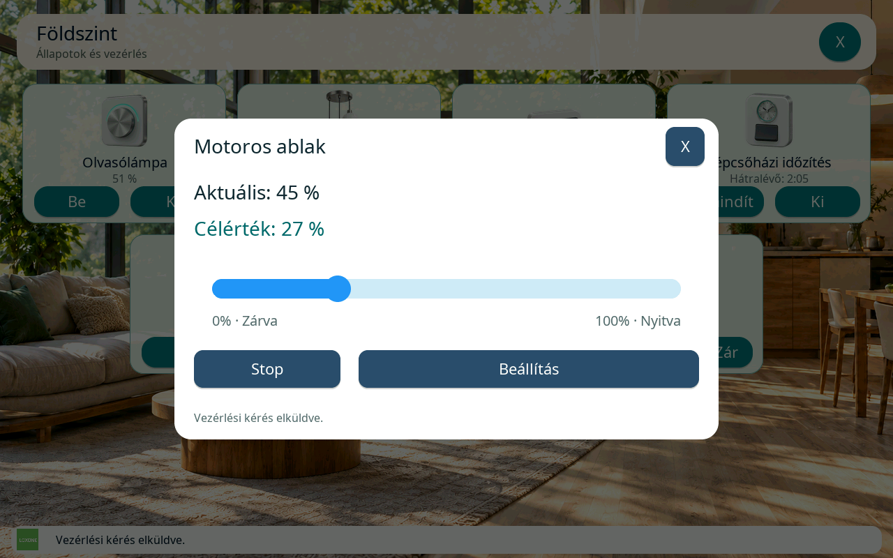

# További Loxone-kártyák az Otthon nézeten

[Dokumentáció](README.md) · [Funkciók és képmutató](features/README.md#otthon-kártyák-leírásai-és-képei)

Az Otthon nézet az önálló dimmert, a központi világítást, az analóg
értékállítót, a részletes időzített kapcsolót, az ajtó–ablak összesítőt,
a kaput és a motoros ablakot külön kártyatípusként kezeli. A korábbi
[világításvezérlő](lighting-controller.md), [IRC termosztát](irc-controller.md)
és [redőnyvezérlő](shading-controller.md) továbbra is használható ugyanazon
az oldalon.

A nyolcadik új típus, a modern `AudioZoneV2` lejátszó külön
[Audio-útmutatót és képgalériát](audio-controller.md) kapott.

## Elérhetőség

A hét kártya a **10.1-es Master közvetlen Loxone adatfogadási módjában**
használható. A 4B Slave, valamint a Master HTTP-, MQTT- és Slave-módja
nem indítja el ezeket a vezérlőket. A webes szerkesztőben a saját
Miniserverből beolvasott, megfelelő típusú szülőblokkot kell kiválasztani;
az állapot-UUID önmagában nem helyettesíti a vezérlőblokkot.

## Beállítás és ikoncsomag

Előbb az új firmware-t, utána a webes felületen a hozzá tartozó
**v4 `loxone-home.zip`** Otthon-erőforráscsomagot telepítsd.
A [frissítési és visszaállítási sorrend](v3-home-config.md#v4-otthon-erőforráscsomag-frissítése)
a régi csomagok kezelését is leírja. Az ikonok SD-kártyáról töltődnek be, a firmware
nem tartalmaz új beágyazott kártyaképeket. Az IRC és a redőny kötött képe
is ebbe a csomagba került.

A Loxone beállításaiban először válaszd ki a **Kártyatípus** mezőt, majd a
hozzá tartozó funkcióblokkot. A kártyanév külön megadható. A kártya bal
alsó **fel/le** gombjaival az adott oldalon módosítható a sorrend.
A mentett sorrend lesz a kijelző sorrendje is. A konfiguráció részletes
leírása a [v3 Otthon beállításainál](v3-home-config.md) található.

Az önálló dimmerhez, az értékállítóhoz és az időzített kapcsolóhoz másik
SD-ikon is választható. A központi világítás, az összesítő és a motoros
ablak kötött ikont kap; a kapu ikonja a Loxone blokk típusából következik.
Régebbi, érvényes csomagból hiányzó kép mellett a gombok működnek, a
részletes kezelők pedig látható **Részletek** gombbal is elérhetők.

## A hét kártya kezelése

| Kártyatípus | Az alap kártyán | Az ikon megérintése után |
| --- | --- | --- |
| **Önálló dimmer** | Tényleges fényerő, **Be**, **Ki** | Fényerőcsúszka és pontos **−/+**; közvetlenül küldi a kívánt értéket. |
| **Központi világítás** | **Be**, **Ki**, csoportos vezérlés felirat | Nincs külön kezelő. |
| **Analóg értékállító – Slider** | Tényleges érték és mértékegység, **Értékállítás** | A csúszka és a **−/+** csak célt választ; a **Beállítás** küldi el. |
| **Részletes időzített kapcsoló** | Időzítés/újraindítás vagy kikapcsolás a blokk módja szerint, külön **Ki** | Hátralévő idő, Loxone-időtartam, opcionális **Tartós be**, **Ki**. |
| **Ajtó–ablak összesítő** | Nyitott és offline elemek száma, **Részletek** | Összesített számok és lapozható állapotlista. |
| **Kapu / garázsajtó** | Nyitottság és mozgás, **Nyit**, **Stop**, **Zár** | Nincs részleges nyitási csúszka. |
| **Motoros ablak** | Nyitottság és mozgás, **Nyit**, **Stop**, **Zár** | Célpozíció, **Beállítás** és **Stop**. |

### Dimmer és analóg értékállító

#### Dimmer

A dimmer a Loxone által közölt minimumot, maximumot és lépésközt követi.
A csúszka melletti **−/+** gombok a következő érvényes lépést választják,
és ugyanúgy közvetlenül küldik az értéket. A tartomány végén a megfelelő
gomb letiltott; a kijelző nem lép a minimum alá vagy a maximum fölé.
A húzás közben érkező célok összevonódnak: a következő küldéshez mindig a
legfrissebb cél marad meg. A **Ki** törli a még várakozó fényerőkérést,
így egy korábbi húzás nem kapcsolhatja vissza később a lámpát.

#### Slider

A Slider a blokk beállított tartományát, lépésközét és formátumát használja.
A **−/+** gombokkal tört lépésköz mellett is pontosan állítható a cél.
A csúszka elengedése és a léptetőgombok megnyomása önmagában nem küld
parancsot; ehhez a **Beállítás** gombot kell megnyomni.
Mindkét kezelő külön mutatja a tényleges értéket és
a kiválasztott célt. A tényleges érték csak Loxone-visszajelzésre változik.

### Központi világítás

A központi világításnak nincs kitalált összesített „bekapcsolva” állapota.
A **Be** az `on`, a **Ki** a központi blokk `reset` parancsát küldi.
A fenti nappali oldalképen az **Összes világítás** kártya ezt a kezelőt
mutatja. A központi blokkhoz nincs külön részletes ablak vagy fényerőcsúszka.

### Részletes időzített kapcsoló

Az időtartamot a Loxone határozza meg. A kijelzőn nincs ettől független,
helyi időtartam-beállítás. Lépcsőházi módban a fő gomb az időzítést indítja
vagy újraindítja. Komfort módban a már működő időzítést kikapcsolja.
A **Ki** mindkét módban külön elérhető.

A **Tartós bekapcsolás engedélyezése** kártyabeállítás alapértelmezetten
aktív. Kikapcsolva a részletes ablakból eltűnik a **Tartós be** gomb, és a
kijelző ezt a parancsot nem engedi elküldeni. A **Ki** ekkor is működik,
akkor is, ha a blokkot korábban másik Loxone-kliens kapcsolta tartósan be.

A hátralévő idő a kapott `deactivationDelay` érték és a ténylegesen eltelt
idő alapján csökken. Ha a becsült idő elfogyott, de a kikapcsolási állapot
még nem érkezett meg, a felirat **Visszajelzésre vár**. A kijelző nem
jelenti ki önállóan, hogy a kapcsoló már kikapcsolt. A `-1` érték tartós
bekapcsolást, a `0` kikapcsolt állapotot jelent.

### Ajtó–ablak összesítő

Ez a kártya csak állapotot mutat. A részletes ablakban a nyitott, zárt,
bukóra nyitott, offline, reteszelt és nem reteszelt elemek száma látható.
Az összesített számokat a Loxone adja: a kijelző nem számolja hozzá még
egyszer a beágyazott összesítőket.

A lista oldalanként hat sort mutat, névvel és az elérhető helyiség-/hely-
információval. Egy sor egyszerre jelezheti a nyitási és a reteszelési
állapotot. A **Nem elérhető** az offline állapot, a **Nincs adat** pedig
hiányzó vagy érvénytelen részletállapot.

A megjelenítésben a **nyitott**, majd a **bukóra nyitott**, végül az
**offline vagy ismeretlen állapotú** elemek kerülnek a többi elé.
Az egyes csoportokon belül megmarad a Loxone eredeti sorrendje.
Állapotváltozáskor a megjelenítési sorrend frissül; a protokoll szerinti
sorindexek és az összesített számok nem változnak meg a rendezéstől.

Legfeljebb **256 részletsor** tárolható. Hosszabb listánál a kezelő jelzi a
korlátot; a Loxone által küldött összesített számok továbbra is a teljes
blokkra vonatkoznak.

### Kapu, garázsajtó és motoros ablak

A kapu a **Nyit / Stop / Zár** vezérlést adja. Ebben a változatban nincs
részleges vagy gyalogos nyitás. A Loxone külön nyitási és zárási tiltását
irányonként követi a felület. A **Stop** ezeknek az iránytiltásoknak a
hatására nem tűnik el, de a teljes blokkra érvényes jogosultsági vagy
biztonsági zárat ez sem kerüli meg.

A kapu ikonja automatikusan követi a struktúrafájl `details.animation`
értékét. Új struktúra betöltésekor a kijelző újra feloldja ezt a típust.

| Loxone típusérték | Megjelenített kapu | SD-ikonazonosító |
| --- | --- | --- |
| `0` | Garázskapu | `gate-garage` |
| `1` | Balra nyíló egyszárnyú kapu | `gate-left` |
| `2` | Jobbra nyíló egyszárnyú kapu | `gate-right` |
| `3` | Kétszárnyú kapu | `gate-double` |
| `4` | Balra tolódó kapu | `gate-slide-left` |
| `5` | Jobbra tolódó kapu | `gate-slide-right` |
| Ismeretlen vagy hiányzó | Semleges kapu | `gate` |

A motoros ablaknál a **0% teljesen zárt**, a **100% teljesen nyitott**.
Ez a [redőnyvezérlő](shading-controller.md) zártsági százalékának fordított
iránya. A csúszkával választott cél csak a **Beállítás** megnyomásakor
indít mozgatást. A célpozíció is követi az iránytiltásokat; részleges tiltás
és ismeretlen aktuális pozíció mellett nem indul bizonytalan irányú mozgás.

## Memória és láthatóság

A hét vezérlő részletes modellje csak a látható Otthon-oldalhoz él.
Lapváltás vagy bezárás azonnal felszabadítja a korábbi modell és az
ajtó–ablak lista dinamikus foglalásait, akkor is, ha egy korábbi parancs
nyugtájára még várunk. A Dimmer még összevont, el nem küldött célértéke
is megszűnik. A már elküldött parancs nyugtázása befejeződhet, de a régi
oldalról sorban maradt kérés nem küldhető el utólag.

A közös Miniserver-állapottár megmarad: ebből épül fel a következő
megnyitáskor az aktuális oldal, új teljes állapotfeliratkozás nélkül.
Ez korlátos közös szolgáltatásadat. Az oldal képeinek, az Audio-nak és a
statikus UI-pillanatképeknek a pontos élettartamát az
[Otthon memóriaszerződése](v3-home-config.md#mi-marad-meg-az-otthon-nézet-bezárása-után)
írja le.

## Visszajelzés és ellenőrzött működés

A parancs elfogadása még nem jelenti a mozgás vagy az értékbeállítás
befejezését. A kártyák a Loxone állapotait mutatják. Kapcsolatvesztés,
megváltozott konfiguráció vagy oldalváltás után a korábbi kezelő nem
küldhet tovább. A bizonytalanul visszaigazolt mozgatási parancsot a kliens
nem játssza le automatikusan újra.

A protokoll alapja a Loxone hivatalos
[Structure File 17.0 dokumentuma](https://www.loxone.com/enen/wp-content/uploads/sites/3/2026/04/1700_Structure-File.pdf).
A megvalósítást a modell-, állapotcache-, titkosított kliens- és valódi
LVGL-felületi tesztek ellenőrzik. A fenti képek a firmware LVGL-kódjából,
szimulált Loxone-adatokkal készültek; nem készülékfotók és nem élő
Miniserverrel végzett hardveres igazolások.

[A dokumentációs képek eredete és frissítése](images/controls/README.md).
