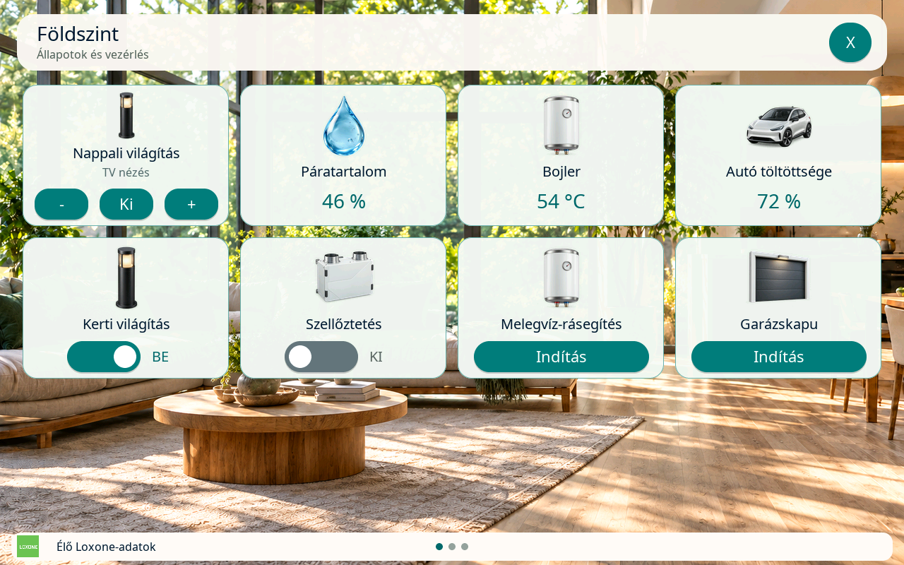
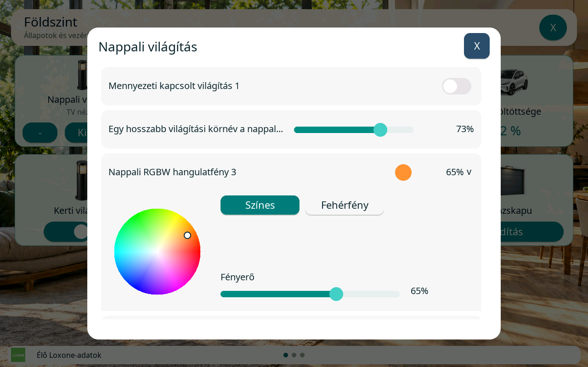

# Részletes funkció- és üzemmód-áttekintés

[Dokumentáció](README.md) · [Funkciók](features/README.md)

A fő README-ből ide áthelyezett részletes projektáttekintés. A beállítási
lépéseket a hivatkozott útmutatók tartalmazzák; a dátumhoz és verzióhoz kötött
bejegyzéseket az eredeti tartalommal őrizzük meg.

Otthoni energiaáramlás-kijelző a **Waveshare ESP32-P4-WIFI6-Touch-LCD-10.1 (SKU 33150)** panelhez. A 1280×800 fekvő LVGL felület a napelem, a ház, a hálózat és az akkumulátor pillanatnyi teljesítményét, energiaútjait és napi statisztikáit mutatja. A külön Slave firmware a **Waveshare ESP32-P4-WIFI6-Touch-LCD-4B (SKU 31416)** panelen fut, 720×720-as felbontással.

A firmware ESP-IDF 5.5.4 és LVGL 9.5.0 alapú. MQTT vagy HTTP POST fogadja a teljes mérési JSON-t öt másodpercenként; a közvetlen Loxone mód WebSocket-állapotokból állítja össze ugyanazt a mintát, a Slave pedig Bluetooth-on a mastertől kapja az élő adatokat és az időt. SD-s működésben FAT32 microSD tárolja a konfigurációt, tizenegy, módtól függően választható, szabadon sorbarendezhető sablont és 35 nap saját statisztikáját. A világos/sötét módot a `NightMode` adat vezérli; az OTA két alkalmazáspartícióval és visszaállítással működik.

A közvetlen Loxone mód beállítása és jelenlegi ellenőrzési korlátai: [Loxone adatkapcsolat](loxone-direct.md).

**Loxone világításvezérlő kártyák:** automatikusan felismert világítási blokkok,
kompakt `− / Ki / +` gombok, aktív világításikép-név és külön kapcsoló-, dimmer-,
RGB/RGBW-kezelő. Feldolgozott kártyamodell csak a megnyitott Otthon-oldalhoz
készül; a konfigurált kártyák utolsó nyers állapotait a kapcsolat idejére
megőrzi, így első megnyitáskor sem kell telefonról változtatni a világítást.
A részletes, görgethető ablak egyetlen színválasztót és legfeljebb nyolc élő
körsort tart memóriában. [Beállítás, működés és készülékes visszaellenőrzés](lighting-controller.md).

| Világításvezérlő Otthon-kártya | RGB/RGBW-kezelő |
| --- | --- |
|  |  |

A képek a tényleges LVGL-felület szintetikus adatokkal készült, statikus
előnézetei, nem készülékfotók. [Mind az öt előnézet, éjszakai és fehérfény-kezeléssel](lighting-controller.md#statikus-előnézetek).

Az Otthon-felület azóta [IRC termosztáttal](irc-controller.md),
[automatikus és központi árnyékolással](shading-controller.md), valamint
[hét további kártyatípussal](loxone-home-controls.md) bővült: önálló dimmer,
központi világítás, Slider, időzített kapcsoló, ajtó–ablak összesítő,
kapu/garázsajtó és motoros ablak. A modern
[AudioZoneV2 lejátszó](audio-controller.md) borítót, hangerőállítást és
lapozható kedvenceket ad. Az összes típus leírása és valódi felületi képe
a [kártyánkénti képmutatóban](features/README.md#otthon-kártyák-leírásai-és-képei)
érhető el. Ezek a vezérlők a 10.1-es Master közvetlen Loxone módjához
tartoznak; a képeket a közös v4 SD-csomag szolgáltatja.

Az Otthon-szerkesztőben az oldalak külön fülön választhatók, a kártyák
fel/le gombokkal rendezhetők. Fülváltás és rendezés megtartja a mentetlen
mezőket; az Otthon mentés gombja az összes oldalt menti.
[Szerkesztés és frissítési sorrend](v3-home-config.md#otthon-oldalak-fülei).

Loxone módban opcionális [relatív páratartalom](relative-humidity.md) párosítható,
szorzóval és eltolással, egész százalékként. A szélsebességes témákon és a Slave-eken
ikonnal jelenik meg; párosítás/érvényes adat nélkül rejtett. A Nap pálya igazított
időjárási és akkumulátorértékeket kapott.

Opcionális **Bluetooth adat seed**: a Beállításokban bekapcsolható master mód
`ZoleeEnergy` néven, párosítás nélkül, csak olvasható energia- és időjárásadatokkal.
Beállítások, protokoll és a C6 firmware követelményei: [BLE adatmegosztás](ble-data-seed.md).

**SD nélküli Slave** is használható: új eszköz automatikus Slave indulással,
belső NVS-beállításokkal és kizárólag a beépített Rendszer témával. A napi
diagramokat és összehasonlításokat hitelesített BLE-kapcsolaton a mastertől
kapja; nincs szükség hálózati fájlmegosztásra vagy flashbe írt statisztikára.
A korábban fő kijelzőként használt eszköz SD-hibája nem vált automatikusan Slave-re.
**SD-kártyával a Slave az adott módban elérhető telepített témákat használhatja,
és saját statisztikát gyűjt a fogadott élő mintákból.** Az Elektromos autó téma
kizárólag közvetlen Loxone módban választható. A master korábbi történetét nem másolja át.

Az új **Slave (Bluetooth)** adatfogadási mód automatikusan mastert keres,
és onnan kapja az energiaadatokat és az időszinkront, Wi-Fi/NTP-beállítás nélkül is.
A slave az első csatlakozáskor érintős PIN-padot mutat, majd titkosítva átveszi
a master Wi-Fi-jét és automatikusfrissítés-kapcsolóját. A kétoszlopos diagnosztika
a BT-szerepet, címeket, kapcsolatot, jelerősséget, masterként a kapcsolódó slave-ek
számát és a párosítási PIN-t is mutatja. Új párosítás kétperces ablaka itt nyitható meg.

Az üzemállapotok között az **5: Hálózat újra elérhető** is támogatott minden témában; a Nap pálya v21 nappal és éjjel nagyobb, zöld felirattal, kontrasztos buborékban, a Rendszer téma új hálózati ikonnal jelzi. Normál üzemben a Nap pálya státuszbuborékja rejtett. [Státuszok, frissítés és adatprotokoll](mqtt.md#status).

## Funkciók és üzemmódok

- **Energiaáramlás és statisztika:** élő teljesítmények, animált energiautak, napi/heti/havi adatok, pénzügyi mutatók és akkumulátordiagnosztika.
- **Adatfogadás:** MQTT, HTTP POST, közvetlen Loxone vagy Bluetooth Slave; világos/sötét megjelenés a `NightMode` szerint.
- **Loxone Otthon:** külön mért fogyasztók, lapozható kapcsoló-, nyomógomb-, szenzor-, állapot- és világításvezérlő-kártyák, energiaasszisztens, jelenlét és postaláda-jelzés. Rövid, legfeljebb 10 másodperces adatkapcsolati kimaradáskor a már megjelenített energianézet/Otthon-oldal figyelmeztetés nélkül, változatlan adatokkal marad látható; a vezérlés ilyenkor nem aktív. [Loxone kapcsolat és türelmi idő](loxone-direct.md#kapcsolat-és-hibák).
- **Elektromos autó:** nappali/éjszakai házjelenet, összegzett töltési teljesítmény, mai töltési energia és becsült közvetlen napelemes arány. Töltő konfigurálása nélkül is választható, rejtett autós adatokkal. [Beállítás](electric-car.md).
- **Kaputelefon:** MJPEG-kép, kétirányú hang, kapunyitás, csengőhangok és párosított 4B kijelzők központi híváskezelése. Csengetés után a médiafeladatok leállása megelőzi a háttértéma visszatöltését; elhúzódó betöltésnél korlátozott újrapróbálás és biztonságos tartalék nézet áll rendelkezésre. [Kaputelefon útmutató](intercom.md) · [Helyreállítás és korlátok](intercom.md#kaputelefon-utáni-témahelyreállítás).
- **Karbantartás:** webes konfiguráció, mentés/visszaállítás, OTA, gyári témák GitHub-frissítése és részletes diagnosztika.

## Loxone Otthon kaputelefon-kijelzőként

Az alapból kikapcsolt **Energiaáramlás tiltás** csak Loxone módban engedélyezhető.
Ilyenkor az Otthon-kártyák maradnak elérhetők, az Adatpárosítás csak NightMode-ot
kínál; a korábbi energia-beállítások megmaradnak. Csempék nélkül fekete logós
nézet és fix 10% fényerő működik; a kaputelefon nappali/éjszakai fényerővel nyílik,
bezárásakor visszatér a logó és 10%. A Slave-ek szintén logós nézetet mutatnak.
A fogyasztók, Otthon-kártyák és kaputelefon külön menthetők.
[Részletek és Master/Slave-frissítés](energy-flow-disable.md).
