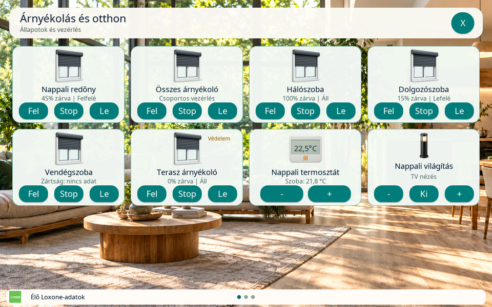
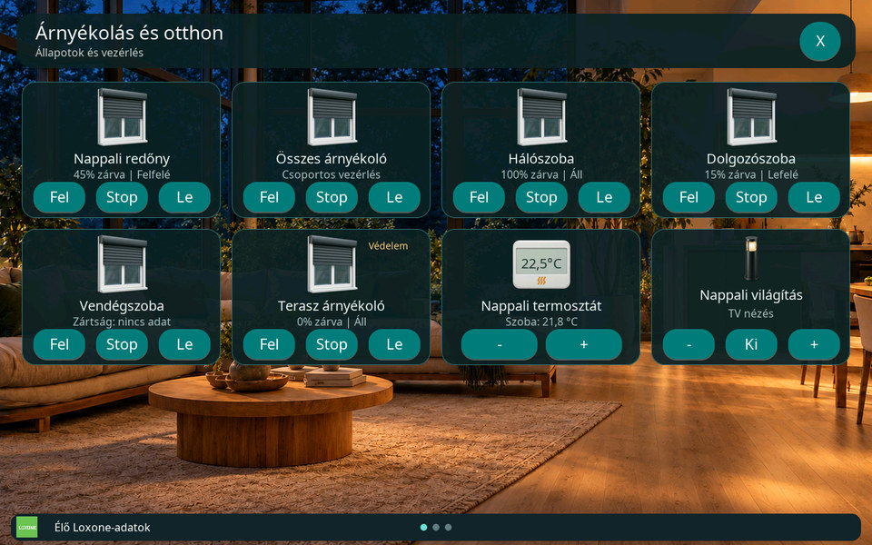
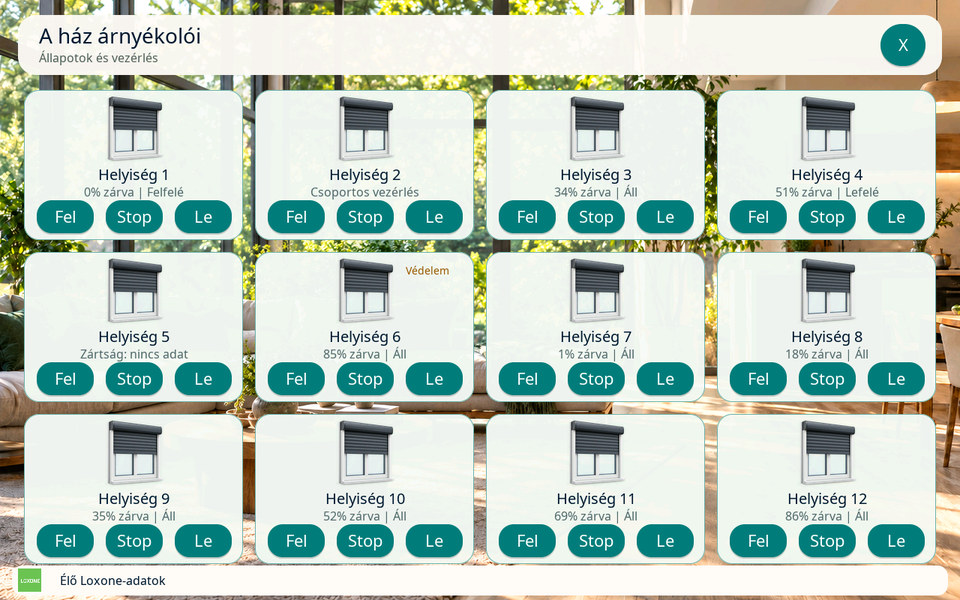
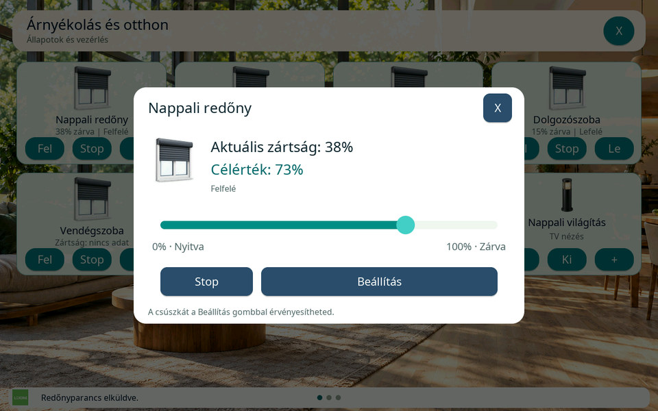

# Loxone redőnyvezérlő Otthon-kártyák

[Funkciók és vezérlés](features/README.md) · [Otthon-konfiguráció](v3-home-config.md)

## Elérhetőség és beállítás

A **Redőnyvezérlő** kártya a Master 10.1 kijelző közvetlen Loxone
üzemmódjában, az Otthon-oldalakon használható. Két Loxone-blokkot kezel:

| Loxone-blokk | Felismert típus | Kezelés a kijelzőn |
| --- | --- | --- |
| Automatikus árnyékolás | `Jalousie`, `details.isAutomatic: true` | Fel / Stop / Le, visszajelzett pozíció és külön százalékos beállítóablak. |
| Központi árnyékolás | `CentralJalousie` | Fel / Stop / Le az összerendelt árnyékolókhoz. |

A hagyományos, nem automatikus `Jalousie` blokk nem szerepel a választható
redőnyvezérlők között. A Waveshare 4B Slave nem kap Otthon-kártyát vagy új
Bluetooth-vezérlést.

1. A kijelző `/loxone` weboldalán kérd le a Loxone adatlistáját.
2. Az Otthon-kártyák között válaszd ki a szerkesztendő oldalt, adj hozzá egy
   kártyát, majd válaszd a **Redőnyvezérlő** típust.
3. A **Loxone automatikus vagy központi árnyékolás blokk** mezőben válaszd
   ki a megfelelő szülőblokkot, majd szükség esetén írd át a megjelenítési nevet. Egy blokk csak egyszer
   szerepel a listában; külön pozíció- vagy mozgásállapotot nem kell párosítani.
4. Mentsd az Otthon-oldalakat. A kártya a Miniserver visszajelzéseit mutatja.

A helyiség- és funkciószűrő a redőnylistára is érvényes. A már párosított,
szűrőn kívüli vagy pillanatnyilag hiányzó blokk azonosítója megmarad a
szerkesztőben, így egy szűrőváltás nem törli a beállítást.

A redőnyikon **rögzített**: ennél a típusnál nincs ikonválasztó, skálázás,
egyéni mértékegység, tizedesjegy- vagy figyelmeztetésbeállítás. A natív
96×96-os kép a **v4 `loxone-home.zip` SD-erőforráscsomag része**; a webes
előnézet is onnan érkezik. A korábban jóváhagyott kép és a mentett
`blinds-shading` azonosító megmarad, a kép nem kerül a firmware-be.

Először az új firmware-t, utána a v4 Otthon-csomagot telepítsd. Korábbi,
érvényes v1–v3 csomagnál a kijelző a bájtazonos régi `blinds` képet használhatja;
a webes szerkesztő az új előnézethez csomagfrissítést jelez. A csomagban
szereplő, de hiányzó/sérült fájl továbbra is hiba. Az Otthon-oldalhoz működő
SD és közös csomag szükséges, a háttér és a logó is onnan érkezik.
[Telepítési és visszaállítási sorrend](../assets/loxone-home/README.md#telepítés-és-visszaállítás).
A weboldal a konfigurációt szerkeszti; a kézi redőnyműveletek a kijelzőn érhetők el.

## A kártya kezelése

A kártya a meglévő, **292×200 képpontos** elrendezésbe illeszkedik; egy
Otthon-oldalon legfeljebb **12 kártya** lehet. A név, a fix redőnyikon és a
visszajelzések mellett három vezérlőgomb jelenik meg:

| Gomb | Művelet |
| --- | --- |
| **Fel** | Teljes felhúzás. |
| **Stop** | A mozgás megállítása. |
| **Le** | Teljes leengedés. |

A központi kártyán a parancs a kiválasztott központi Loxone-blokkhoz megy;
az érintett árnyékolókat és azok viselkedését a Loxone-konfiguráció
határozza meg. A központi blokk nem szolgáltat dokumentált, közös
százalékos pozíciót vagy egyetlen összesített mozgásirányt, ezért a kártya
nem képez átlagot az alárendelt redőnyökből. A központi ikon nem nyit
százalékos állítóablakot.

Az egyedi automatikus árnyékolás pozíciója és mozgásiránya a Miniserver
állapotadataiból származik. **0% = teljesen felhúzva, 100% = teljesen
leengedve.** Hiányzó vagy érvénytelen pozícióból nem keletkezik 0%-os
érték. A kártya nem számol saját futásidőt, és nem becsli meg a mozgást a
gombnyomás óta eltelt időből.

## Százalékos beállítás külön ablakban

Egy egyedi **Automatikus árnyékolás** kártyán érintsd meg a redőnyikont.
A felugró ablakban a pozíció **0–100% között, 1%-os lépésekben** állítható.
A csúszka mozgatása a kiválasztott célértéket változtatja; a célpozíció
csak a **Beállítás** gomb megérintésekor megy a Loxone felé. Az ablak
**Stop** gombja közvetlenül megállítást kér. Az ablak bezárása önmagában
nem küld kérést.

Az ablakhoz élő kapcsolat, vezérelhető blokk és érvényes visszajelzett
pozíció szükséges. Ha nyitott ablaknál zárolás érkezik, a vezérlés
letiltódik. Kapcsolat-, oldal- vagy profilváltás, illetve érvénytelenné
váló pozíció bezárja az ablakot.

A kiválasztott százalék a kívánt célpozíció. A kártyán megjelenő tényleges
pozíció kizárólag a Miniserver visszajelzésére változik; a parancs nyugtája
nem jelenti a mozgás befejezését. A Loxone saját futásidő-, végállás- és
motorvezérlési beállításai érvényesülnek.

## Statikus előnézetek

A képek a firmware tényleges LVGL-felületének RGB565 tesztrenderéből
készültek, szintetikus Loxone-adatokkal, 960×600-as JPEG formátumban.
A nappali és éjszakai vegyes oldalon hat redőny-, egy IRC- és egy
világításkártya látható.

| Nappali megjelenés | Éjszakai megjelenés |
| --- | --- |
|  |  |

Teljes oldal tizenkét redőnykártyával, köztük központi vezérlővel:



Az egyedi felugró ablak külön mutatja a visszajelzett zártságot és a
csúszkával kiválasztott célértéket:



[Képek eredete és frissítése](images/shading/README.md).

## Kézi vezérlés és automatika

A kártyán és a felugró ablakban **nincs Auto gomb**. Nem küldünk
automatika-újraindítást, árnyékolási módot vagy saját időzített
visszaállítást. A kézi felhúzás, leengedés, megállítás és pozícióállítás
hatással lehet a Loxone automatikus árnyékolására. Az automatika folytatását
a blokk beállításai és a Loxone-ban kialakított vezérlés határozzák meg.

A központi **Fel** vagy **Le** újbóli megérintése ismét ugyanazt az irányt
kéri. Megállításhoz a külön **Stop** gombot használd; a központi blokk
nem a második azonos irányú parancsból következtet a megállításra.

A gyártói működés részletei: [Automatic Blinds](https://www.loxone.com/enen/kb/automatic-blinds/)
és [Automatic Shading Central](https://www.loxone.com/enus/kb/automatic-shading-central/).

## Hiányzó adatok és tiltott vezérlés

| Jelenség | Mit ellenőrizz? |
| --- | --- |
| A kívánt blokk nincs a listában | Frissítsd az adatlistát; ellenőrizd a helyiség-/funkciószűrőt, a felhasználó hozzáférését és a támogatott blokktípust. Egyedi blokknál automatikus árnyékolás szükséges. |
| Az egyedi pozíció nem ismert | Várd meg a pozíció-visszajelzést, és ellenőrizd az élő kapcsolatot. Érvénytelen adat felülírja a korábbi pozíció érvényességét. |
| A gombok tiltottak | Ellenőrizd az élő kapcsolatot, a blokk zárolását, a csak olvasható vagy védett hozzáférést, az offline eszközállapotot és a folyamatban lévő parancsot. |
| Nem nyílik százalékos ablak | A központi kártyához nincs ilyen művelet. Egyedi kártyán ellenőrizd az állapotadatokat és a vezérlési feltételeket. |
| Biztonsági állapot látható | A `safetyActive` visszajelzés tájékoztatás. A ténylegesen engedett mozgást a Loxone blokkja és a külön zárolási állapotok határozzák meg. |
| Az ikon hiányzik vagy az Otthon-oldal nem nyitható | Ellenőrizd az SD-t és az Otthon-erőforráscsomagot. Az új webes előnézethez v4 csomag kell; a régi `blinds` kép csak a kijelző kompatibilitási tartaléka. |

A `locked` és `jLocked` állapot, a `read-only` korlátozás, a védett
hozzáférés és az offline eszközállapot megakadályozhatja a vezérlést.
Ha a blokk zárolásállapotot hirdet, a szükséges kezdőadatnak meg kell
érkeznie. A `jLocked` beérkezett üres szövege ismert, feloldott állapot;
a még nem kapott vagy hibás zárolásadat nem az.

A **`safetyActive` önmagában nem általános vezérlési tiltás**. A gyártó
[Automatikus árnyékolás útmutatója](https://www.loxone.com/enen/kb/automatic-blinds/)
bizonyos biztonsági helyzetekben enged kézi működtetést az App/Web felől.
A kijelző nem próbálja megkerülni a Miniserver zárolásait, és nem írja
felül a blokk biztonsági működését.

Kapcsolatvesztéskor, profilmentéskor és lapváltáskor a már elavult vagy
érvénytelenített sorban álló parancs nem hajtható végre. A kártya
**Fel / Stop / Le** gombjai és a felugró ablak **Stop** gombja is a kártya
profilrevíziójához kötött: mentés után egy korábbi érintés nem kerülhet az
új profil parancscéljához. A százalékos kérés ugyanezt a profilvédelmet
használja. Újracsatlakozáskor a szükséges állapotoknak újra meg kell
érkezniük. Nyugtahiány esetén a kijelző nem ismétli meg automatikusan a
műveletet: a tényleges állapotot a Loxone visszajelzéséből kell ellenőrizni.

## Konfiguráció és protokoll

A schema 2 profilban mindkét blokkhoz a `shading` kártyatípus tartozik.
Az `icon` mindig **`blinds-shading`**. A `control_uuid` a kiválasztott
szülőblokk stabil azonosítója; az aktuális parancscímet a friss katalógus
`action_uuid` mezője adja.

```json
{
  "id": "living-blinds",
  "name": "Nappali redőny",
  "type": "shading",
  "icon": "blinds-shading",
  "control_uuid": "40000000-0000-0000-0000000000000001"
}
```

Az UUID szemléltető. A mentett mezők: `id`, `name`, `type`, `icon`,
`control_uuid`. Nincs külön `source`, szorzó, eltolás vagy általános
értékformázás. Hiányzó, eltérő vagy hibás importált ikon esetén a parser,
a szerializáló és a webes szerkesztő is a rögzített ikonazonosítót állítja
elő, a rejtett oldalak kártyáinál is. Általános kártyatípusra váltva
ismét elérhető az ikonválasztó; az össze nem illő vezérlőpárosítás törlődik.

A katalógus csak támogatott árnyékolási szülőbejegyzéshez csatol nem üres
`shading` JSON-szöveget, valamint `shading_blocked` és `shading_central`
jelzést. A szerkesztő ezt a metaadatot és a blokk típusát együtt vizsgálja.
A modell a rendelkezésre álló `position`, `up`, `down`, `locked`,
`safetyActive`, `deviceState` és `jLocked` állapotot dolgozza fel.
A metaadatban ezek kulcsai `position`, `up`, `down`, `locked`, `safety`,
`device` és `lock`; az utóbbi a `jLocked` állapot UUID-ja.

| Művelet | Parancsvég | Támogatás |
| --- | --- | --- |
| Fel | `FullUp` | Egyedi és központi blokk. |
| Stop | `stop` | Egyedi és központi blokk. |
| Le | `FullDown` | Egyedi és központi blokk. |
| Százalék beállítása | `manualPosition/<0..100>` | Csak az egyedi automatikus blokk. |

A teljes parancs alakja `jdev/sps/io/<action_uuid>/<parancsvég>`, a
parancsnevek kis- és nagybetűi lényegesek. A `position` állapot nyers
tartománya **0..1**, ezt a megjelenítés **0..100%** tartományra alakítja.
A `manualPosition` parancs már százalékot vár. A központi blokk nem kap
`manualPosition` parancsot, Auto-, árnyékolásmód- vagy lamellaszög-vezérlés
nem tartozik ehhez a kártyához.

A protokoll elsődleges forrása a Loxone
[Structure File dokumentációja](https://www.loxone.com/enen/wp-content/uploads/sites/3/2026/04/1700_Structure-File.pdf):
`CentralJalousie` a 42–43., `Jalousie` a 87–89. oldalon; a hozzáférési
korlátozások és a `jLocked` leírása a 15–17. oldalon található.

## Memória és láthatóság

A redőnyvezérlés a meglévő Loxone-workerhez és az egyetlen WebSocket
állapotfolyamhoz csatlakozik. Nem kap új háttérfeladatot, feladatvermet
vagy külön lekérdezési ciklust. Blokkmodell csak a látható Otthon-oldalhoz
él; ugyanarra a blokkra mutató, azonos oldali kártyák közös modellt
használnak. Az LVGL-feliratok és állapotjelzések csak változáskor frissülnek.

A [közös nyers állapottár](lighting-controller.md#memória-és-láthatóság)
a konfigurált redőnyök állapotait rejtett oldalnál is megőrzi. Lapnyitáskor
ebből épül fel a látható modell, új állapotfeliratkozás nélkül. A rejtett
oldalnak nincs saját blokkmodellje vagy LVGL-frissítése, és az állapottár
nem tárol parancsot. A közös tár továbbra is legfeljebb **512 UUID** és
összesen **64 KiB szöveg** keretével működik; a blokkonkénti állapotadatok
nem hoznak létre párhuzamos, teljes másolatot. A modellek és a nyers tár
PSRAM-ból foglalódnak, belső/DMA-heapre visszaesés nélkül.

A redőnyikon **96×96 RGBA PNG, 11 648 bájt**. Egy aktív oldalon az összes
redőnykártya egyetlen dekódolt ARGB8888-képet használ, amelynek tartós
képpontpuffere **36 864 bájt**. Ez nem kártyánkénti költség. Redőny nélküli
oldalhoz nem készül ilyen puffer; lapváltáskor és bezáráskor felszabadul.
Ez a méret csak a képpontadaté, nem tartalmazza a UI-objektumokat vagy a
dekódolás átmeneti memóriaigényét. [Az ikon forrása és előállítása](assets.md#redőnyikon).

## Fejlesztői ellenőrzés

A repó gyökeréből:

```sh
python3 tests/test_shading.py
python3 tests/test_loxone_protocol.py
node tests/test_loxone_home_web.js
node tests/test_shading_browser.js
python3 tests/test_web_preview.py
python3 tools/prepare_web.py --check
python3 tests/test_documentation.py
```

A böngészőpróbához Playwright és Chromium szükséges. A teszt a tényleges,
C-headerbe ágyazott weboldalt és az SD-katalógus PNG-jét használja 390 és 1280
képpontos nézetben. A HTTP-válaszokat szintetikus tesztadatok adják.
Ellenőrzi a támogatott blokkok szűrését, a v4 SD-csomag fix ikonját,
a hibás és rejtett oldali importált mezők normalizálását, a mentés mezőit,
valamint az IRC és az általános kártyatípusok közötti váltásokat. A HTTP
teszt a rögzített SD-ikonokhoz is megköveteli a webes hitelesítést;
csomag nélkül 404 választ, telepítés után a tényleges PNG-bájtokat várja.

A modellteszt az automatikus/központi blokkok felismerését, a natív
parancsokat, a pozíciót és a vezérlési tiltásokat ellenőrzi, ASan/UBSan
és `-O0`/`-O2` melletti veremkeret-ellenőrzéssel. A közös protokollteszt
vizsgálja az állapotfolyam és a függő parancsok kezelését.

A `tests/preview` natív LVGL-próbáját a `ZOLEE_SHADING_ONLY=1` kapcsoló
indítja; a panelnek megfelelő RGB565 renderút a `ZOLEE_PREVIEW_RGB565=1`
beállítással választható. A próba forrása `tests/preview/shading_test.inc`.

A host tesztek és szintetikus renderelések nem helyettesítik a Master és
4B firmware fordítását, a saját Miniserverrel végzett parancspróbát vagy
a fizikai panel működési és terhelési vizsgálatát. Az aktuális CI-eredményt
az adott forrásváltozat ellenőrzései mutatják; ez az útmutató nem rögzít
készülékes elfogadást.
