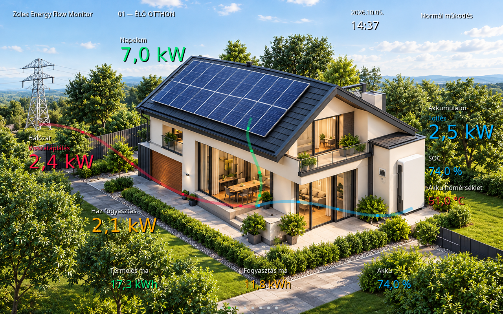
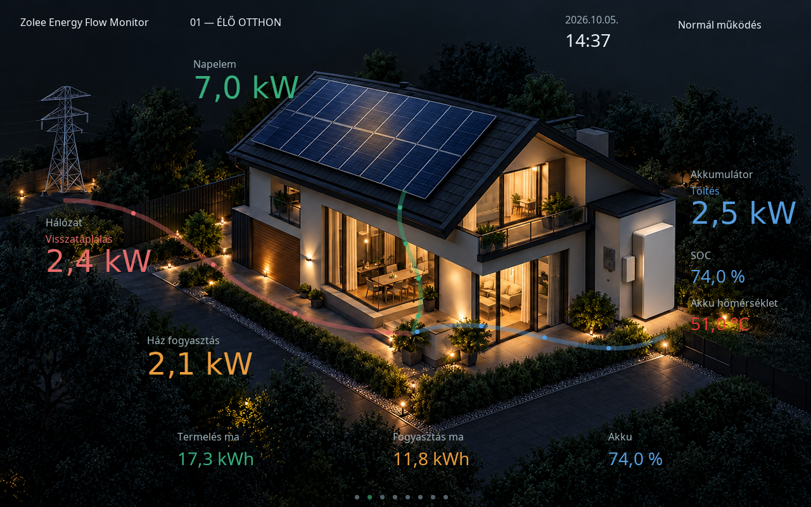
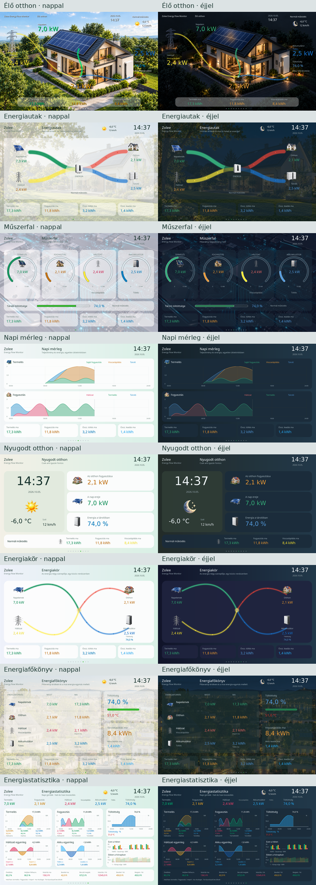
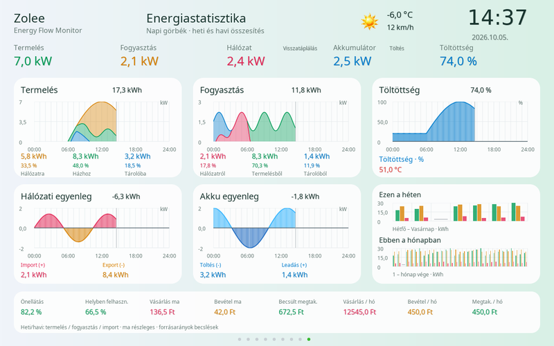
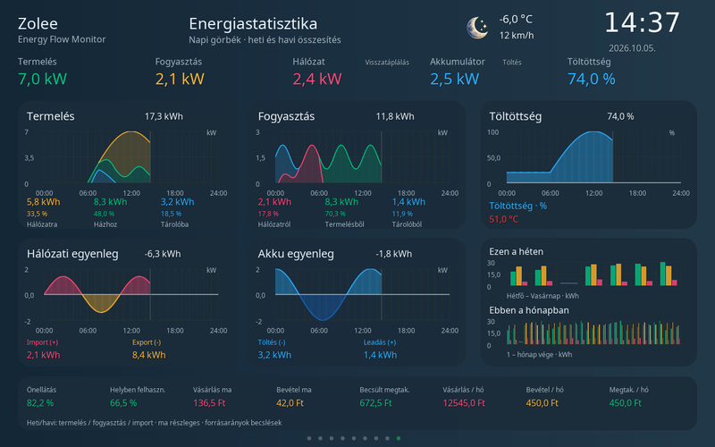

# SD-kártyás sablonok

Az eredeti nézet a firmware része, mindig elérhető. A nyolc választható elrendezés a repository
`templates/` könyvtárában van, mindegyik saját világos és sötét témával.

| Csomag | Nézet |
|---|---|
| `01-live-home` | Élő otthon: nappali zöld kert / esti ház, élő energiautakkal |
| `02-energy-paths` | Energiautak: széles színes összeköttetések, irányjelző pöttyök |
| `03-instruments` | Műszerfal: négy teljesítménymérő, töltöttségjelző |
| `04-daily-balance` | Napi mérleg: két nagy, háromrétegű napi diagram |
| `05-calm-home` | Nyugodt otthon: nagy óra, saját kerámia időjárásikonok, három fő adat |
| `06-energy-orbit` | Energiakör: négy szereplő íves összeköttetésekkel, középen SOC |
| `07-energy-ledger` | Energiafőkönyv: most/ma táblázat, tároló és export összesítők |
| `08-statistics` | Energiastatisztika: öt napi grafikon, heti/havi oszlopok, élő számok és pénzügyek |

## Használat

Másold a repository `templates` mappáját az SD gyökerébe. Példa:
`/templates/01-live-home/template.json`. A USB-telepítő ZIP `sd-card/templates`
mappája ugyanezt tartalmazza; ezt az SD gyökerébe kell másolni, nem a firmware-frissítőbe feltölteni.
Közvetlen kártyamásolás után indítsd újra az eszközt.

A kijelzőn balra húzás a következő, jobbra húzás az előző elrendezésre lép.
A lista körbeér; a beépített nézet az első. Nincs időzített vagy automatikus
elrendezésváltás. A választás a `/templates/selection.txt` fájlba kerül,
ideiglenes fájllal és biztonsági másolattal. Hiányzó/sérült kiválasztott csomagnál
a beépített nézet jelenik meg. SD-íráshiba esetén az aktuális munkamenetben a
választás működik, de az újraindítás utáni megőrzés nem garantálható.

A `NightMode` adatmező választja a `light`/`dark` témát. Lapozás ezt nem módosítja.
A Wi-Fi/MQTT/adathiány/indítás/végzetes hiba oldalak közösek. Helyreálláskor az
aktuális elrendezés az adatcsomag szerinti témával tér vissza. A sablonok a
közös SD-hibajelzést is megkapják. Minden adat a meglévő fogadási/statisztikai
útvonalból jön, a sablon nem fogad külön csomagokat és nem számol külön előzményt.

## Webes kezelés

Nyisd meg: `http://zolee-energy-flow-display.local/templates`
(vagy az eszköz IP-címe után `/templates`). A főoldalon is van hivatkozás.

- ZIP feltöltése: kibontás elkülönített `.install` könyvtárba, ellenőrzés, majd
  siker esetén átnevezés a végleges csomagkönyvtárra. Hibás csomag nem aktiválódik.
- Aktiválás: a kijelző következő frissítésekor betöltődik. A feltöltés önmagában
  nem változtatja meg a kiválasztott sablont.
- Törlés: az aktív sablon törlése visszalép az alapnézetre. A beépített nézet nem
  törölhető. Meglévő csomagazonosító nem írható felül; előbb töröld a régi csomagot.

A hitelesítés az OTA-felületével azonos (`ota.username`/`ota.password`);
üres felhasználónév esetén az eddigi OTA-szabály szerint nincs bejelentkezés.
Ez nem érinti a hitelesítés nélküli HTTP energiaadat-fogadást.
A módosító webkérések `X-Zolee-Template: 1` fejlécet igényelnek; a weboldal hozzáadja.

Telepíthető ZIP-ek készítése: `python tools/prepare_templates.py`.
Eredmény: `dist/templates/*.zip`; a CI `template-packages-…` artifactja is ezeket
tartalmazza. Mindegyik ZIP külön tölthető fel. A ZIP gyökerében a `template.json`
és a PNG-k legyenek, külső csomagkönyvtár vagy alkönyvtár nélkül.

## Leírófájl, 1. séma

```json
{
  "schema": 1,
  "id": "my-layout",
  "name": "Saját elrendezés",
  "version": 1,
  "light": {
    "background": "#F0F5F3",
    "elements": [
      {"type":"value","source":"pv","x":40,"y":40,"w":300,"h":60,"font":48,"color":"#36AE7C"}
    ]
  },
  "dark": {
    "background": "#111F2C",
    "elements": [
      {"type":"value","source":"pv","x":40,"y":40,"w":300,"h":60,"font":48,"color":"#36AE7C"}
    ]
  }
}
```

A koordinátarendszer 1280×800. Az `elements` sorrendje a rajzolási sorrend:
későbbi elem felülre kerül. Minden elemhez kötelező `x`, `y`, `w`, `h`;
az elem határa nem nyúlhat a kijelzőn kívülre. Az alsó 28 px-et célszerű a
közös lapjelzőnek/SD-hibajelzésnek szabadon hagyni.

| `type` | Tartalom, további mezők |
|---|---|
| `box` | Kártya/háttér: `background`, `radius`, `opacity` |
| `label` | Szöveg: `text`, opcionális `text_en`, `font`, `color`, `align` |
| `value` | Élő adat: `source`, `font`, `color`, `align` |
| `image` | Csomagon belüli PNG: `file`; a képet a `w`/`h` méretre skálázza |
| `weather` | Közös időjáráslogika, opcionális saját `files` készlet: `sunny`, `partly_cloudy`, `cloudy`, `rain`, `snow`, `night` |
| `bar` | `source`, `max` (alapérték 100), `color`, `background`; `soc` esetén a közös töltöttségszínek |
| `gauge` | Köríves mérő: `source`, `max` (alapérték 15), `color`, `background` |
| `flow` | `source`, `color`, `radius` (vonalvastagság), relatív `{x,y}` pontok: alapból 2–8 pontos `polyline`; `curve: "bezier"` esetén 4 vagy 7 vezérlőpont |
| `chart` | `kind`: `production` vagy `consumption`; minimum 150×100 |

Színek: `#RRGGBB`. Átlátszóság: 0–255. Betűméretek: 12, 16, 20, 28;
48 és 96 csak numerikus élő adathoz, órához/dátumhoz. Ezek számjegyeket és
a használt mértékegységeket tartalmazó betűkészletek. `align`: `left` vagy `center`.
A szöveges címkék HU/EN karakterkészletet használnak. A `text_en` hiányában a
`text` jelenik meg angol nyelvi beállításnál is.

Adatkapcsolatok:

- `pv`, `home`, `grid`, `battery`: pillanatnyi kW, a kijelzés abszolút értékű,
  0,1 kW alatt W-ra vált. A flow előjeles adatot használ: a pontlista iránya a
  pozitív irány; hálózatnál vételezés, akkumulátornál kisütés. Negatív értéknél
  megfordulnak a pöttyök. Nulla körül eltűnnek; 7 kW-nál érik el a maximális sebességet.
- `soc`, `battery_temp`, `temperature`, `wind`, `clock`, `date`, `status`,
  `grid_direction`, `battery_direction`.
- `production_today`, `consumption_today`, `import_today`, `export_today`,
  `charge_today`, `discharge_today`: a közös napi kWh-összesítések.
- `pv_home`, `pv_export`, `pv_stored`: a közös energiaelosztási modell kW értékei.

A diagramok a tényleges 5 perces adatsorokat és az eredeti háromrétegű rajzolót
használják. Termelés: saját fogyasztás / visszatáplálás / tárolt;
fogyasztás: hálózat / termelés / tároló. A hálózati akkumulátortöltés nem kerül
a napelemes tárolás görbéjébe. A hiányzó adatszakaszok üresek maradnak.

## Korlátok és validálás

Legfeljebb 15 SD-s sablon + alapnézet. Csomagonként két téma, témánként legfeljebb
96 elem, legfeljebb 32 PNG; JSON maximum 64 KiB, legfeljebb 16 beágyazási szint.
Azonosító: 1–32 kisbetű, szám, `-`, `_`; a `builtin` foglalt. A könyvtárnévnek
egyeznie kell az azonosítóval. A PNG-fájlnév ugyanez a karakterkészlet, `.png`
végződéssel, legfeljebb 64 karakter.

ZIP maximum 8 MiB, kibontva maximum 8 MiB; képfájl maximum 2 MiB,
összes kódolt kép maximum 4 MiB, számított RGBA képmemória összesen 12 MiB.
PNG: maximum 1280×800, 8 bites RGB/RGBA, nem interlace. A PNG-k teljes CRC- és
zlib-dekódolási ellenőrzést kapnak, nem csak a kiterjesztést vizsgáljuk.

Csak Stored/Deflate ZIP támogatott. Titkosított, többkötetes, ZIP64, symlink,
alkönyvtáras, ismétlődő fájlnevű, sérült CRC-jű és könyvtárból kilépő útvonalat
tartalmazó ZIP elutasítva. Nincs JavaScript/Lua, tetszőleges fájlelérés vagy
külső URL a leíróban. A validálás a támogatott séma és erőforrások ellenőrzése;
az esztétikus elrendezést a szimulátorban kell ellenőrizni.

A feltöltés nem az LVGL szálon fut. A UI előtöltése nem vár a webes feltöltés
SD-zárára; a meglévő RAM-beli nézet addig tovább működik. Az új képek cseréje a
grafikus zár alatt, a régi objektumok és képcache felszabadításával történik.
Az LVGL képcache 6 MiB: a házhátteret nem kell minden animációs képkockán újradekódolni.

## Ellenőrzés és képi forrás

`python tests/test_templates.py`: a tényleges C telepítő, séma, PNG-k,
hibás ZIP-ek, megőrzés, törlés és visszaállás tesztjei.
A `ui-preview` CI tíz valódi LVGL-sablonképet renderel, és ellenőrzi a közös
hibaoldalból visszatérést. A Windows szimulátor ugyanazt a sablonrajzolót használja.
A fizikai kijelzőn a húzás érzékenységét, a nagy házháttér animációs sebességét és
az SD-kártya sebességét külön hardveres próba igazolja.

A ház nappali és éjszakai háttérképe AI-val generált, a korábban elfogadott
házlátvány alapján. Prompt: ugyanaz a modern napelemes ház, bal oldali hálózati
oszlop, jobb oldali tároló; nappal világoszöld kert, éjjel sötét környezet/meleg
ablakfény. Minden szöveg, szám, panel, nyíl és energiaút nélkül. A kimenetet
1280×800 RGB PNG-re méreteztük. A képfájlok a csomag `day.png`/`night.png`
állományai; az értékek, vonalak és pöttyök élő LVGL-elemek.
Az Élő otthon 4. verziójában az értékek közvetlenül a házképen jelennek meg:
nincsenek adatmeződobozok, fejléc- vagy összesítőkártyák, illetve külön eszközikonok.
A ház, a napelem, a hálózati oszlop és a tároló maga a háttérillusztráció része.
A korábban generált saját ikonfájlok megmaradnak a csomagban, de ez a nézet nem rajzolja ki őket.
Nappal telítettebb zöld, piros, kék és narancs értékek, valamint minden felirat és
érték mögött 2 px-es fekete árnyék segíti az olvashatóságot. Az energiautak 7 px vastagok.
Az árnyék `shadow: true` jelölése megőrzi a fekete színt hőmérsékleti riasztásnál is;
a fő hőmérsékletérték figyelmeztető színei továbbra is működnek.
A többi csomag a saját, sablononként különálló PNG-ikonjait használja.

## Sablon készítése

A [gyakorlati útmutató](template-authoring.md) a saját ikonoktól és a két témától a Bézier-energiautakon át a ZIP ellenőrzéséig és telepítéséig vezet. A [generálási promptok](template-icon-prompts.json) a hét különálló ikonkészlet forrását rögzítik.

## Tényleges LVGL-előnézetek

Az alábbi képek a firmware rajzolójából származnak, nem statikus látványtervek.







Az energiautak `glow: 0..24` mezője állítható fényudvart ad. A fény intenzitása és a pontok sebessége a teljesítménnyel nő, 7 kW felett korlátozott; nulla teljesítménynél a fény kialszik. A kézi sablonváltás 160 ms belépő áttűnést használ: a következő sablon SD-betöltése az LVGL-záron kívül történik. Nincs automatikus váltás és nincs két teljes képernyős képpuffer foglalás.

## 08 – Energiastatisztika

Világos és sötét, 1280×800-as nézet: csak számszerű pillanatnyi energiaáramlás; napi termelési/fogyasztási forrásdiagramok, előjeles import/export, előjeles akkumulátorteljesítmény és SOC-görbe. A sorozatokat a valós ötperces mérési átlagok adják; az összes energiát időben integráljuk. A heti/havi kártyán napi termelési, fogyasztási és import oszlopok láthatók; a hiányzó nap szürke jel. Az alsó sor a napi/havi pénzügyeket és az energiaarányokat mutatja.

## Feltöltés előtti webes előnézet

A `/templates` oldalon válaszd ki a ZIP-et: a böngésző helyben bontja ki, ellenőrzi a ZIP/PNG CRC-t, és demóadatokkal nappali/sötét előnézetet rajzol. Megjelenik a sablonverzió, a tömörített képek mérete és az összes dekódolt kép felső memória-becslése. Ez utóbbi nem a teljes firmware RAM-fogyasztása. Modern, `DecompressionStream('deflate-raw')` támogatású böngésző szükséges.

Az **Ellenőrzés az eszközön** gomb `/api/templates/validate` kérésben küldi a ZIP-et. A C-validátor változatlan követelményekkel ellenőrzi, majd törli az ideiglenes fájlokat; nem telepít, nem aktivál és nem írja át a katalógust. A **Telepítés** csak pozitív eredmény után engedélyezett; a telepítő ismét ellenőriz. Már létező azonosító nem írható felül. Új ZIP kiválasztása érvényteleníti a korábbi jóváhagyott állapotot.

A szerkeszthető HTML/JS: `assets/web/`. Beágyazás újragenerálása: `python tools/prepare_web.py`.



