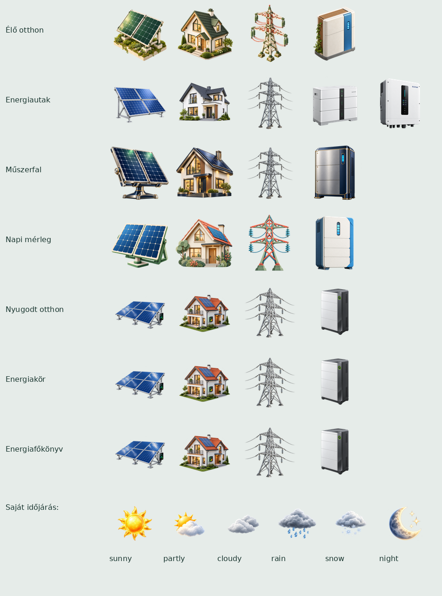
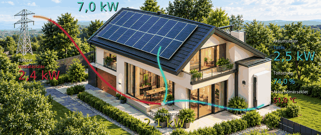

# SD-kártyás sablonok

Az [Energiaáramlás tiltás](energy-flow-disable.md) külön szabályai: Loxone Otthon-alapnézet, megőrzött témák és Slave logós képernyő.

Az eredeti nézet a firmware része, mindig elérhető. A választható elrendezések a repository
`templates/` könyvtárában vannak, mindegyik saját világos és sötét témával.

| Csomag | Nézet |
|---|---|
| `01-live-home` | Élő otthon: nappali zöld kert / esti ház, élő energiautakkal |
| `02-energy-paths` | Energiautak: széles színes összeköttetések, irányjelző pöttyök |
| `03-instruments` | Műszerfal: négy teljesítménymérő, töltöttségjelző |
| `04-daily-balance` | Napi mérleg: két nagy, háromrétegű napi diagram |
| `05-calm-home` | Nyugodt otthon: saját nappalibelső nappal/éjjel, három nagy főadat és napi összegzés |
| `06-energy-orbit` | Energiakör: saját energiaudvar, három ívelt energiaút, 24 órás napállás-idővonal |
| `07-energy-ledger` | Energiafőkönyv: most/ma táblázat, tároló és export összesítők |
| `08-statistics` | Energiastatisztika: öt napi grafikon, heti/havi oszlopok, élő számok és pénzügyek |
| `09-solar-journey` | Nap pálya: 24 órás napjárás, nappali/éjszakai ház, termelési grafikon és energiaáramlás; érvényes `SunPosition` szükséges |

| `10-battery-diagnostics` | [Akku diagnosztika](battery-diagnostics.md): mért energia/SOC, kapacitásbecslés, párosított hatásfok és megfigyelt ciklusok |

## Használat

Másold a repository `templates` mappáját az SD gyökerébe. Példa:
`/templates/01-live-home/template.json`. A USB-telepítő ZIP `sd-card/templates`
mappája ugyanezt tartalmazza; ezt az SD gyökerébe kell másolni, nem a firmware-frissítőbe feltölteni.
Közvetlen kártyamásolás után indítsd újra az eszközt.

A kijelzőn balra húzás a következő, jobbra húzás az előző elrendezésre lép.
A lista körbeér; a Rendszer nézet az első, nem törölhető és nem mozgatható. A többi sablon sorrendje a webes sablonkezelőben a fel/le gombokkal módosítható; az SD-kártyán az `order.txt` őrzi a sorrendet. Nincs időzített vagy automatikus
elrendezésváltás. A választás a `/templates/selection.txt` fájlba kerül,
ideiglenes fájllal és biztonsági másolattal. A mentés a téma megjelenése után,
a következő runtime-körben (kb. 200 ms-mal később) fut, így a FAT-metaadatírás
nem késlelteti a lapozást; sikertelen írást a következő kör újrapróbál. Hiányzó/sérült kiválasztott csomagnál
a beépített nézet jelenik meg. SD-íráshiba esetén az aktuális munkamenetben a
választás működik, de az újraindítás utáni megőrzés nem garantálható.

A `NightMode` adatmező választja a `light`/`dark` témát. Lapozás ezt nem módosítja.
A Wi-Fi/MQTT/adathiány/indítás/végzetes hiba oldalak közösek. Helyreálláskor az
aktuális elrendezés az adatcsomag szerinti témával tér vissza. A sablonok a
közös SD-hibajelzést is megkapják. Minden adat a meglévő fogadási/statisztikai
útvonalból jön, a sablon nem fogad külön csomagokat és nem számol külön előzményt.

## Gyári témák frissítése a GitHubról

A Sablonok oldal **Gyári témák frissítése a GitHubról** részén a **Frissítések
keresése** gomb a futó firmware kiadási tagjéhez (fejlesztői buildnél a
legutóbbi stabil kiadáshoz) tartozó `templates/` könyvtárat nézi meg a GitHubon,
és témánként összeveti a `template.json` `version` mezőjét a telepítettel. A
frissíthető témák mellett **Frissítés**, a még nem telepített gyári témák mellett
**Telepítés** gomb jelenik meg, és egy gombbal az összes frissíthető téma is
telepíthető.

- A letöltés az eszközön fut (a böngészőnek nem kell internet), a
  `raw.githubusercontent.com` és az `api.github.com` HTTPS-kapcsolatán, a
  tanúsítványlánc ellenőrzésével.
- A fájlok a `templates/.download` könyvtárba kerülnek, majd ugyanaz a teljes
  validálás és atomi csere fut, mint a kézi ZIP-telepítésnél. Hiba esetén a régi
  téma változatlan marad.
- Csak kérésre fut, saját háttérfeladatban, az OTA-val közös kizárással; a
  kijelzőt és a témaváltást nem lassítja. Wi-Fi és internetkapcsolat szükséges.
- A saját (külső) témákat nem érinti.
- A telepített téma lehet újabb is a kiadásnál (fejlesztői ZIP-ből telepítve):
  ilyenkor a lista **Helyi újabb** állapotot ír, és nem ajánl visszalépést.

### Hibajelzés

A hibák okát a visszajelző sáv és az **Eseménynapló** is megmutatja, hogy ne
csak annyi látszódjon, hogy „a GitHub nem érhető el”:

| Üzenet | Jelentés |
| --- | --- |
| `A legutóbbi kiadás nem kérdezhető le: kapcsolódás: …` | hálózati vagy TLS-hiba; a kapcsolódás 3 s szünettel kétszer, a kiadás lekérdezése 1,5 s múlva egyszer újrapróbálkozik ([OTA-diagnosztika](automatic-update-diagnostics.md)) |
| `… HTTP 403 (a GitHub korlátozza a kéréseket)` | óránkénti kéréskorlát; később újra működik |
| `… a válasz nem JSON` / `nincs tag_name a válaszban` | váratlan API-válasz |
| `… nincs elég memória` | kevés szabad RAM; a puffer PSRAM helyett a belső RAM-ból is kérhető |
| `A témalista nem tölthető le (v…): …` | a kiadás megvan, a `templates/` listája nem |
| `<fájl>: SD-írási hiba` | a letöltés sikerült, az SD-kártyára írás nem |

A sikeresen feloldott kiadást az eszköz megjegyzi: egy későbbi átmeneti
API-hiba után ugyanazt a kiadást használja, és ezt a naplóban is jelzi.

## Webes kezelés

Nyisd meg: `http://zolee-energy-flow-display.local/templates`
(vagy az eszköz IP-címe után `/templates`). A főoldalon is van hivatkozás.

- ZIP feltöltése: kibontás elkülönített `.install` könyvtárba, ellenőrzés, majd
  siker esetén átnevezés a végleges csomagkönyvtárra. Hibás csomag nem aktiválódik.
- Aktiválás: a kijelző következő frissítésekor betöltődik. A feltöltés önmagában
  nem változtatja meg a kiválasztott sablont.
- Törlés: az aktív sablon törlése visszalép az alapnézetre. A beépített nézet nem
  törölhető. Meglévő azonosítónál biztonságos frissítés történik; a régi csomag csak sikeres ellenőrzés és fájlcsere után törlődik.

A hitelesítés az OTA-felületével azonos (`ota.username`/`ota.password`);
üres felhasználónév esetén az eddigi OTA-szabály szerint nincs bejelentkezés.
Ez nem érinti a hitelesítés nélküli HTTP energiaadat-fogadást.
A módosító webkérések `X-Zolee-Template: 1` fejlécet igényelnek; a weboldal hozzáadja.

Telepíthető ZIP-ek készítése: `python tools/prepare_templates.py`.
Eredmény: `dist/templates/*.zip`; a CI `zolee-templates-…` artifactja is ezeket
tartalmazza. Mindegyik ZIP külön tölthető fel. A ZIP gyökerében a `template.json`
és a PNG-k legyenek, külső csomagkönyvtár vagy alkönyvtár nélkül.

## Leírófájl, 1. séma

```json
{
  "schema": 1,
  "id": "my-layout",
  "name": "Saját elrendezés",
  "version": 1,
  "light": {
    "background": "#F0F5F3",
    "elements": [
      {"type":"value","source":"pv","x":40,"y":40,"w":300,"h":60,"font":48,"color":"#36AE7C"}
    ]
  },
  "dark": {
    "background": "#111F2C",
    "elements": [
      {"type":"value","source":"pv","x":40,"y":40,"w":300,"h":60,"font":48,"color":"#36AE7C"}
    ]
  }
}
```

A koordinátarendszer 1280×800. Az `elements` sorrendje a rajzolási sorrend:
későbbi elem felülre kerül. Minden elemhez kötelező `x`, `y`, `w`, `h`;
az elem határa nem nyúlhat a kijelzőn kívülre. Az alsó 28 px-et célszerű a
közös lapjelzőnek/SD-hibajelzésnek szabadon hagyni.

| `type` | Tartalom, további mezők |
|---|---|
| `box` | Kártya/háttér: `background`, `radius`, `opacity` |
| `label` | Szöveg: `text`, opcionális `text_en`, `font`, `color`, `align` |
| `value` | Élő adat: `source`, `font`, `color`, `align` |
| `image` | Csomagon belüli PNG: `file`; a képet a `w`/`h` méretre skálázza |
| `weather` | Közös időjáráslogika, opcionális saját `files` készlet: `sunny`, `partly_cloudy`, `cloudy`, `rain`, `snow`, `night` |
| `bar` | `source`, `max` (alapérték 100), `color`, `background`; `soc` esetén a közös töltöttségszínek; `soc_four_bands: true` a Nap pálya négy tartományát használja |
| `gauge` | Köríves mérő: `source`, `max` (alapérték 15), `color`, `background` |
| `flow` | `source`, `color`, `radius` (vonalvastagság), relatív `{x,y}` pontok: alapból 2–8 pontos `polyline`; `curve: "bezier"` esetén 4 vagy 7 vezérlőpont |
| `chart` | `kind`: `production`, `consumption`, `grid`, `battery`, `soc`, `week`, `month`, `solar_hourly`; minimum 150×100. `solar_hourly`: 24 órás, tényleges kWh-s, zöld/sárga (helyi/tárolt és export) oszlopok. |
| `solar_disc` | Opcionális nappálya-korong (LVGL); `center_x`, `center_y`, `radius_x`, `radius_y`, `glow`; hiányzó `SunPosition` esetén elrejtendő |

Színek: `#RRGGBB`. Átlátszóság: 0–255. Betűméretek: 12, 16, 20, 28;
48 és 96 csak numerikus élő adathoz, órához/dátumhoz. Ezek számjegyeket és
a használt mértékegységeket tartalmazó betűkészletek. `align`: `left` vagy `center`.
A szöveges címkék HU/EN karakterkészletet használnak. A `text_en` hiányában a
`text` jelenik meg angol nyelvi beállításnál is.

A `value` típusú, `source: "status"` elem `hide_when_normal: true` beállítással
normál üzemben (`Status = 1`) a szövegárnyékával együtt rejtve marad.
`status_bubble: true` esetén lekerekített háttérbuborék is megjelenik, amely
normál üzemben szintén eltűnik. A buborék a szöveghez képest oldalanként
12 px, felül/alul 8 px helyet használ, ezért ennyi helyet kell hagyni a
kijelző szélétől. A `background` és `opacity` a hátterét szabályozza;
az 5-ös státusz betű- és keretszíne a `positive_color` (alapérték: zöld),
a többi státuszé a `color`. A mező csak `value` / `status` elemhez használható.
Eltérő státusznál az aktuális, nyelvi beállítás szerinti állapotot mutatja.
A `text_shadow`, `shadow_color`, `shadow_offset` (0–4 px) és
`shadow_opacity` (0–255) mezőkkel a szöveg kisméretű árnyéka állítható.

Adatkapcsolatok:

- `pv`, `home`, `grid`, `battery`: pillanatnyi kW, a kijelzés abszolút értékű,
  1 kW alatt W-ra vált. A flow előjeles adatot használ: a pontlista iránya a
  pozitív irány; hálózatnál vételezés, akkumulátornál kisütés. Negatív értéknél
  megfordulnak a pöttyök. Nulla körül eltűnnek; 7 kW-nál érik el a maximális sebességet.
- `soc`, `battery_temp`, `battery_capacity`, `battery_energy`, `sun_azimuth`, `sun_altitude`, `sunrise`, `sunset`, `sun_direction`, `temperature`, `wind`, `clock`, `date`, `status`,
  `grid_direction`, `battery_direction`.
- `production_today`, `consumption_today`, `import_today`, `export_today`,
  `charge_today`, `discharge_today`: a közös napi kWh-összesítések.
- `pv_home`, `pv_export`, `pv_stored`: a közös energiaelosztási modell kW értékei.

A diagramok a tényleges 5 perces adatsorokat és az eredeti háromrétegű rajzolót
használják. Termelés: saját fogyasztás / visszatáplálás / tárolt;
fogyasztás: hálózat / termelés / tároló. A hálózati akkumulátortöltés nem kerül
a napelemes tárolás görbéjébe. A hiányzó adatszakaszok üresek maradnak.

## Korlátok és validálás

Legfeljebb 15 SD-s sablon + alapnézet. Csomagonként két téma, témánként legfeljebb
96 elem, legfeljebb 32 PNG; JSON maximum 64 KiB, legfeljebb 16 beágyazási szint.
Azonosító: 1–32 kisbetű, szám, `-`, `_`; a `builtin` foglalt. A könyvtárnévnek
egyeznie kell az azonosítóval. A PNG-fájlnév ugyanez a karakterkészlet, `.png`
végződéssel, legfeljebb 64 karakter.

ZIP maximum 8 MiB, kibontva maximum 8 MiB; képfájl maximum 2,5 MiB,
összes kódolt kép maximum 5 MiB, számított futásidejű RGBA képmemória összesen 12 MiB (a két webes előnézet nélkül).
PNG: maximum 1280×800, 8 bites RGB/RGBA, nem interlace. A PNG-k teljes CRC- és
zlib-dekódolási ellenőrzést kapnak, nem csak a kiterjesztést vizsgáljuk. Ez
telepítéskor, induláskor és a csomagkönyvtár bármilyen változása után fut. A
teljesen ellenőrzött könyvtár ujjlenyomatát (fájlnév, méret, módosítási idő,
típus) a firmware megjegyzi: lapozáskor változatlan csomagnál a `template.json`
sémaellenőrzése és a betöltött PNG-k chunk-CRC-je fut, ismételt kitömörítés és
az előnézetek beolvasása nélkül. Sérült képnél ugyanúgy a Rendszer nézet jelenik
meg. Részletek: [teljesítmény](performance.md#gyorsabb-témaváltás--sd-olvasás-és-ismételt-validálás).

### Előre dekódolt kép-segédfájlok

Az eszköz a csomag mellé `<alap>-<szélesség>x<magasság>.raw` fájlokat készít a
jelenetekben szereplő minden kép-változathoz, telepítés után a háttérben,
fájlonként. Ezek nem részei a ZIP-nek, nem
számítanak a 32 képes és az 5 MiB-os kódolt keretbe, és a csomag törlésével
együtt eltűnnek. A kijelző ezekből dekódolás és méretezés nélkül dolgozik, így a
témaváltás érezhetően gyorsabb; hiányzó vagy sérült segédfájlnál minden a
megszokott PNG-úton fut tovább. Részletek: [teljesítmény](performance.md).

Csak Stored/Deflate ZIP támogatott. Titkosított, többkötetes, ZIP64, symlink,
alkönyvtáras, ismétlődő fájlnevű, sérült CRC-jű és könyvtárból kilépő útvonalat
tartalmazó ZIP elutasítva. Nincs JavaScript/Lua, tetszőleges fájlelérés vagy
külső URL a leíróban. A validálás a támogatott séma és erőforrások ellenőrzése;
az esztétikus elrendezést a szimulátorban kell ellenőrizni.

A feltöltés nem az LVGL szálon fut. A UI előtöltése nem vár a webes feltöltés
SD-zárára; a meglévő RAM-beli nézet addig tovább működik. Az új képek cseréje a
grafikus zár alatt, a régi objektumok és képcache felszabadításával történik.
Az LVGL képcache 10 MiB: a házhátteret nem kell minden animációs képkockán újradekódolni.

## Ellenőrzés és képi forrás

`python tests/test_templates.py`: a tényleges C telepítő, séma, PNG-k,
hibás ZIP-ek, megőrzés, törlés és visszaállás tesztjei.
A `ui-preview` CI tizennyolc valódi LVGL-sablonképet renderel, és ellenőrzi a közös
hibaoldalból visszatérést. A Windows szimulátor ugyanazt a sablonrajzolót használja.
A fizikai kijelzőn a húzás érzékenységét, a nagy házháttér animációs sebességét és
az SD-kártya sebességét külön hardveres próba igazolja.

A ház nappali és éjszakai háttérképe AI-val generált, a korábban elfogadott
házlátvány alapján. Prompt: ugyanaz a modern napelemes ház, bal oldali hálózati
oszlop, jobb oldali tároló; nappal világoszöld kert, éjjel sötét környezet/meleg
ablakfény. Minden szöveg, szám, panel, nyíl és energiaút nélkül. A kimenetet
1280×800 RGB PNG-re méreteztük. A képfájlok a csomag `day.png`/`night.png`
állományai; az értékek, vonalak és pöttyök élő LVGL-elemek.
Az Élő otthonban az adatok a házképen jelennek meg; csak az alsó összegző sáv kap áttetsző mezőt. A ház és az energiaeszközök a háttér részei, külön eszközikonokat nem igényelnek.
Nappal telítettebb zöld, piros, kék és narancs értékek, valamint minden felirat és
érték mögött 2 px-es fekete árnyék segíti az olvashatóságot. Az energiautak 7 px vastagok.
Az árnyék `shadow: true` jelölése megőrzi a fekete színt hőmérsékleti riasztásnál is;
a fő hőmérsékletérték figyelmeztető színei továbbra is működnek.
A többi csomag a saját, sablononként különálló PNG-ikonjait használja.

## Sablon készítése

A [gyakorlati útmutató](template-authoring.md) a saját ikonoktól és a két témától a Bézier-energiautakon át a ZIP ellenőrzéséig és telepítéséig vezet. A [assetjegyzék](../assets/template-manifest.json) a jelenlegi képek ellenőrzőösszegeit és ismert eredetét rögzíti.

## Tényleges LVGL-előnézetek

Az alábbi képek a firmware rajzolójából származnak, nem statikus látványtervek.


| Téma | Nappal | Éjjel |
| --- | --- | --- |
| Rendszer (beépített) |  |  |
| Élő otthon |  |  |
| Energiautak |  |  |
| Műszerfal |  |  |
| Napi mérleg |  |  |
| Nyugodt otthon |  |  |
| Energiakör |  |  |
| Energiafőkönyv |  |  |
| Energiastatisztika |  |  |
| Nap pálya |  |  |
| Akku diagnosztika |  |  |





Az energiautak `glow: 0..24` mezője állítható fényudvart ad; az aktív és inaktív út erőssége külön állítható. A pontok sebessége a teljesítménnyel nő, 7 kW felett korlátozott; nulla teljesítménynél a pontok rejtettek. A nagy grafikus témák áttűnés nélkül váltanak; az egyszerű nézeteknél rövid belépő áttűnés használható: a következő sablon SD-betöltése az LVGL-záron kívül történik. Nincs automatikus váltás és nincs két teljes képernyős képpuffer foglalás.

## 08 – Energiastatisztika

Világos és sötét, 1280×800-as nézet: csak számszerű pillanatnyi energiaáramlás; napi termelési/fogyasztási forrásdiagramok, előjeles import/export, előjeles akkumulátorteljesítmény és SOC-görbe. A sorozatokat a valós ötperces mérési átlagok adják; az összes energiát időben integráljuk. A heti/havi kártyán napi termelési, fogyasztási és import oszlopok láthatók; a hiányzó nap szürke jel. Az alsó sor a napi/havi pénzügyeket és az energiaarányokat mutatja.

## Feltöltés előtti webes előnézet

A `/templates` oldalon válaszd ki a ZIP-et: a böngésző helyben bontja ki, ellenőrzi a ZIP/PNG CRC-t, és a csomagban mentett nappali/sötét előnézeteket mutatja. Megjelenik a sablonverzió, a tömörített képek mérete és az összes dekódolt kép felső memória-becslése. Ez utóbbi nem a teljes firmware RAM-fogyasztása. Modern, `DecompressionStream('deflate-raw')` támogatású böngésző szükséges.

Az **Ellenőrzés az eszközön** gomb `/api/templates/validate` kérésben küldi a ZIP-et. A C-validátor változatlan követelményekkel ellenőrzi, majd törli az ideiglenes fájlokat; nem telepít, nem aktivál és nem írja át a katalógust. A **Telepítés** csak pozitív eredmény után engedélyezett; a telepítő ismét ellenőriz. Már létező azonosító esetén a Telepítés gomb frissítést ajánl fel, külön megerősítéssel. Új ZIP kiválasztása érvényteleníti a korábbi jóváhagyott állapotot.

A szerkeszthető HTML/JS: `assets/web/`. Beágyazás újragenerálása: `python tools/prepare_web.py`.

## Aktuális irányjelzések és opcionális elemek

A házhoz vezető út piros, hálózati vételezés narancs, export citromsárga. Akku töltése sötétebb, leadása világosabb kék. Az elem opcionális `positive_color`/`negative_color` mezője követi az előjelet. A `pulse` elem pulzáló csomópont; a mérősávok `outline_color` körvonala és az értékváltozási animáció a Műszerfal olvashatóságát segíti.

Az időjárásikon akkor látható, ha hőmérséklet, napsugárzás és csapadék is érvényes. A hőmérséklet és szél külön-külön rejtőzik null értéknél, minden témában. A kapcsolódó statikus címkének is adj `source` mezőt. [Adatprotokoll](mqtt.md).

## Kiemelt regressziós követelmények (2026-10-15)

- **Rendszer** és **Napi mérleg**: a grafikon görbéje alatti kitöltés ugyanannak
  az adatsornak a színét használja, mint a görbe, csak áttetszően. A kitöltés
  nem lehet szürkés, és a három energiasor megkülönböztethetősége nem veszhet el.
- **Minden energiaáramlásos téma**: a pontok sebessége az abszolút kW-értékkel
  arányosan nő. A `main/app_flow_model.h` közös számítását kell használni;
  7 kW-nál van a sebességmaximum, nulla teljesítménynél a pontok rejtettek.
  Az előjel a mozgás irányát jelzi, nem a sebességet.
- **Ellenőrzés**: `python3 tests/run_tests.py` végén a
  `tests/test_visual_regressions.py` megakadályozza a javítások véletlen
  kikerülését. A kijelzőn nappali és éjszakai módban is vizuálisan tesztelendő.

## 09 – Nap pálya

A téma jóváhagyott, külön nappali/éjszakai napelemes házfotót használ. A napív a háttér része; a mozgó napkorong a hozzá kalibrált 31 pontos nappali és 21 pontos éjszakai útvonalat követi. A v18-as csomagban csak a napnyugta előtti nappali szakasz kapott sűrűbb illesztést; a reggeli/déli és az éjszakai geometria változatlan. Érvényes `SunPosition` nélkül a lapozás átugorja a témát.

A v17-es akkukártya SOC-sávja `soc_four_bands: true` beállítást használ:
30% alatt piros, 30–50% narancs, 50–70% citromsárga, 70% fölött zöld.
Az 50%-os határ a sárga, a 70%-os még a sárga tartomány része.
A nap alatti, középről növekvő, kitöltött kör fix 1,2 ciklus/s ütemben pulzál.
Végső átmérője a PV-termeléssel arányos 0–8 kW között; 8 kW fölött a korábbi
maximális méret marad. Minden méretnél teljesen elhalványul a ciklus végére,
nulla termelésnél nem látszik. Külön sugárvonalak nincsenek.
A SOC-sáv vékony körvonalat és kontrasztosabb üres hátteret kapott;
a napkelte-kártya a felirataival együtt további 15 px-szel balra került. Az éjszakai korong
képe állandó, csak a holdudvar kap 4,2 másodperces légző animációt.
A holdudvar kitöltése 22–38/255 fedettségű; nap→hold és hold→nap váltáskor
a friss adatcsomag alapján már az első képkockán beáll. A firmware javítja
a sablonanimáció korábban elavult mérési mintáját is. A v19-es ZIP geometriája
változatlan, előnézete az erősebb holdudvart mutatja.
A részletes működés: [Nap pálya](solar-journey-acceptance.md).

## Mentett előnézeti képek

Mind a tizenegy csomag kötelező építési bemenete a `preview-light.png` és
`preview-dark.png`. Ezek a valódi LVGL-kijelző 480×300 px-es képei demóadatokkal;
a validátor legfeljebb 640×400 px-es RGB/RGBA előnézetet fogad el.
A két képet együtt kell megadni. Az előnézet nem használható kijelzőelemként,
és a kijelző nem tölti a grafikus assetek közé, így nem növeli az LVGL-képmemóriát.
A 32 fájlos és 5 MiB-os csomagkorlátba viszont beleszámít.

A régi SD-sablonok előnézet nélkül is működnek és frissíthetők. A webes
sablonkezelő ilyenkor üres keretet mutat, és nem tölti le helyettük a nagy
háttérképet. A csomagok egyenként frissíthetők. A web kizárólag a mentett
előnézetet jeleníti meg; nincs eltérő böngészős rajzoló. A képek lusta betöltést,
verziózott URL-t és egyórás privát gyorsítótárazást használnak.

Új képek készítése az LVGL-render után:

```sh
python3 tools/prepare_template_previews.py .preview-images
```

A script a sablonkönyvtárakat, az áttekintő képet és az assetjegyzéket is frissíti.
A csomag `version` értékét elrendezés- vagy előnézetváltoztatáskor emeld.

## Automatikus ZIP-csomagolás

A GitHub Actions `zolee-templates-<commit>` artifactja a `templates/` alatti
összes érvényes sablonhoz külön ZIP-et tartalmaz. A `tools/prepare_templates.py`
a verziókezelt JSON-t és PNG-ket változtatás nélkül csomagolja, hiányzó vagy
fölösleges képnél megáll. Nem írja újra a már finomhangolt elrendezéseket.
A `tests/test_template_packages.py` ellenőrzi a ZIP-ek teljességét és bájtszintű azonosságát.

A Műszerfal és az Energiafőkönyv nappali és éjszakai nézetében nincs teljes
képernyős színezőmaszk: csak a kártyák áttetsző háttere fedi a háttérképet.
A webes aktiválás is megjeleníti az eszköz betöltőképernyőjét az SD-olvasás előtt.

A szövegelemek `text_shadow: true` mellett opcionális `shadow_color` színt
kaphatnak (alapértelmezés: fekete). A `foreground: true` az `image` és `pulse`
elemeknél engedélyezett: az elemet az áramló pontok fölé emeli. Az Energiautak
fejléce fehér árnyékot, inverterikonja ilyen előtér-réteget használ; nincs
alap háttérmaszkja. A Műszerfal fejléce mindkét módban fehér, kártyafeliratai
feketék, kártyái világos alapúak. Az Energiafőkönyv táblázat- és kártyacímei
az oldalcím színét követik; a külső kártyák fedettsége 160/255.

A Rendszer nézet apró, 240×150 px-es nappali/éjszakai előnézete firmware-be
ágyazott PNG. A két kép összesen körülbelül 21 KiB flashhelyet használ; nincs
SD-olvasás és nincs LVGL-képdekódolás. A generátor legfeljebb 32 KiB-ot enged.
A `/api/templates/preview?id=builtin&mode=light` és `mode=dark` végpontok
ugyanazzal a hitelesítéssel működnek, mint a többi előnézet.

Az Energiautak v11-ben a nappali fekete kártyacímek, ikonfeliratok és állapot
sötét módban fehérek. Az Energiakör v12 két közös tengelyre illesztett,
szimmetrikus keresztet használ; a középső `pulse` elem `foreground: true`
beállítással a vonalak és a mozgó pontok fölött pulzál mindkét módban.
Ehhez a v12-es ZIP mellett a `pulse` előtérjelölését támogató firmware is
frissítendő. Az energiaáramlás közös sebességképlete változatlan.

## Loxone Otthon – közös erőforrások (v3 fejlesztési ág)

A fogyasztói és Otthon-kártyás oldal közös `loxone-home.zip` csomagját ugyanitt,
a témakezelőben lehet ellenőrizni, telepíteni és frissíteni. A csomag külön
**közös erőforrásként** jelenik meg; nem választható energiaelrendezés, és nem
kerül a lapozási sorrendbe. 64 ikont, külön fogyasztói és Otthon nappali/éjszakai háttérpárt (összesen négy képet) és helyi logót ad. A csomag v3-tól két 400×250-es, valódi LVGL-előnézetet is tartalmaz a sablonkezelő számára; a nagy kijelzőképek és a méretkorlátok változatlanok.

A Master teljes USB-csomagjának `sd-card/templates/loxone-home` könyvtárában is
megtalálható. OTA-frissítésnél az új firmware mellett ezt az SD-csomagot is telepítsd.
A kártyák a `/loxone` oldalon szerkeszthetők; a kijelzőn a ház érintése a fogyasztókat,
a lefelé húzás az Otthon-kártyákat nyitja meg. Az Otthon szerkesztőjében legfeljebb 8 oldal nevezhető el, mindegyiken 12 kártyával; jobbra/balra húzás a saját lapok között vált, alul oldalpontokkal. Jobb felső X: vissza az előző témához.
A diagnosztikát felfelé húzás nyitja, és saját X gombja zárja.
A közös csomag hiányát a szerkesztő tetején piros figyelmeztetés jelzi;
telepített csomagnál az ikonválasztók a kiválasztott kis képet is megmutatják.
A felhasználói próba utáni javítások és a megismétlendő eszközpróba:
[v3-field-fixes.md](v3-field-fixes.md).

A teljes v3 még fejlesztés alatt áll; a részletes állapot a
[folytatási tervben](v3-development-plan.md) követhető.

A Nyugodt otthon v9 saját, jóváhagyott fotóhátteret kapott. Részletek és grafikai
méretek: [calm-home.md](calm-home.md). Az új megjelenéshez a `05-calm-home.zip`
csomagot telepítsd újra a webes sablonkezelőben; az azonos azonosítójú sablon
frissítése megőrzi a témasorrendet. Az OTA a telepített SD-sablont nem cseréli le.

Az Energiakör v13 új `solar_timeline` eleméhez az új Master firmware is kell,
majd a `06-energy-orbit.zip` telepítése. [Részletek](energy-orbit.md).

### Akku diagnosztikai adatforrások

Az új firmware `battery_diag_` forrásai: `capacity`, `capacity_pct`, `assessment`,
`charge_pct`, `discharge_pct`, `charge_detail`, `discharge_detail`,
`day_charge_pct`, `day_discharge_pct`, `efficiency_pct`, `cycles`, `c_rate`,
`measurement`, `soc_error`, `evidence` (mindegyik előtt `battery_diag_`).
Ezek `value` elemekhez valók; az adatminőséget is kezelő szöveget adnak.
A `capacity` számmező 48 px-es lehet; a hiányzó eredmény `--`.
A többihez teljes karakterkészletű 12/16/20/28 px fontot használj.
A képletek és a referencia érvényessége: [Akku diagnosztika](battery-diagnostics.md).

A `battery_eta` forrás (v2-es Akku diagnosztika téma) az akku becsült hátralévő
idejét adja egy sorban; szigetüzemben és áramszünetre készülve kiemelt színnel.
A régebbi firmware ezt a forrást nem ismeri, ezért a `10-battery-diagnostics`
v2 csomag előtt a firmware-t kell frissíteni.

## Elektomos auto

A `11-electric-car` csomag csak közvetlen Loxone módban aktiválható.
Töltő beállítása nélkül is választható; ilyenkor az autós felirat és energiaút
rejtett. [Beállítások és autótöltés](electric-car.md).
